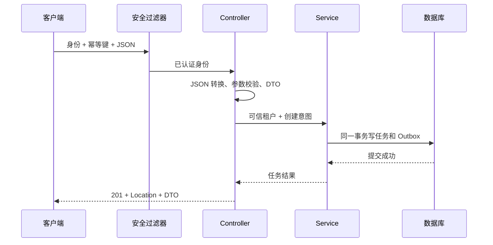

# REST 接口、分层、DTO 与任务服务

一个创建任务的接口，不只是把 JSON 保存进表。它要回答：谁提交、输入是否合法、重复提交怎么办、数据何时算成功、客户端如何知道后续状态。本专题以 JDK 25、Spring Boot 4.1.1 的任务服务贯穿这些问题。

## 1. 先读接口，再看注解

| 操作 | 请求 | 成功结果 | 主要失败 |
| --- | --- | --- | --- |
| 创建 | `POST /api/tasks`，带幂等键和 JSON | 201，Location 和任务 DTO | 400 输入错误、409 幂等冲突 |
| 查询 | `GET /api/tasks/{id}` | 200，任务 DTO | 404 当前租户下不存在 |
| 列表 | `GET /api/tasks?after=...&limit=20` | 200，有上限的列表 | 400 分页参数错误 |
| 取消 | `POST /api/tasks/{id}/cancel?version=0` | 200，新状态和版本 | 409 状态或版本冲突 |

201 表示任务资源已经建立，不表示后台工作已经完成。异步操作若尚未创建可确认的结果，也可能采用 202 和操作查询地址；不能见到异步就固定返回 202。

## 2. 一次创建的分工



Controller 翻译 HTTP：路径、请求头、状态码。Service 表达规则：可否创建、状态如何迁移、事务边界在哪里。Repository 或 JdbcTemplate 负责持久化。不是每个小类都必须增加一个接口，但 HTTP 对象不应一路传进数据库层。

`@RestController` 使返回值走响应体转换；它没有自动补齐事务、幂等和权限。框架流程见 [MVC 请求执行链](../../spring/03-web/02-DispatcherServlet映射与请求执行链.md)。

## 3. 请求 DTO 和响应 DTO 为什么分开

请求只接受允许修改的字段，例如 `name`；`tenant`、`status`、`version` 由服务端决定。直接把数据库实体作为输入，容易让客户端覆盖内部字段。响应也不应暴露密码、内部路由、懒加载关系或未来可能变化的存储结构。

配套工程的请求模型为：

```java
public record CreateTask(@NotBlank @Size(max=80) String name) {}
```

这是 `TaskController` 内部记录的节选，需要 Jakarta Validation 导入和 Validation Starter。校验负责格式与局部约束；“当前版本能否取消”必须到 Service 和数据库中判断。

## 4. 从空工程到可运行实验

完整源码位于 `examples/spring-boot/service-lab/`，包含 POM、配置、建表脚本、主类、Controller、Service、安全配置、异常映射和测试。依赖由 Boot 4.1.1 管理，使用 `spring-boot-starter-webmvc`、`validation`、`jdbc`、`security`、`actuator`；不要求读者自行拼接节选。

在该目录、JDK 25 和 Maven 可用的终端执行：

```bash
mvn clean verify
java -jar target/boot-service-lab-1.0.0.jar
curl -i http://127.0.0.1:8080/actuator/health
curl -i -u alice:lab-only-alice http://127.0.0.1:8080/api/tasks
```

健康端点应为 200 且 `status=UP`，初始列表为 `[]`。无身份查询应为 401。示例只绑定环回地址，账号仅供实验，内存数据库进程退出即丢失，不是生产部署模板。8080 被占用时用 `--server.port=8081`。

写接口保留 CSRF 防护；不能只复制 Basic Authorization 就期待 POST 成功。测试使用 Spring Security 的 CSRF 请求支持，覆盖成功创建和缺 Token 的 403，原因见[浏览器安全边界](../05-security/05-CSRF-CORS-Cookie与会话边界.md)。

## 5. 什么测试能证明这条链路

工程同时使用三种证据：真实临时端口 HTTP 验证健康端点；带真实安全过滤器的 MockMvc 验证 MVC 输入、响应和授权；真实 H2 JDBC 验证事务、唯一约束和并发幂等。MockMvc 不是 TCP 压测，H2 也不能证明 PostgreSQL/MySQL 的所有锁行为相同。

源码阅读从 `TaskController.create` 到 `TaskService.create`，再看 `schema.sql` 的唯一约束，最后看 `ServiceLabTest`。重点是知道每个保证由哪一层提供。

## 6. 练习与答案

### 6.1 Controller 返回任务后，数据库事务仍未提交可以吗

业务若承诺“创建成功”，就应先确认相应持久化事务成功，再产生成功结果。示例事务在 Service 返回前完成；如果提交失败，应进入异常响应，而不是发送 201 后再补救。

### 6.2 为什么不存在和其他租户的任务都返回 404

查询已经带可信租户条件。对调用者两者均不可见，统一 404 避免通过错误差异枚举其他租户资源，但日志中仍应保留必要的脱敏诊断信息。

### 6.3 只有 Controller 测试是否足够

不够。模拟 Service 可以验证 HTTP 契约，不能验证 SQL、事务回滚、唯一约束和连接释放；必须用对应层的真实依赖补充验证。

## 7. 继续阅读

- [参数校验与 Problem Details](./02-参数校验错误响应与ProblemDetails.md)
- [Spring Boot Servlet 支持](https://docs.spring.io/spring-boot/reference/web/servlet.html)

Boot 提供 MVC 集成和消息转换的默认配置；接口的业务契约仍由应用定义。
