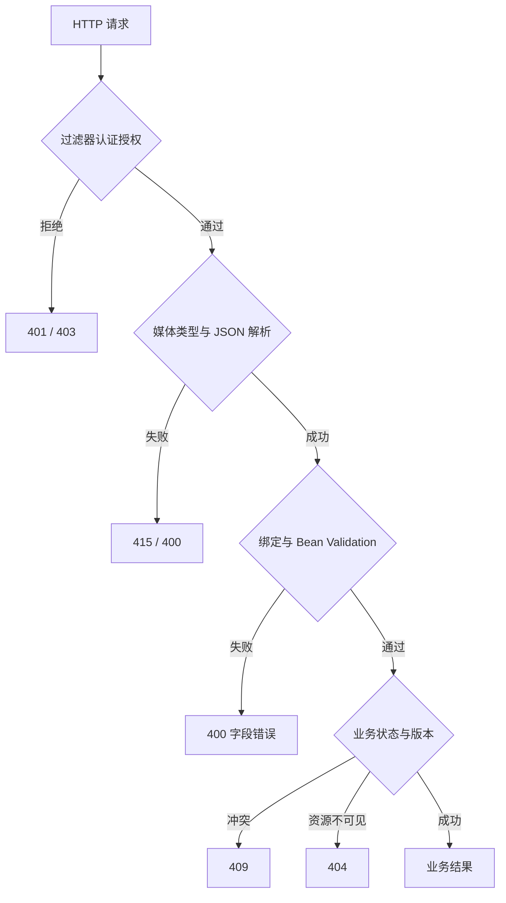

# 参数校验、错误响应与 Problem Details

客户端收到“失败”后，需要知道能否修改输入重试、是否需要重新登录、是否已经创建了资源。全部返回 HTTP 200 加一个模糊的 `success=false`，会让网关、客户端和监控对失败各自理解。

## 1. 错误发生在不同阶段



`@RestControllerAdvice` 位于 MVC 异常解析范围内，不能假定它能捕获前面所有 Filter 中的异常。Spring Security 的认证入口和拒绝处理器也要遵守自己的错误契约。

## 2. 校验分三类

Bean Validation 检查局部事实，例如名字非空、长度不超过 80；类型转换检查字符串是否能成为数值；业务校验检查状态和并发条件。`@Valid` 会触发嵌套对象校验，但不会自动遍历没有标注级联的关联对象。

`@NotNull` 不排除空字符串，`@NotEmpty` 不排除全空格，`@NotBlank` 针对字符序列排除空白。创建与更新规则不同，可以分 DTO，不必过早把复杂校验组塞进同一个实体。

请求对象校验可能产生 `MethodArgumentNotValidException`，MVC 方法参数校验可能产生 `HandlerMethodValidationException`。不要只处理一种异常就认定所有输入错误已经统一。MVC 内建方法校验与类级 `@Validated` 代理路径也需区分。

## 3. 用 Problem Details 表达错误

[Spring 的 RFC 9457 支持](https://docs.spring.io/spring-framework/reference/web/webmvc/mvc-ann-rest-exceptions.html)提供 `ProblemDetail` 和 `ResponseEntityExceptionHandler`。标准字段有 `type`、`title`、`status`、`detail`、`instance`；可以加入稳定业务码和关联 ID，不能把堆栈、SQL、口令作为 detail 返回。

```json
{
  "type": "about:blank",
  "title": "Conflict",
  "status": 409,
  "detail": "TASK_CONFLICT",
  "instance": "/api/tasks/123/cancel",
  "code": "TASK_CONFLICT"
}
```

这是响应形状示意，`123` 不是实验生成的 UUID。状态行和 body 的 status 必须一致，媒体类型应为 `application/problem+json`。客户端按稳定 code 决策，不按可能翻译的自然语言判断。

## 4. Boot 配置与应用扩展

```properties
spring.mvc.problemdetails.enabled=true
```

该开关处理框架内置 MVC 错误，并不自动理解所有自定义异常。配套工程 `ApiErrors` 把不存在、冲突、非法参数映射为明确状态。自定义 Advice 接管已有处理时要考虑顺序；不要无差别捕获 `Exception` 并把所有故障变成 400。

字段错误只返回允许公开的字段名与约束码。不要原样回显拒绝值：密码、Token 可能恰好在非法输入中。服务端记录完整异常，响应仅带可追踪 ID，避免每层重复打印堆栈。

## 5. 按错误矩阵验证

在 `service-lab` 运行 `mvn test`，覆盖空白/超长名字、损坏 JSON、缺请求头、不支持的 Content-Type、缺身份、缺 CSRF、跨租户读取和版本冲突。检查的不只是“非 200”，还包括状态、内容类型和字段。

业务失败与系统失败应分开统计。用户输错名字不代表数据库故障；大量 400 也可能是客户端发布不兼容。错误率必须同时按端点、原因类别和版本观察。

## 6. 练习与答案

### 6.1 反序列化失败会进入 Service 吗

通常不会。参数对象尚未构造成功，Controller 方法也不能正常调用；不能依赖 Service 捕获来统一这类错误。

### 6.2 能否把所有数据库异常返回 409

不能。特定唯一约束可以映射业务冲突，连接失败、语法错误、磁盘故障不能伪装成客户端冲突。要按明确异常和约束判断。

### 6.3 为什么不返回详细 SQL 帮助客户端排查

它泄露内部结构，且不是稳定契约。客户端需要错误类别和关联 ID；SQL、参数及内部堆栈应在受权限控制、脱敏的服务端证据中分析。

## 7. 关联阅读

- [JSON 与数据契约](./03-JSON日期精度空值与对象边界.md)
- [MVC 参数转换与校验](../../spring/03-web/03-参数绑定消息转换校验与异常处理.md)
