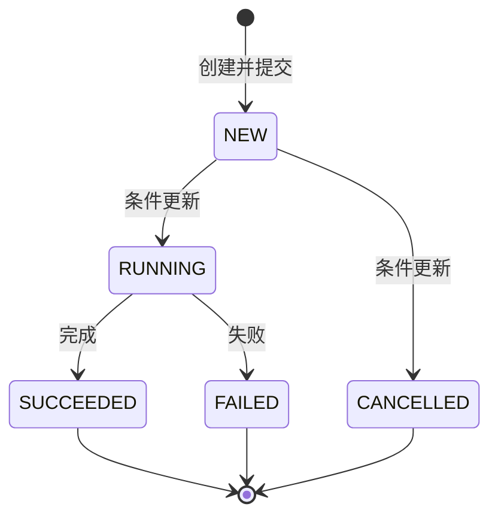

# 分页、并发更新、状态机与幂等

两个请求都先查到任务是 NEW，再分别取消和启动，可能产生互相矛盾的结果。问题不在于 Java if 写错，而是检查和写入之间允许其他请求改变事实。

## 1. 状态迁移由原子操作保护



图表示完整业务模型；配套实验只实现 NEW 到 CANCELLED，不把未实现的执行器当成可用功能。

```sql
UPDATE task SET status='CANCELLED', version=version+1
WHERE tenant=? AND id=? AND status='NEW' AND version=?;
```

影响一行表示条件同时满足；零行需区分不可见资源与冲突。不能先查再无条件 UPDATE。版本保护竞争，状态条件保护业务规则，两者不同。

## 2. 幂等键和业务写入协调

实验以 `(tenant, request_key)` 唯一约束仲裁重复创建，同键同名字返回原任务，不同名字返回 409。任务与 Outbox 同事务写入；唯一冲突后先退出失败事务，再读原结果，避免在 PostgreSQL 已失败事务中继续查询。

生产请求更复杂时，保存规范化请求摘要、操作类型、处理状态和结果引用。不要对任意 JSON 原字符串直接求摘要：字段顺序不应改变同一请求的含义。记录有效期应覆盖最大重试窗口；清理后同一键可能再次产生动作，必须明确约定。

“查 Redis 无键→写数据库→写 Redis”存在并发窗口。分布式锁不能替代业务唯一性和提交结果判断。外部副作用见 [Outbox](../03-data/06-业务事务Outbox与外部副作用.md)。

## 3. offset 与 keyset

`OFFSET 100000 LIMIT 20` 可能扫描大量记录，前页插入/删除也会使后页重复或遗漏。Keyset 用稳定排序键和上一页最后的键，例如 `(created_at,id)`，索引和 WHERE 必须匹配。

实验用 `id > after ORDER BY id LIMIT ?` 展示游标。随机 UUID 顺序不是时间顺序，并发插入较小 UUID 不会出现在后页；它不是严格快照导出方案。导出一致快照需要事务快照、固定截止条件或专门任务。

COUNT 也有成本，且总数与当前页可能不在同一时刻。只需“有无下一页”时可查 `limit+1`，不必每次滚动计算全量总数。

## 4. 并发验证

`service-lab` 用固定四线程提交八次同键请求，验证只创建一个任务和一条事件；旧版本再次取消失败。等待有上限，不允许测试无限等锁。

目标数据库还需验证不同状态竞争、连接失败、提交成功但响应丢失。H2 通过不等于完成生产数据库的锁与隔离验证。

## 5. 练习与答案

### 5.1 请求超时说明任务没创建吗

不能。事务可能已提交，只是响应丢失。用同一幂等键重试或查询结果，不要换键重新创建。

### 5.2 接口幂等保证消息只投一次吗

不能。消息仍可能重复，消费者要按事件 ID 去重，并和本地副作用事务协调。

### 5.3 乐观锁冲突后可以无条件重试吗

不可以。重读并判断状态；别人已取消或完成时应返回冲突，不能覆盖结果。

## 6. 延伸

- [隔离与并发控制](../../spring/02-aop-transactions/05-隔离级别数据库锁与并发控制.md)
- [PostgreSQL 事务隔离](https://www.postgresql.org/docs/current/transaction-iso.html)
