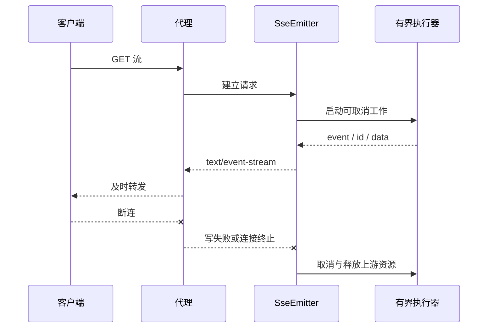

# 上传下载、SSE 与客户端断连

一次下载慢，可能是客户端接收慢；流断开后后台仍在执行，也可能把线程和连接长期占住。难点是生命周期，不是把返回类型改为 `SseEmitter`。

## 1. 上传经过哪些资源

连接收到 multipart，经容器解析后可能落临时文件，应用校验、扫描、转存，再提交元数据。网关 body 限制、Boot multipart 限制、容器和磁盘配额要协调。

```properties
spring.servlet.multipart.max-file-size=10MB
spring.servlet.multipart.max-request-size=12MB
```

这是示意上限，不是容量建议。单文件与整请求大小不同；并发上传还占网络、临时盘、文件描述符和线程。大文件不能无条件 `getBytes()` 全量进堆。

用户文件名只当元数据，不直接拼本地路径；服务器生成存储名，校验实际格式与大小，对不可信内容隔离扫描。写临时对象成功后再发布元数据，失败清理孤儿对象；下载也要对象级授权。

## 2. 流式输出不等于零内存

`StreamingResponseBody` 边读边写，仍有输入流、执行器、容器和网络缓冲。MVC 阻塞式写出遇到慢客户端仍占工作线程；异步 Servlet 释放原请求线程，不代表所有后续工作都不阻塞。

范围请求和续传要正确处理 Range、206、校验器及内容一致性。不能一边内容变化一边承诺相同字节位置代表同一数据。

## 3. SSE 的事件与取消



SSE 是单向 HTTP 事件流；id 与重连可用于恢复，但保留历史、去重需应用设计。200 已发出后，通常不能再改另一 HTTP 状态，应定义流内错误和终止协议。

完成、超时、异常、取消都汇入幂等清理路径：Future 取消、关闭上游 body/订阅、停止队列和标记工作。`cancel(true)` 只是中断请求；上游不响应时需调用其取消接口，不能声称中断一定终止远端 GPU 推理。

## 4. 有界资源与代理缓冲

不能每条流建立无限线程或无限队列。满时拒绝新流、降采样或断开慢消费者，策略取决于业务。MVC 异步执行器、请求超时和上游 deadline 要分别设计。

代理缓冲可能让已生成的事件迟迟不到客户端。Nginx 可在对应 location 评估 `proxy_buffering off`，协调读超时与心跳；不要全局关闭所有缓存/缓冲。

```bash
curl -N --max-time 10 http://127.0.0.1:8080/events
```

仅在实现了 `/events` 的实验使用此命令，`service-lab` 无该端点。完整可运行 SSE 基础示例在 [Spring 异步请求](../../spring/03-web/05-异步请求SSE与WebSocket.md)。

## 5. 如何证明清理完成

反复建立、主动断开多条流，比较工作数、队列、线程、连接和内存是否回基线；再测试慢消费者、代理超时、异常与退出。“onError 已执行”不等于上游已停止。

## 6. 练习与答案

### 6.1 SSE 多久一定知道客户端离线

无固定保证，可能直到写失败、心跳或超时才察觉，需要多种机制协同。

### 6.2 为什么 2GB 下载不能直接放 byte 数组

会占大量堆，并发可能 OOM，也有数组大小限制。应采用有界缓冲或合适的对象存储下载方式。

### 6.3 停机时可以无限等待长连接结束吗

不可以。停止新工作，给有限窗口，到期取消并明确客户端恢复方式，否则滚动发布无法结束。

## 7. 官方机制

- [Spring MVC 异步请求](https://docs.spring.io/spring-framework/reference/web/webmvc/mvc-ann-async.html)
- [HTTP 客户端的超时与取消](./06-HTTP客户端连接池超时重试与取消.md)
