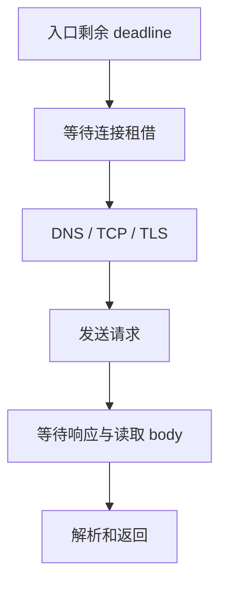

# HTTP 客户端、连接池、超时、重试与取消

只配置“超时 3 秒”，调用仍可能远超 3 秒。超时分布在租借、建连、读响应和重试等阶段，未必共享总截止时间。

## 1. 客户端门面与网络实现

`RestClient` 是同步门面，`WebClient` 提供响应式链；连接复用、超时和取消依赖底层请求工厂/连接器。宜注入 Boot 的 Builder，不在每个请求里新建客户端和线程池。[Boot REST 客户端](https://docs.spring.io/spring-boot/reference/io/rest-client.html)

MVC 中 WebClient 后立即 `block()`，当前线程仍阻塞。虚拟线程也不会让下游容量无限，连接数和并发仍需上限。

## 2. 预算分解



连接超时不等于读超时，读超时可能是数据之间的空闲时间而非总时长。HTTP/2 并发流不等于 TCP 连接数。Apache、JDK 与 Reactor Netty 的参数语义不能互换。

子调用应扣除已消耗时间，给本地处理/返回留余量。重试退避也计入预算；仅剩 800ms 时，不该启动最多 3s 的新尝试。

## 3. 请求工厂配置示例

以下 Bean 节选需要 Spring 的 `Bean`、`RestClient` 导入，使用 JDK HttpClient：

```java
@Bean
RestClient inventoryClient(RestClient.Builder builder) {
    var http = java.net.http.HttpClient.newBuilder()
        .connectTimeout(java.time.Duration.ofSeconds(1)).build();
    var factory = new org.springframework.http.client.JdkClientHttpRequestFactory(http);
    factory.setReadTimeout(java.time.Duration.ofSeconds(2));
    return builder.baseUrl("https://inventory.example.invalid")
        .requestFactory(factory).build();
}
```

域名是占位符。片段只展示建连/读取配置，不提供租借超时、业务总 deadline 和重试，也不意味着 JDK 资源管理等同 Apache 池。拥有客户端/执行器的一方还需设计关闭。

## 4. 连接池观察点

看每个目标的活动/空闲连接、待租借数、租借时间、建连失败、响应耗时和 body 消费/关闭。响应未消费/关闭可能无法复用连接。池少会排队，池多可能打垮下游。

平均并发约为吞吐乘平均占用时间。100 次/秒、200ms 占用，平均约 20 个并发；这不证明池设成 20 就够。峰值、尾延迟、HTTP/2、多实例和下游上限都要验证。

## 5. 重试与取消

连接异常可能在发送前，也可能在下游已提交后。非幂等操作必须有业务键或状态查询。不要默认重试所有 500、超时和 4xx；429/503 还需理解 Retry-After、预算和负载。

三层各三次尝试可能放大成 27 次。统一重试责任，限制次数、退避、抖动和并发。客户端取消不表示远端事务回滚，远端业务能否停止需要协议支持。

## 6. 验证方法

用可控本地 stub 制造慢响应头、慢 body、断连和错误状态，断言耗时与尝试数，检查取消后连接回落。完整基础实验见 [WebClient 执行链](../../spring/03-web/07-WebFlux-Netty与WebClient执行链.md)。外网测速不能稳定验证特定超时分支。

## 7. 练习与答案

### 7.1 读超时后重试 POST 一定安全吗

不一定，远端可能已提交。需要幂等键或结果查询，不能根据本地没响应认定没执行。

### 7.2 池等待高、下游 CPU 低，先扩容吗

先查池上限、泄漏、慢 body、建连、分布和其他瓶颈；CPU 低不能证明有处理余量。

### 7.3 入口 1 秒超时，内部重试 5 秒有什么问题

入口已放弃，内部继续占资源和产生副作用。需要统一 deadline 与取消传播。

## 8. 继续阅读

- [Spring REST 客户端机制](https://docs.spring.io/spring-framework/reference/integration/rest-clients.html)
- [熔断与隔离](../04-integrations/06-Resilience4j熔断隔离限流与时间预算.md)
- [WireMock 的 HTTP 模拟与验证边界](../../java-components/09-testing/wiremock/01-HTTP模拟匹配响应状态与验证边界.md)
