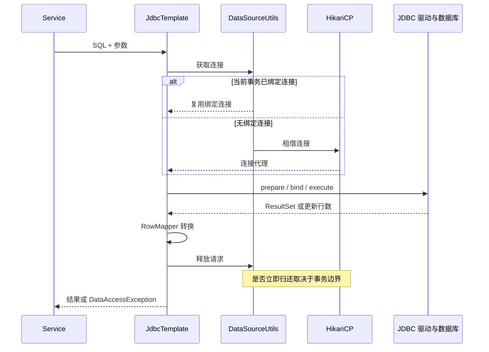

# JDBC、JdbcTemplate 与 SQL 执行路径

JdbcTemplate 减少重复的连接和异常处理代码，但不会替你选择索引、限制返回行数或决定业务事务。先分清谁拥有连接，再看一条 SQL 的执行。

## 1. 从应用到数据库


先用总览区分资源归属，再看下方一条 SQL 的时序；事务未完成时，请求“释放连接”不一定立即把它归还池。



事务内连接一般保持到事务完成；非事务查询结束后可以归还。连接 close 在池中通常是逻辑归还，不等于每次断开 TCP。[Spring JDBC 核心机制](https://docs.spring.io/spring-framework/reference/data-access/jdbc/core.html)

## 2. 依赖、配置与初始化

Boot 工程使用 JDBC Starter 和相应驱动，驱动必须支持目标数据库与 JDK。`service-lab` 用 H2 和 `schema.sql` 隔离实验；生产改用 PostgreSQL/MySQL 后要移除实验式自动建表，交给版本化迁移。

```properties
spring.datasource.url=jdbc:postgresql://db.example.invalid:5432/tasks
spring.datasource.username=task_app
spring.datasource.password=REPLACE_WITH_SECRET
spring.datasource.hikari.maximum-pool-size=10
```

这是结构示意；需增加驱动并从受控 Secret 注入凭据，不提交真实密码。TLS、连接/查询超时要按驱动参数配置，Hikari 租借超时不约束 SQL。

## 3. 参数绑定保护的是值

```java
List<Task> tasks = jdbc.query(
    "SELECT id,name,status,version FROM task WHERE tenant=? AND status=? ORDER BY id LIMIT ?",
    (rs, row) -> new Task(rs.getString("id"), rs.getString("name"),
        rs.getString("status"), rs.getLong("version")),
    tenant, "NEW", 20);
```

这是方法节选，Task 定义见任务服务。问号绑定值，不绑定表名、列名或排序方向；动态排序应映射白名单，不能拼客户端文本。绑定也不能解决越权，WHERE 仍需可信 tenant。

`queryForObject` 期待特定行数，不等于“没有就返回 null”。零行/多行、SQL NULL 与原始类型要分别处理。大结果应分页或正确关闭流式结果，别把百万行一次装进 List。

## 4. 异常翻译和业务结果

SQL 异常翻译为数据访问异常，便于处理重复键、完整性问题和暂时性故障，不能把所有异常转成“查无数据”。更新零行通常不是 JDBC 异常，应由业务解释。

事务第二条 SQL 失败，应验证第一条也回滚。捕获异常继续报成功可能破坏预期；部分数据库在事务出错后拒绝后续语句，需退出失败事务再查询或补偿。

## 5. 查询慢时拆分时间

总耗时包含租借、网络、数据库执行、结果读取、映射和应用处理。数据库只用 10ms，应用却用 2s，可能卡在租借或巨大结果映射。观察 SQL、参数基数、计划和等待，不只看方法名。

`service-lab` 覆盖参数绑定、更新行数、租户过滤和事务回滚；目标库锁、索引与网络不在 H2 实验保证内。

## 6. 练习与答案

### 6.1 每次 JdbcTemplate 调用都借新连接吗

不一定。当前线程有相同数据源的事务绑定连接时复用；是否新建物理连接还取决于池。

### 6.2 租借超时 1 秒，SQL 也在 1 秒结束吗

不会。SQL 执行与网络读取需要独立超时和取消。

### 6.3 update 返回 0 为什么不能照常报成功

可能是版本冲突、状态不允许或资源不可见，必须结合契约解释。

## 7. 下一步

- [HikariCP 与容量](./02-HikariCP生命周期排队与容量.md)
- [事务连接绑定源码](../../spring/04-internals/05-事务拦截器连接绑定与完成路径.md)
