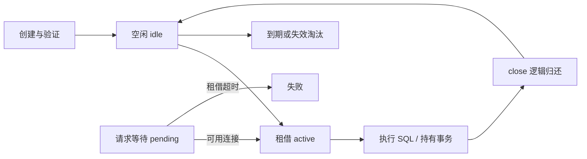

# HikariCP 生命周期、排队与容量

连接池不是数据库加速缓存，而是连接复用与并发闸门。增大池可能减少应用排队，也可能把排队转移到数据库，恶化所有实例延迟。

## 1. 连接状态

连接借走但没执行 SQL 也算 active，例如事务里等待 HTTP。池只知道连接未归还，不认识业务是否在做有效工作。

## 2. 参数边界

| 参数 | 控制什么 | 不控制什么 |
| --- | --- | --- |
| maximumPoolSize | 单池物理连接上限 | 数据库整体连接上限 |
| minimumIdle | 尝试维持的空闲连接数 | 立即创建成功 |
| connectionTimeout | 租借最长等待 | SQL 执行时间 |
| maxLifetime | 生命周期、归还后的淘汰 | 强杀使用中的连接 |
| idleTimeout | 符合条件的空闲淘汰 | 活跃事务超时 |
| keepaliveTime | 空闲连接探活 | 所有网络故障 |
| leakDetectionThreshold | 长时间占用诊断 | 自动回收泄漏 |

相互约束、最小值和默认值以当前版本为准，不抄旧文章默认值。[HikariCP 配置](https://github.com/brettwooldridge/HikariCP)

## 3. 先算总预算

假设数据库给应用 120 个连接，正常 6 副本，发布时最多 8 副本。不能按 120/6=20 设置每池 20，发布时就会达到 160，还没算管理与其他任务。

一个实例也可能有读/写池、迁移池和批处理池，预算应求和。平均占用并发约为 `请求率 × 每请求连接持有时间`；持有时间不等于一条 SQL 时间。

## 4. pending 上升怎么判断

先看 active 是否到上限、usage 时长、数据库锁等待、慢查询、事务范围和请求率。active 不回落可能是泄漏，也可能是真实长事务；泄漏提示只是调用栈线索。

SQL 快但连接占用高，查事务内 HTTP、逐行循环、`REQUIRES_NEW` 额外连接、响应流持有连接。数据库已饱和时扩池通常更糟，应限并发、缩持有、优化查询。

## 5. 隔离验证

在测试把池设为 2，借走两个，再发第三次租借，确认超时失败；归还一个后恢复。用 try-with-resources，不在生产故意占满。

`service-lab` 设置最大 4、租借 1 秒，通过并发创建验证小池完成有界业务，但不模拟生产网络。实际压测记录吞吐、P99、pending、锁和总连接，不能只看成功率。

## 6. 练习与答案

### 6.1 调大 maxLifetime 能解决租借等待吗

通常不能直接解决。先看连接被谁占用，生命周期不是并发容量。

### 6.2 leak 日志后连接会强制关闭吗

不会，检测提供诊断线索；强关正在执行的事务可能破坏业务。

### 6.3 事务内调用远端为何耗尽连接池

连接随事务保持，下游慢会拉长持有并让其他请求排队，需要缩小事务和设计可靠副作用。

## 7. 关联

- [事务与 Outbox](./06-业务事务Outbox与外部副作用.md)
- [慢请求等待链](../06-production/08-慢请求线程池连接池与下游等待.md)
