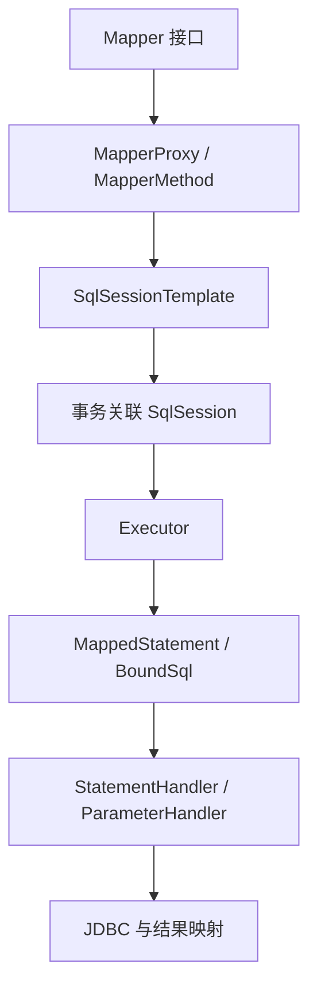

# MyBatis 的 Mapper、SqlSession、执行与缓存

MyBatis 把接口方法和 SQL 映射起来，不像 JPA 那样依赖脏检查生成所有更新。SQL、映射、受影响行数和事务仍由应用负责。

## 1. 版本与接入

[官方兼容表](https://mybatis.org/spring-boot-starter/mybatis-spring-boot-autoconfigure/)区分 Starter 4.0、3.0 等系列。Boot 4 选择明确支持它的系列，不把 Boot 3 Starter 原样带入。坐标 `org.mybatis.spring.boot:mybatis-spring-boot-starter` 的版本要单独锁定并验证，不能假定全部由 Boot BOM 管理。

本文沿执行链分析 Boot 4 集成。[persistence 完整工程](https://github.com/newswitch/newswitch.github.io/tree/main/examples/spring-boot/deepening-lab/persistence) 已接入 MyBatis Starter 4.0.0，并通过真实 H2 测试验证参数绑定、事务回滚、缓存和更新行数。原 service-lab 保持 JdbcTemplate 实现，二者是不同实验，不能把一种实现的测试结果套给另一种。

## 2. 一次查询的内部路径

配套工程固定使用 4.0.0，不覆盖 Boot 管理的 Spring 模块：

```xml
<dependency>
  <groupId>org.mybatis.spring.boot</groupId>
  <artifactId>mybatis-spring-boot-starter</artifactId>
  <version>4.0.0</version>
</dependency>
```

配置数据源后，在接口使用 `@Mapper`，或配置类用 `@MapperScan("你的Mapper包")`。XML 方式还需确认 mapper-locations、namespace 与方法 ID 对应；两种方式最终都映射为 MappedStatement。



SqlSessionTemplate 协调事务中的 Session；原生 DefaultSqlSession 不能当线程安全单例共享。Spring 管理事务时，不要手动 Session commit/rollback 制造另一套边界。

## 3. 映射与参数

```java
@Mapper
public interface TaskMapper {
    @Select("SELECT id,name,status,version FROM task WHERE tenant=#{tenant} AND id=#{id}")
    TaskRow find(@Param("tenant") String tenant, @Param("id") String id);

    @Update("UPDATE task SET status='CANCELLED',version=version+1 " +
        "WHERE tenant=#{tenant} AND id=#{id} AND version=#{version} AND status='NEW'")
    int cancel(@Param("tenant") String tenant, @Param("id") String id,
        @Param("version") long version);
}
```

以上是原任务表的映射形状，TaskRow 需要与查询列匹配；可直接构建运行的 TaskMapper、嵌套 Row record 和导入见完整工程。井号形式绑定值，美元符号形式进行文本替换，不应用于直接接受的用户值。表名和排序字段应来自白名单。XML foreach、if、choose 解决 SQL 组合，不自动保证逻辑正确。

别名、驼峰配置、构造器和 null 都影响映射。先用简单返回模型验证；嵌套 select 也可能产生 N+1。

## 4. 缓存在哪

一级缓存关联 SqlSession，行为受配置、语句和事务影响。Spring 同事务可能复用 Session，跨事务不应期待共享一级缓存。

二级缓存按 namespace 等机制组织，需要显式理解失效。其他应用、其他 namespace 或直接 SQL 改库时，不一定及时失效。命中不等于跨进程一致性，更不是幂等保证。

批量 Executor 改变实际执行与错误暴露时机。方法返回不等于批量 SQL 已提交，要检查 flush、提交及真实结果。

## 5. 同模型对照验证

完整步骤见[MyBatis 与 JPA 对照实验](./07-MyBatis与JPA的SQL事务缓存对照实验.md)。在仓库根目录执行：

```bash
mvn -B -ntp -f examples/spring-boot/deepening-lab/pom.xml -pl persistence verify
```

SqlCounter 在 StatementHandler.prepare 计数：同一事务内相同查询两次为 1；事务外分别调用为 2；查询、Mapper 更新、再查询为 3。显式开启 CachedMapper namespace 二级缓存后，JdbcTemplate 的外部更新不会自动使它失效，测试能稳定观察到缓存旧值。

更新 0 行不一定抛异常。实验先以 version=0 成功更新，再用旧版本更新得到 0；业务要按行数处理竞争，而不是把“不报错”当成功。不存在的租户/ID 返回 null，重复主键报错，事务回滚后值不改变，均有断言。

计数证明本版本、配置和输入下执行了几次 prepare，不等于数据库查询成本相同；真实计划、索引、网络和锁需另行测量。SQL 日志包含参数时应限制范围并脱敏。

找不到 Mapper 时先查扫描范围和 Bean 定义，再查依赖和数据源；不要随意叠注解掩盖扫描错误。

## 6. 练习与答案

### 6.1 接口没有实现类为何能注入

扫描器注册工厂 Bean 并创建代理，代理找到 MappedStatement 执行，并非 Java 自动补写实现。

### 6.2 MyBatis 还需要事务吗

需要，多条 SQL 原子性来自数据库事务及正确参与。

### 6.3 二级缓存能保证实时订单状态吗

不能普遍保证，需考虑跨实例与其他写路径的失效，对强一致状态慎用。

## 7. 深入阅读

- [MyBatis Java API](https://mybatis.org/mybatis-3/java-api.html)
- [MyBatis-Spring 事务](https://mybatis.org/spring/transactions.html)
