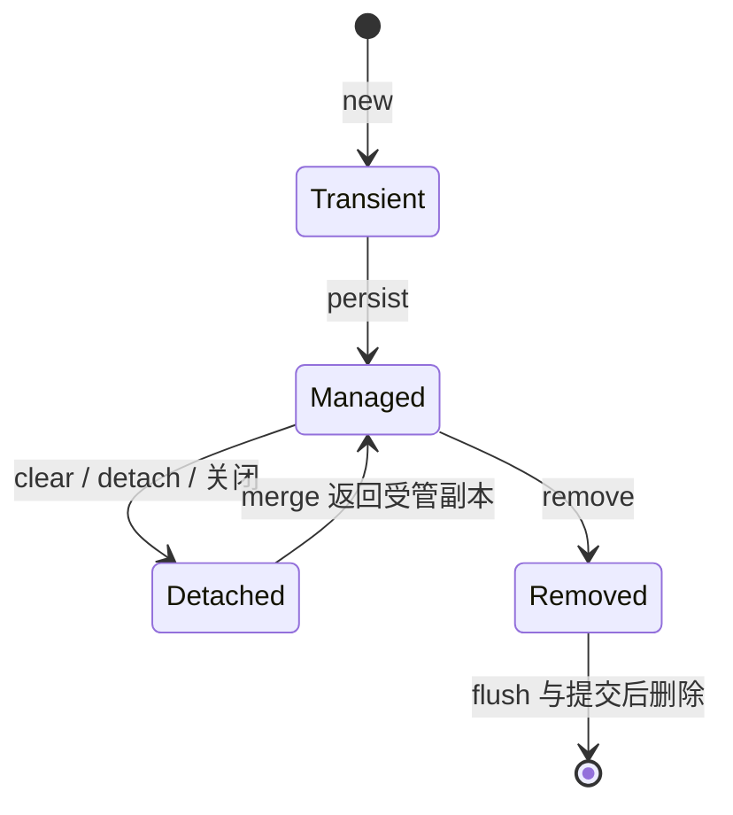

# JPA 实体状态、脏检查、懒加载与 N+1

JPA 是规范，Hibernate 是常见实现，Spring Data JPA 提供 Repository 等抽象。混作“save 会自动写库”，容易误判 SQL 时机和事务范围。

## 1. 实体状态



Managed 实体被上下文跟踪；改字段可能在 flush 产生 SQL，不一定要再 save。merge 返回受管副本，原对象不一定受管。[Spring Data 实体保存判断](https://docs.spring.io/spring-data/jpa/reference/jpa/entity-persistence.html)

## 2. flush 不是 commit

flush 把变更同步成 SQL，可能触发约束错误，事务仍可回滚。commit 才完成事务提交。查询前、显式 flush、提交时均可能执行 SQL，受模式和实现影响。

一级缓存是身份映射和工作单元的一部分，不是所有查询都不用访问库的万能缓存。大批量导入不分批 flush/clear，可能让上下文持有大量实体。

## 3. 关联与 N+1

先查 20 个任务，再逐个访问 owner，可能再发 20 条 SQL。LAZY 不是自动批量；EAGER 也不保证一条 SQL。依据实际条数与规模关系判断。

DTO 投影只取需要列，fetch join 明确加载，EntityGraph 表达计划，批量抓取减少往返。集合 fetch join 叠加分页要小心行膨胀、内存分页或语义变化，必须实际检查。

## 4. 事务、OSIV 与响应层

Service 事务内确定数据并映射 DTO，不靠序列化触发懒关联。引入 JPA Starter 的工程显式审视：

```properties
spring.jpa.open-in-view=false
spring.jpa.hibernate.ddl-auto=validate
```

JdbcTemplate 实验无需此配置。关闭 OSIV 后出现懒加载异常，说明原边界不明确，不应简单全部改 EAGER。生产 schema 用迁移管理，ddl-auto=update 不提供可靠变更审阅和多版本兼容。独立 persistence 实验使用可丢弃 H2 的 create-drop，不应将其复制到生产配置。

## 5. 乐观锁与批量更新

引入 `spring-boot-starter-data-jpa` 和驱动后，实体需要主键与受支持的构造方式。下面是最小映射形状，不是任务实验的现有实体：

```java
@Entity
@Table(name = "task")
public class TaskEntity {
    @Id
    private String id;
    private String tenant;
    private String name;
    private String status;
    @Version
    private long version;

    protected TaskEntity() {}

    public void cancel() {
        if (!"NEW".equals(status)) throw new IllegalStateException("not cancellable");
        status = "CANCELLED";
    }
}
```

注解来自 `jakarta.persistence`。上面只用于说明原任务模型的字段形状；带完整构造方式、访问器、LAZY owner 与版本字段的可运行实体见 [JobEntity 与 OwnerEntity](https://github.com/newswitch/newswitch.github.io/tree/main/examples/spring-boot/deepening-lab/persistence/src/main/java/lab/persistence)。Service 在事务中查出当前租户的受管实体，再调用领域方法，flush 时产生带版本约束的更新；数据库竞争失败和对象 if 拒绝是两条路径。

Repository 可用 `findByTenantAndId` 表达可见范围，不只 findById 就假定已授权。列表优先返回投影；表实体不直接充当 HTTP 协议。

`@Version` 检测版本竞争，冲突后重新判断规则，不无条件重试。JPQL/native 批量更新绕开逐实例脏检查，上下文实体可能陈旧，需要 flush/clear 与版本策略。

数据库锁超时、查询超时、事务超时仍要分别设计，ORM 不会消除数据库并发问题。

## 6. 验证路径

记录事务和 flush 前后的 SQL、其他事务可见性、上下文关闭后的关联访问。分别用 1、20、100 条数据测试查询数，别只测一条掩盖 N+1。

独立 [MyBatis/JPA 对照实验](./07-MyBatis与JPA的SQL事务缓存对照实验.md) 已加入 Hibernate：3 个任务分别关联不同 owner，普通 LAZY 遍历产生 4 次 prepare，fetch join 为 1；显式 flush 后回滚，数据库仍保留旧值；两个 EntityManager 竞争同一版本时，后提交者 flush 失败；JPQL 批量更新后，受管对象保持旧字段，clear 后重读才改变。

这些测试用真实 H2 与完整 Boot 上下文执行。它们证明对象/SQL/事务边界，不能替代目标 MySQL/PostgreSQL 的锁、分页和执行计划验证。不要将两个 EntityManager 的并发实验改成跨线程共享同一个上下文。

## 7. 练习与答案

### 7.1 save 返回表示其他事务已可见吗

不表示，可能未 flush 或提交，且受隔离级别影响。

### 7.2 全部 EAGER 能根治 N+1 吗

不能，还可能过度抓取。需要明确查询形状并检查 SQL。

### 7.3 批量 SQL 后实体为什么还是旧值

上下文保留旧对象，批量操作不自动更新每个受管对象，需刷新/清理并考虑事务语义。

## 8. 参考资料 {/* #8-参考 */}

- [Hibernate ORM 指南](https://hibernate.org/orm/documentation/)
- [Spring Data JPA 查询](https://docs.spring.io/spring-data/jpa/reference/jpa/query-methods.html)
