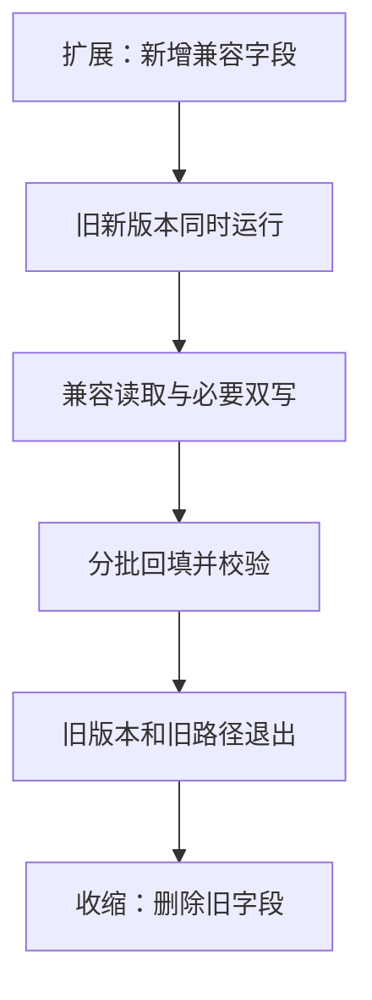

# Flyway、Liquibase 与兼容数据库变更

代码可回滚不等于数据库可回滚。删掉旧列后，旧代码可能无法运行。迁移首先是多个应用版本共享数据结构的问题。

## 1. 工具负责与不负责什么

Flyway 按版本/可重复迁移组织 SQL 和历史；Liquibase 使用 changeset/changelog。它们记录执行、检查部分漂移并协调迁移，但不证明 DDL 兼容，也不让所有 DDL 都可事务回滚。

一个 schema 明确唯一管理方式，别让 schema.sql、Hibernate update 和两套迁移工具同时修改相同表。[Boot 数据初始化](https://docs.spring.io/spring-boot/how-to/data-initialization.html)

## 2. Flyway 最小目录

Boot 4.1.1 的 Flyway 接入可使用以下依赖片段，PostgreSQL 支持模块和驱动也要存在，版本由 BOM 核对：

```xml
<dependency>
  <groupId>org.springframework.boot</groupId>
  <artifactId>spring-boot-starter-flyway</artifactId>
</dependency>
<dependency>
  <groupId>org.flywaydb</groupId>
  <artifactId>flyway-database-postgresql</artifactId>
</dependency>
```

已有非空 schema 不能直接假装成空库执行 V1。先盘点真实结构，再制定受审阅的 baseline，核对历史和后续迁移；不要为消除报错盲目开启 baseline-on-migrate。

```text
src/main/resources/db/migration/
├── V1__create_task.sql
├── V2__add_priority.sql
└── V3__add_priority_index.sql
```

```sql
-- V2__add_priority.sql，锁行为需在目标数据库验证
ALTER TABLE task ADD COLUMN priority INTEGER;
```

需引入对应 Boot 集成和数据库支持模块，不能只加旧 flyway-core 就保证兼容。已发布脚本不直接改，新迁移修正；校验和变化不能随意 repair 忽略。

Liquibase 用 changeset 组织，标识、作者、文件路径等参与历史管理。本文不同时启用两套工具；回滚声明需要验证，不能代替备份。

选择 Liquibase 时使用对应 `spring-boot-starter-liquibase`，指定 changelog 并移除冲突的建表路径。两者选其一，依赖清单见 [Boot 管理的坐标](https://docs.spring.io/spring-boot/appendix/dependency-versions/coordinates.html)。

## 3. expand-contract



大表索引、类型转换、NOT NULL 和默认值回填可能持锁或大量 IO，取决于数据库版本和操作。SQL 只有一行不等于低风险。回填应有界、可重入，观察复制延迟。

改名可先加新列、兼容读写、回填，再删旧列。双写仍需处理失败与一致性，不是调用两次就完成。

## 4. 谁运行迁移

可在应用启动时执行，也可单独 Job/发布阶段执行。前者带来启动耗时和账号权限，后者要确保迁移后才发兼容应用。迁移锁协调执行者，不允许无限等待。

运行账号与迁移账号分离，验证多副本启动竞争、锁等待上限和发布失败状态。

## 5. 失败怎么恢复

先查失败语句、历史表和真实 schema，不先删历史表。非事务 DDL 可能部分成功；repair 修改历史元数据，不撤销错误数据。

演练空库升级、旧版升级、重复运行、中断、并发、旧代码读新库、恢复后再迁移。service-lab 使用 schema.sql 隔离实验，不宣称已演练迁移工具。

## 6. 练习与答案

### 6.1 为什么不修改 V1 来加列

旧环境已执行，会产生校验和差异与历史分叉，应追加迁移。

### 6.2 有迁移锁就可以执行任何 DDL 吗

不可以，锁不解决业务阻塞、复制压力、耗时和兼容性。

### 6.3 回滚代码后能立即删新列吗

先确认应用、任务、消费者和恢复路径均不再依赖它，再独立收缩。

## 7. 官方资料

- [Flyway](https://documentation.red-gate.com/flyway)
- [Liquibase](https://docs.liquibase.com/)
