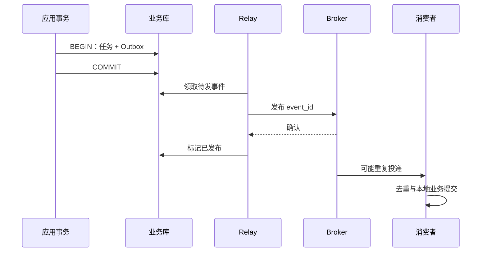

# 业务事务、Outbox 与外部副作用

“创建任务后发消息”涉及两个系统。数据库事务不会自动把消息队列和远端 HTTP 一起回滚，不同调用顺序只是改变失败窗口。

## 1. 直接写法的窗口

先发消息再提交，消息可见但事务回滚；先提交再发，进程可能在中间崩溃；事务里等待发送，连接占用变长且仍非两边原子提交。

AFTER_COMMIT 事件适合本地提交后动作，进程崩溃仍可能丢事件，它不是持久化日志。[事务事件](https://docs.spring.io/spring-framework/reference/data-access/transaction/event.html)

## 2. 保存发送意图

同库事务保证业务和待发记录同成同败。Relay 可轮询或通过 CDC 读取，还需独立重试、监控、清理和恢复，不是建表就结束。

## 3. 崩溃窗口与去重

Broker 接受后、标记前崩溃会重复发送；发送前先标记则可能漏发。因此通常按至少一次设计。

消费者在本地事务插入唯一 event_id 处理记录、执行业务、提交后 ACK。去重有效期覆盖重放窗口。远端支付仍需对方幂等键，本地回滚不了已完成的付款。

## 4. 并行、顺序和积压

多 Relay 用数据库锁或领取状态/租约协调，具体 SQL 按数据库选择。过期领取、卡住和毒消息要能恢复；锁不消除发布确认后的重复。

同任务事件可带 aggregate ID 与版本，选择分区或串行处理；全局顺序与高并行有权衡，时间戳不能直接证明绝对顺序。

监控最老未发年龄、待发数、发布速率、失败、重复与消费延迟。只看总行数会漏掉少量长期卡住的事件。

## 5. 实验覆盖边界

service-lab 同事务写 TaskCreated 与任务，取消也写事件。测试让事件插入失败，断言任务回滚；并发同键只产生一条创建事件。

实验无 Broker、Relay、CDC 和消费者，不能声称端到端可靠投递。扩展需模拟提交后崩溃、发布后未标记、消费提交后未 ACK，确认重放不重复副作用。

## 6. 练习与答案

### 6.1 Outbox 等于全链路 exactly once 吗

不是。它保证本地数据与发送意图一致，重发和消费副作用仍要处理。

### 6.2 为什么不能发送前标记完成

标记后发送前崩溃会永久漏发。

### 6.3 已发布记录什么时候清理

结合审计、重放、恢复与去重窗口归档/清理，不能刚确认成功就忽略恢复证据。

## 7. 下一步

- [Kafka 客户端](../04-integrations/02-Kafka发送消费提交重试与幂等.md)
- [Debezium Outbox Event Router](https://debezium.io/documentation/reference/stable/transformations/outbox-event-router.html)
