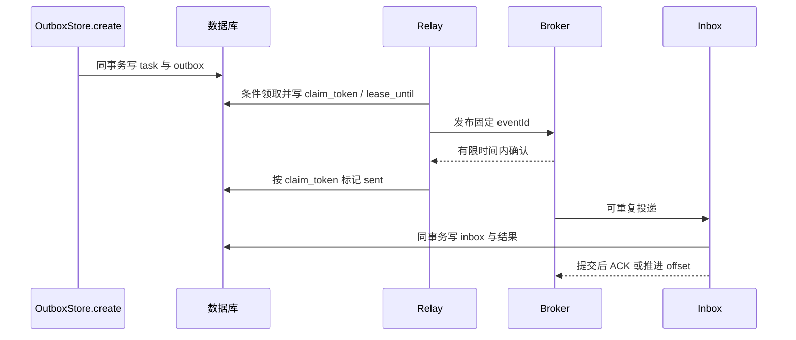

# Outbox Relay 领取、重发与消费者去重实战

Outbox 解决的是“业务已经提交，但发送意图不能随进程一起消失”。它不会让数据库和 Broker 自动变成同一个事务。可运行方案必须继续回答谁领取、何时重发、如何防旧实例更新状态，以及消费者为什么不会重复执行业务。

## 1. 最小闭环与工程入口

源码位于 [deepening-lab/delivery](https://github.com/newswitch/newswitch.github.io/tree/main/examples/spring-boot/deepening-lab/delivery)。先运行不依赖外部服务的事务与故障窗口测试：

```bash
mvn -B -ntp -f examples/spring-boot/deepening-lab/pom.xml -pl delivery verify
```

默认只运行本地测试，外部客户端不启动 listener；真实 Redis/Kafka/RabbitMQ 使用单独的 `-Pbrokers` 联调，见[中间件隔离联调](../04-integrations/07-RedisKafkaRabbitMQ隔离联调与故障恢复.md)。两种模式都使用可丢弃实验库，不接业务实例。



## 2. 四张表分别保存什么

`delivery_task` 保存业务对象；`delivery_outbox` 保存待发正文、是否确认、领取令牌、租约、尝试次数与下次重试时间；`delivery_inbox` 用 event_id 唯一约束记录已处理事件；`delivery_result` 表示消费者的数据库副作用。

TaskEvent 固定 schemaVersion=1，包含 eventId、taskId、tenant 和 type。构造与解析都检查字段，正文限制 4096 字符。eventId 在创建发送意图时生成，重发时保持不变。不能每次发送重新生成，否则消费者无法识别业务重复。

示例消费者只处理 TaskCreated，不实现完整任务状态机。租户来自业务侧可信边界；如果对外增加 HTTP 接口，不能直接相信客户端提交的 tenant 字段。

## 3. 业务与发送意图必须同事务

`OutboxStore.create` 通过 TransactionTemplate 先插任务，再插 Outbox。测试给 Outbox 加入一个拒绝本次插入的数据库约束，断言 create 抛错后任务数仍为 0；随后移除约束。

这比在 Java 中手动抛异常更具体：失败发生在真实第二条 SQL，验证第一条写入确实参与同一事务。它只证明同库原子性，不证明 Broker 写入也能被回滚。

创建接口的请求幂等和消息消费者的事件幂等是两层问题。原 [service-lab](https://github.com/newswitch/newswitch.github.io/tree/main/examples/spring-boot/service-lab) 已用 `(tenant, request_key)` 唯一约束处理前者；这里专注后者，不能将“不同请求各创建一条任务”误称为同请求幂等。

## 4. 为什么先 SELECT 再条件 UPDATE

先读一小批候选 event_id，再逐条尝试：

```sql
UPDATE delivery_outbox
SET claim_token = ?, lease_until = ?, attempts = attempts + 1
WHERE event_id = ?
  AND sent = FALSE
  AND (claim_token IS NULL OR lease_until <= ?);
```

候选 SELECT 不是锁。多个 Relay 可能读到同一 ID，只有条件更新成功的一个获得本次领取权。读候选时同时过滤 retry_at；失败释放后设置未来时间，避免一个不可用 Broker 引发热循环。

实验在事务内做有限批量领取，发布时不持有数据库连接。生产可按数据库选择 `FOR UPDATE SKIP LOCKED` 等模式，但锁语义、扫描索引与隔离级别必须实测，不能直接复制到所有数据库。

示例使用应用提供的 UTC 时间，便于确定性测试。多机器部署必须控制时钟偏移，或将领取条件与期限统一交给数据库时钟。租约不能比可能持续的发布操作还短而又不考虑重叠发布。

## 5. claim_token 为什么比一个 owner 名称更重要

假设旧 Relay A 领取事件后卡住，租约到期，B 重新领取。A 后来恢复并收到确认，如果只按 event_id 更新，它可能覆盖 B 的领取状态。

`markSent` 同时要求 event_id、当前 claim_token 和 sent=false；每次领取生成新随机令牌。旧 A 的更新影响 0 行，测试 `expiredClaimIsFenced` 直接验证该结果。

这个令牌保护的是**数据库中的领取状态**，不会阻止 A 向外部 Broker 迟到发送。外部重复仍靠稳定 eventId 和消费者去重处理；不能将本地条件更新称为对所有外部副作用都有效的分布式 fencing。

## 6. 发布操作必须有完成语义和期限

Relay 只执行一次有界迭代，Publisher 必须在 Broker 确认成功后返回，失败或超时则抛异常。Kafka 适配器等待发送 Future；RabbitMQ 适配器等待 correlated confirm，同时检查 mandatory return。两者的等待都有 5 秒上限。

Relay 看到超时并不能断定消息没到 Broker：可能是确认丢失。因此保留发送意图，等待下一次重试，不先标 sent。发布确认成功才标记，仍存在“确认后、标记前进程退出”的重复窗口。

默认实验没有无限后台循环，便于逐步观察。实际调度器应限制同时运行的 Relay 数、领取批次和退出等待；应用关闭时停止领取，再在期限内等待已发布操作，不启动无界 Future 队列。

## 7. 如何确定性重现重复窗口

`crashAfterBrokerAcceptanceProducesDuplicateNotLostEvent` 不随机杀进程，而是精确模拟边界：

1. 创建任务并领取事件。
2. 将该事件记录为已被 Publisher 接收，但故意不调用 markSent。
3. 推进测试时钟，让另一 Relay 重新领取并发布。
4. 断言两个发布记录具有相同 eventId。
5. 将两次交付送给 Inbox，断言第一次生效、第二次去重，最终结果只有一条。

这验证协议状态机，不冒充真实 Broker 掉电测试。真实断连和 Broker 恢复需要在隔离服务中补测确认、重投和进度提交。

## 8. Inbox 的唯一约束和业务结果必须一起提交

`Inbox.apply` 的事务先插去重行，再写结果行。若结果写入失败，整个事务回滚，去重行也不能留下。否则下次交付会误判“已处理”并跳过未完成的业务。

捕获 DuplicateKeyException 放在事务模板外：例如 PostgreSQL 中，约束错误后当前事务通常已处于失败状态，不应在里面继续查询。回滚后查询已提交去重行，并比较规范化事件正文；同 eventId 不同正文不能默默当正常重发。

并发测试用 8 次交付竞争同一事件，断言只产生一次业务结果。唯一约束是最终裁决，`if (!exists) insert` 的预检查无法替代它。

## 9. 结果只在本地库，远端副作用怎么办

本实验的原子范围是去重行和本地结果表。若消费者改成发送付款、邮件或调用另一个 HTTP 服务，本地事务回滚不了已经完成的远端动作。

可继续使用对方支持的业务幂等键，或再写一层本地发送意图，必要时查询远端结果进行补偿。远端超时同样代表结果未知，不等于未执行。将去重表插入后就直接调用一次远端接口，不能构成“端到端恰好一次”的证明。

## 10. 顺序、清理与恢复

本实验只发布一种创建事件，不承诺同聚合的多事件顺序。若扩展 Created → Started → Finished，需要持久化 aggregateVersion、按聚合选择分区/串行路由，并限制多 Relay 同一聚合并行；仅设置 Kafka key 不能消除发送前的顺序反转。

去重保留时间至少覆盖 Broker 重放、备份恢复和人工补发窗口。Outbox 已发记录可以归档，但归档前要明确如何审计、恢复和重建投递。重放保留原 eventId，不手动删除 Inbox 后“一次性全重跑”。

诊断时分开观察待发数、最老未发年龄、领取超时、确认失败、消费失败、重复次数、DLQ 和结果表。队列 lag=0、sent=true 都不能单独证明所有业务结果正确。

## 11. 练习与答案

### 11.1 旧 Relay 的 markSent 更新 0 行，能否认为消息一定没发出去

不能。它只说明当前令牌已不是数据库认可的领取权；旧实例仍可能迟到发送。保留稳定 eventId 并让消费者幂等。

### 11.2 为什么业务结果写入失败时要回滚 Inbox

若去重行独立提交，后续重投会被跳过，业务结果却永远缺失。两者必须在同一本地事务里同成同败。

### 11.3 发布超时后重试会产生重复，为什么还要重试

不重试可能永远漏发；重试保留至少一次交付的可能，再通过去重处理不确定性。没有一种客户端超时设置能消除两个系统之间的提交窗口。

## 12. 关联与参考

- [事务与外部副作用](./06-业务事务Outbox与外部副作用.md)
- [Spring 事务管理](https://docs.spring.io/spring-framework/reference/data-access/transaction.html)
- [Debezium Outbox Event Router](https://debezium.io/documentation/reference/stable/transformations/outbox-event-router.html)
