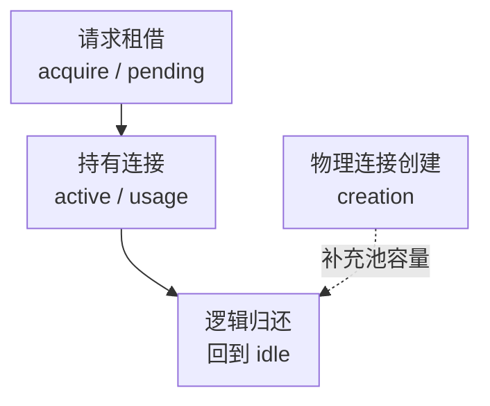

# HikariCP 连接池核心监控指标采集与告警

连接池监控要回答的不是“池里有多少连接”，而是请求能否在预算内获得连接，连接被谁持有，以及把池扩大后数据库是否仍承受得住。active 很高可能是慢 SQL，也可能是事务拿着连接等待 HTTP，二者需要完全不同的处理。

本文固定 **HikariCP 6.3.0 的 MicrometerMetricsTracker 与 Micrometer 1.15.0 Prometheus 命名**解释指标契约，不改变 Spring Boot 学习主线的依赖管理，也不是生产版本推荐。基础约定见[监控指标地图](../../../sre/observability/01-主流组件监控指标地图.md)，`job="app-pool"`，保留 service、instance 和 pool 标签；池名应稳定且低基数。

## 1. 租借、持有与 SQL 是不同的时间



acquire 是获取连接的等待，usage 是连接借出到归还的持有时间，creation 是建立物理连接的时间。usage 包含应用持有连接时的其他等待，不等于纯 SQL 执行；客户端请求还可能在入口线程池排队，不能把这三个平均数相加冒充端到端 P99。

## 2. 接入与池类型边界

Spring Boot 的通用 DataSource 统计和 Hikari 原生 metrics 不是同一套名字。需要确认实际连接池、Micrometer registry、自动配置/显式 tracker 以及监控端点均已生效，避免重复绑定或重复求和。Prometheus 端点还需认证/TLS 与网络限制。

| 对象 | 应有证据 | 不能混用的时间 |
| --- | --- | --- |
| JDBC/HikariCP | active、idle、pending、max、acquire、usage、creation、timeout | 租借超时不是 SQL 超时 |
| HTTP 客户端池 | leased、available、pending、route、连接建立/复用与请求结果 | 等池、TCP/TLS 建立和服务端响应分开 |
| Go database/sql、SQLAlchemy | 对应实现的占用、等待、超时和连接生命周期 | 名称/累计范围不自动与 Hikari 一样 |
| 虚拟线程或异步服务 | 连接许可与准入排队仍需监控 | 线程便宜不代表数据库连接无限 |

同一实例可能有读写池、批任务池、迁移池。容量规划应覆盖所有应用、副本、发布 surge 与故障切换，不只看当前一个 pool 的 max。

## 3. 核心指标卡片

以下为 Hikari 原生 tracker 经默认 Prometheus registry 转换后的名字，标签含 pool；不是所有 `jdbc_connections_*` 指标都与它一一等价。

| 问题 | 指标 | 类型、单位与边界 |
| --- | --- | --- |
| 池中连接 | `hikaricp_connections` | G，当前物理连接数；分时采样不要求每次都与其他 Gauge 严格同步 |
| 活跃与空闲 | `hikaricp_connections_active`、`hikaricp_connections_idle` | G，连接数；active 表示借出，不保证此刻在执行 SQL |
| 等待者 | `hikaricp_connections_pending` | G，等待线程数；不等于所有业务排队请求 |
| 配置容量 | `hikaricp_connections_max`、`hikaricp_connections_min` | G，配置连接数；max 不是已创建数量 |
| 租借耗时 | `hikaricp_connections_acquire_seconds_sum/count` | Timer，累计秒/事件数；包含相关超时等待记录，不应只解释为成功租借 |
| 持有耗时 | `hikaricp_connections_usage_seconds_sum/count` | Timer，累计秒/归还记录；仍未归还的长持有不会提前完成记录 |
| 创建耗时 | `hikaricp_connections_creation_seconds_sum/count` | Timer，累计秒/创建记录；与租借不同 |
| 租借超时 | `hikaricp_connections_timeout_total` | C，事件次；不是所有 SQL/网络错误 |
| 分布与最大值 | 对应 Timer 的 bucket、max | 桶需配置；max 是窗口最大值，不是 P99 |

表中 `/count` 表示同一 Timer 的独立 `_count` 指标，例如 `hikaricp_connections_acquire_seconds_count`，并非带斜杠的真实名称。

## 4. 源码分析与查询

[MicrometerMetricsTracker](https://github.com/brettwooldridge/HikariCP/blob/HikariCP-6.3.0/src/main/java/com/zaxxer/hikari/metrics/micrometer/MicrometerMetricsTracker.java)将 acquire 的纳秒、usage/creation 的毫秒交给 Timer，Prometheus registry 再以秒导出，不应二次换算。[PoolBase](https://github.com/brettwooldridge/HikariCP/blob/HikariCP-6.3.0/src/main/java/com/zaxxer/hikari/pool/PoolBase.java)的借用成功和超时统计路径都会记录获取连接的等待时间，timeout 另有专用 Counter。

当前活跃连接占配置上限比例：

```promql
(
  hikaricp_connections_active{job="app-pool"}
  / hikaricp_connections_max{job="app-pool"}
)
and (hikaricp_connections_max{job="app-pool"} > 0)
```

平均租借等待秒数，只计算有记录的窗口：

```promql
(
  rate(hikaricp_connections_acquire_seconds_sum{job="app-pool"}[5m])
  / rate(hikaricp_connections_acquire_seconds_count{job="app-pool"}[5m])
)
and (rate(hikaricp_connections_acquire_seconds_count{job="app-pool"}[5m]) > 0)
```

平均连接持有秒数：

```promql
(
  rate(hikaricp_connections_usage_seconds_sum{job="app-pool"}[5m])
  / rate(hikaricp_connections_usage_seconds_count{job="app-pool"}[5m])
)
and (rate(hikaricp_connections_usage_seconds_count{job="app-pool"}[5m]) > 0)
```

如果连接一直不归还，usage 的完成样本可能反而很少。因此要同时看 active、pending、事务年龄和线程/Trace，不能只看“已归还连接的平均持有时间”。

每秒发生租借超时：

```promql
rate(hikaricp_connections_timeout_total{job="app-pool"}[5m])
```

只有已启用 acquire percentile histogram 并验收桶时，才可计算租借 P99：

```promql
histogram_quantile(0.99,
  sum by (cluster, service, instance, pool, le) (
    rate(hikaricp_connections_acquire_seconds_bucket{job="app-pool"}[5m])
  )
)
```

## 5. 示例告警与容量推理

有等待者且 active 超过配置上限的 90%，持续 5 分钟提示持续饱和；不是所有池故障都满足此条件。创建失败导致“active 很低但 pending 很高”需要另一条可用性策略。

```yaml
groups:
  - name: hikari-pool-core
    rules:
      - alert: HikariPoolSaturated
        expr: |
          (hikaricp_connections_pending{job="app-pool"} > 0)
          and on (cluster, service, instance, pool)
          ((hikaricp_connections_active{job="app-pool"} / hikaricp_connections_max{job="app-pool"}) > 0.9)
          and on (cluster, service, instance, pool)
          (hikaricp_connections_max{job="app-pool"} > 0)
        for: 5m
        labels:
          severity: warning
        annotations:
          summary: "HikariCP 连接池持续饱和且存在等待者"
```

稳定负载下，平均占用连接约为“每秒完成的租借次数 × 平均持有秒数”，这是排队论的均值关系，不是突发或尾延迟保证。多副本总连接预算要在数据库容量以内，并预留发布和故障窗口。

| 现象 | 优先判断 |
| --- | --- |
| active 高、usage 高 | 慢 SQL、长事务、外部调用或泄漏，定位持有者后再调池 |
| pending 高、active 低 | 物理连接创建失败、数据库不可达、认证/TLS 或连接补充速度 |
| creation 慢且频繁 | 连接生命周期、网络、数据库登录和短连接风暴 |
| acquire 快、请求慢 | 排查入口线程池、SQL 执行、下游与响应写出，不误归因连接池 |

不要自动增大 maximumPoolSize、杀死全部连接或把 connectionTimeout 改得无限长。恢复需要请求达标、等待和超时回落，数据库及多实例连接余量同时满足预算。

## 6. 掌握检查

1. 为什么 active 不等于数据库正在执行请求数？连接可能被借出后等待其他工作。
2. 为什么 usage 平均值可能漏掉最严重的长持有？计时记录尚未完成，必须看在途占用和事务年龄。
3. 为什么本机池没满，数据库仍连接不足？所有池、副本和发布 surge 共享数据库预算。
4. 为什么 P99 不能用 `_max` 代替？最大值和分位数是不同统计量，桶必须实际存在。

进一步阅读：[HikariCP 生命周期与容量](./02-HikariCP生命周期排队与容量.md)、[慢请求的等待分解](../06-production/08-慢请求线程池连接池与下游等待.md)、[Actuator 与指标](../06-production/02-Actuator-Micrometer健康检查与指标.md)。
