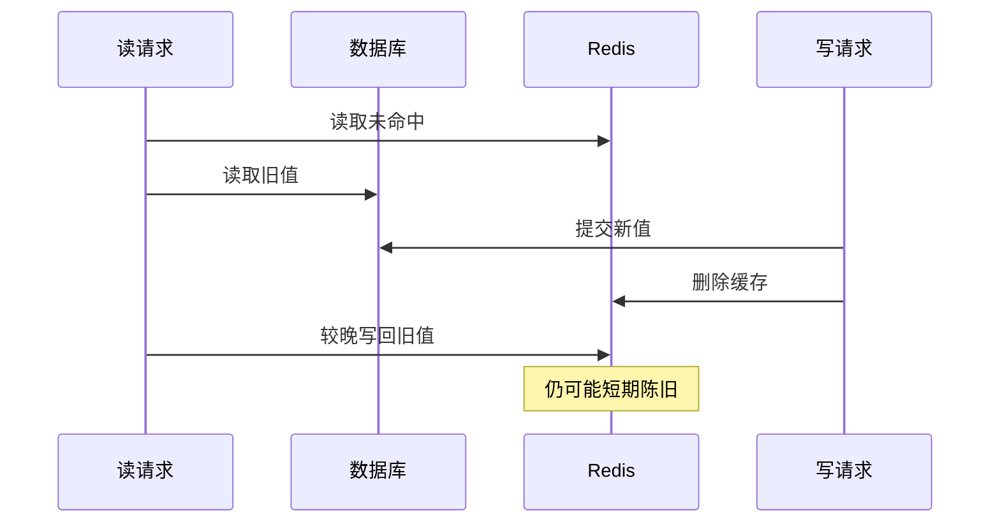

# Redis 序列化、缓存策略与一致性

缓存把读取转移到更便宜的位置，同时引入第二份数据。命中率高不等于业务正确，数据库更新后旧值仍被返回，往往是写入顺序与并发边界的问题。

## 1. 接入对象分别负责什么

添加 `org.springframework.boot:spring-boot-starter-data-redis`，由 Boot 管理 Spring Data Redis 与客户端版本。ConnectionFactory 管连接资源，RedisTemplate 管命令和序列化，CacheManager 把缓存抽象映射到 Redis。

```properties
spring.data.redis.host=127.0.0.1
spring.data.redis.port=6379
spring.data.redis.connect-timeout=1s
spring.data.redis.timeout=500ms
spring.cache.type=redis
spring.cache.redis.time-to-live=5m
spring.cache.redis.cache-null-values=false
```

这是本地独立 Redis 的接入片段，不在任务实验中自动启用；远程服务还需 TLS、认证、拓扑和网络策略。连接超时与命令等待不同，池参数是否生效取决于客户端及池化配置。

## 2. 键与值是协议

可先用 StringRedisTemplate 明确观察存储内容。下面是方法主体节选，假设已注入 template、Boot JsonMapper 与仓储：

```java
String key = "lab:task:v1:" + trustedTenant + ":" + taskId;
String cached = template.opsForValue().get(key);
if (cached != null) return mapper.readValue(cached, TaskView.class);
TaskView result = repository.findVisible(trustedTenant, taskId);
if (result != null) {
    template.opsForValue().set(key, mapper.writeValueAsString(result),
        java.time.Duration.ofMinutes(5));
}
return result;
```

它展示读穿与 JSON，不包含击穿保护、错误策略与并发一致性。Cache 抽象将动作放在代理，需启用缓存、配置 CacheManager 并明确 `@Cacheable` 键；两种方式都不能省略租户。

字符串键可采用 `环境:业务:缓存版本:租户:对象ID`。必须包含真实影响结果的身份/权限维度，不能让不同租户共用同一个对象键。版本前缀利于迁移，也会短期增加容量和回源。

值采用明确 schema 和类型，不把任意 Java 序列化对象当长期跨版本协议。JSON 改字段、日期、枚举同样需要兼容。显式选择序列化器，别以为 RedisTemplate、StringRedisTemplate 和 RedisCache 默认格式相同。

## 3. cache-aside 的并发窗口



先提交数据库再失效缓存，避免回滚事务却提前改变缓存，但仍有图示竞争。TTL、带版本更新、可靠失效事件、读写隔离和业务容忍窗口共同决定方案。延迟双删不是无条件强一致证明。

`@Cacheable` 依赖代理，默认代理模式的自调用可能不拦截。`sync=true` 不应直接理解为跨所有实例的全局锁。事务感知缓存会改变执行时机，但不把数据库与 Redis 变成分布式原子事务。[Redis Cache 行为](https://docs.spring.io/spring-data/redis/reference/redis/redis-cache.html)

## 4. 穿透、击穿与雪崩

不存在的 ID 大量回源，可短 TTL 缓存空结果或先做输入约束；热点键同时失效，可合并加载或有界锁；大批同刻过期，可用 TTL 抖动和分批预热。保护回源并发比单纯增加 Redis 内存更重要。

降级也需要边界：权限、余额等数据不应无条件用任意陈旧值。缓存不可用时全量直打数据库，可能把一个故障变成两个；限流、短路和本地有限缓存要按业务选择。

## 5. 验证与观测

验证序列化往返、租户键隔离、旧 schema、新旧版本并行、提交回滚、删除失败重试和图示竞争。记录 hit/miss、加载时间、键数、内存、eviction、错误、回源并发，避免把用户 ID 作为指标标签。

本文无本机 Redis 联调结果；在独立测试服务运行上述矩阵，不向已有业务 Redis 写入实验键。

## 6. 练习与答案

### 6.1 TTL 能保证提交后立即读到新值吗

不能，它限制部分陈旧时间，不保证更新瞬间一致。

### 6.2 为什么缓存键需要租户

相同对象 ID 在不同租户或权限下结果可能不同，不隔离可能泄露数据。

### 6.3 Redis 故障后绕过缓存一定更安全吗

不一定，瞬间回源可能打垮数据库，需要并发保护和业务化降级。

## 7. 后续

- [事务与外部副作用](../03-data/06-业务事务Outbox与外部副作用.md)
- [Boot Redis 支持](https://docs.spring.io/spring-boot/reference/data/nosql.html#data.nosql.redis)
