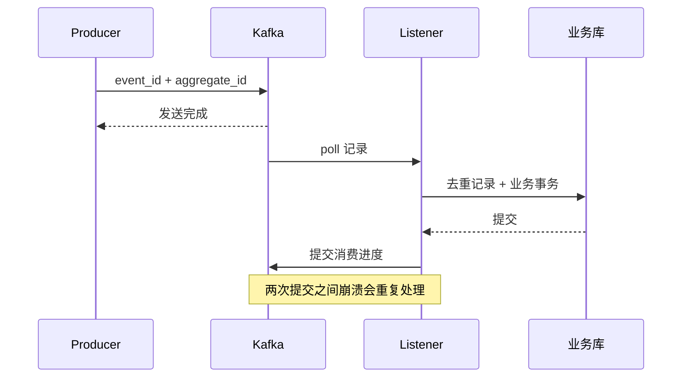

# Kafka 发送、消费、提交、重试与幂等

Kafka 的三个“成功”不是一回事：生产者收到发送结果、消费者提交数据库、消费组提交 offset。理解它们的先后，才能解释重复与丢处理。

## 1. Boot 的接入边界

Boot 4 工程可使用 `spring-boot-starter-kafka`，具体模块和版本由当前 BOM 确认；不要强行混入旧版 spring-kafka。KafkaTemplate 负责发送，ListenerContainer 管 poll、线程、错误处理和提交。

```properties
spring.kafka.bootstrap-servers=127.0.0.1:9092
spring.kafka.consumer.group-id=task-workers
spring.kafka.consumer.enable-auto-commit=false
spring.kafka.listener.ack-mode=record
spring.kafka.consumer.auto-offset-reset=earliest
spring.kafka.consumer.key-deserializer=org.apache.kafka.common.serialization.StringDeserializer
spring.kafka.consumer.value-deserializer=org.apache.kafka.common.serialization.StringDeserializer
spring.kafka.producer.key-serializer=org.apache.kafka.common.serialization.StringSerializer
spring.kafka.producer.value-serializer=org.apache.kafka.common.serialization.StringSerializer
spring.kafka.producer.acks=all
spring.kafka.producer.properties.enable.idempotence=true
```

这是单 broker 实验连接片段。生产还要明确 TLS/SASL、topic 分区、副本、最小同步副本和配额。earliest 只在无有效已提交 offset 等条件下生效，不是每次重启重读所有数据。[Boot Kafka 集成](https://docs.spring.io/spring-boot/reference/messaging/kafka.html)

## 2. 数据与 offset 的时间线



生产者幂等主要约束特定生产会话/协议内重复发送，不等于消费者数据库副作用恰好一次。Kafka 事务的 exactly-once 也有明确作用域，不能自动覆盖任意外部数据库或 HTTP。

## 3. listener 的执行边界

发送不能调用后丢弃结果。持有 `KafkaTemplate<String,String>` 的组件可观察 Future：

```java
template.send("task-events", aggregateId, jsonEvent)
    .whenComplete((result, error) -> {
        if (error != null) recordSendFailure(eventId, error);
        else recordBrokerAccepted(eventId);
    });
```

回调不能复用未知线程中的调用方事务。两个 record 方法是待实现的业务操作，不代表已可靠更新 Outbox，其失败也要能恢复。同步等待 Future 同样需有限时。

监听方法解析 schema 后调用同步、幂等、带事务的 Service，不要 fire-and-forget 立即返回。event_id 随业务传递，用于重复处理，不只依靠当前 offset。

一个消费组同一分区通常由一个消费者负责，因此 concurrency 大于分区数不会线性增加有效消费。把记录交给后台线程后立即返回，容器可能认为处理成功并推进进度，崩溃时任务却没完成。

若处理过慢，poll 间隔超过配置可能触发重平衡。调大 max.poll.interval 只能改变检测窗口，不解决无限慢处理。要限制单批大小、工作时间，并采用与提交语义一致的并发模型。

## 4. 重试、毒消息与顺序

短暂故障可有界退避；业务不合法、反序列化失败要分类，避免无限重试堵死分区。转重试 topic/死信可能改变同键事件顺序，消费者应检查业务版本和允许迁移。

ACK/offset 模式和错误处理器要一起验证；抛异常、捕获后吞掉、恢复器处理完各代表不同进度行为。死信也必须可监控、可重放、可去重，不是“丢进去就解决”。

## 5. 验证矩阵

独立 broker 测：发送结果异常、业务提交前崩溃、提交后 offset 前崩溃、重平衡、毒消息、重放和乱序。观察 lag、最老消息年龄、处理时长、重试和重复，lag=0 也可能意味着消息被错误跳过。

当前 service-lab 只验证本地 Outbox，不启动 Kafka。容器配置说明见 [Spring Kafka 提交模式](https://docs.spring.io/spring-kafka/reference/kafka/receiving-messages/message-listener-container.html)。

## 6. 练习与答案

### 6.1 生产者 acks=all 说明业务处理成功吗

不说明，它属于消息写入确认；消费和数据库是后续链路。

### 6.2 先提交 offset 再写业务会怎样

中间崩溃可能永久跳过尚未完成的业务处理。

### 6.3 重试 topic 为什么影响顺序

失败消息离开原分区处理路径，后续消息可能先完成；需明确顺序要求与版本校验。

## 7. 延伸

- [Outbox](../03-data/06-业务事务Outbox与外部副作用.md)
- [Kafka 官方设计](https://kafka.apache.org/documentation/#design)
