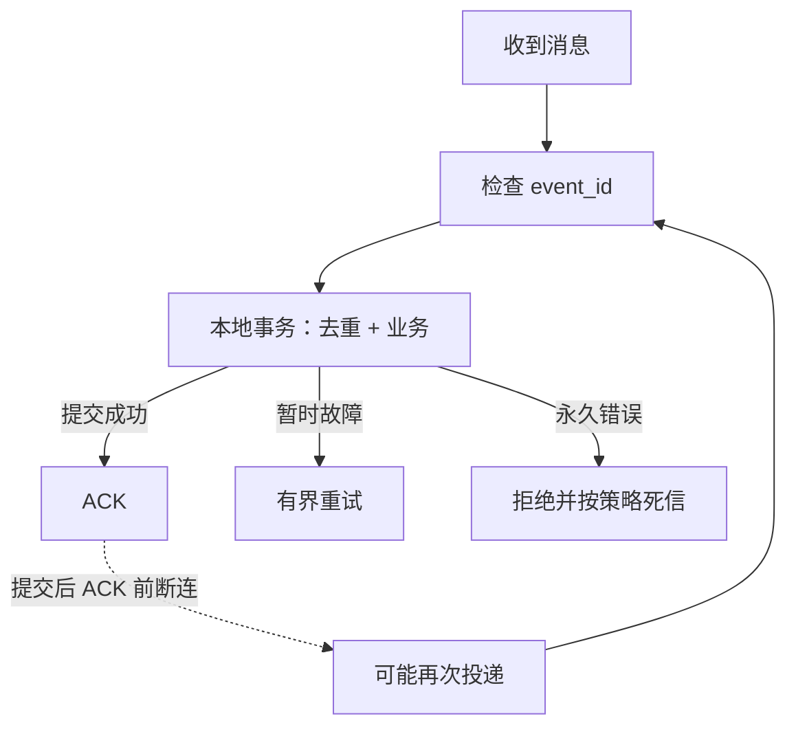

# RabbitMQ Confirm、ACK、死信与重复投递

消息成功到达交换器，不代表路由到了队列；路由到队列，也不代表消费者数据库提交。可靠性需要分别确认这些边界。

## 1. 交换器、队列与客户端

引入 `spring-boot-starter-amqp`，RabbitTemplate 发消息，监听容器管理连接、信道和消费。交换器按 binding 路由，队列承载等待处理的数据；双方声明的名称、类型、持久化参数必须一致。

```properties
spring.rabbitmq.host=127.0.0.1
spring.rabbitmq.port=5672
spring.rabbitmq.publisher-confirm-type=correlated
spring.rabbitmq.publisher-returns=true
spring.rabbitmq.template.mandatory=true
spring.rabbitmq.listener.simple.acknowledge-mode=auto
spring.rabbitmq.listener.simple.prefetch=20
```

是隔离实验配置片段，需自行建立账号、vhost、交换器和队列；生产不能使用默认凭据。simple 配置只适用于相应监听容器，不可直接套给 direct。[Boot AMQP 集成](https://docs.spring.io/spring-boot/reference/messaging/amqp.html)

## 2. 三种结果

| 机制 | 回答的问题 | 不能证明 |
| --- | --- | --- |
| Publisher Confirm | Broker 是否接受发布 | 已被业务消费 |
| mandatory Return | 消息是否无法路由到队列 | 消费成功 |
| Consumer ACK | 当前交付是否完成 | 其他外部副作用原子性 |

无法路由的消息在一些配置下仍可获得发布确认，必须同时处理 Return。持久化消息、耐久队列、复制类型与确认机制需一起考虑。[RabbitMQ 确认语义](https://www.rabbitmq.com/docs/confirms)

## 3. ACK 与事务



Spring 容器 AUTO ACK 通常由监听方法成功/失败结果决定，不等于 broker 的自动无确认消费模式。手动 ACK 也不会自动解决数据库原子性；不能处理前先 ACK，更不能吞异常让框架误判成功。

## 4. prefetch、重投与死信

prefetch 限制未确认交付，可避免单消费者囤太多，但总占用还取决于消费者数、消息大小和处理时间。不是越大越好：失败恢复和尾延迟也会变差。

立即 nack/requeue 同一毒消息会热循环。区分可重试/永久错误，采用退避、次数限制与死信。DLX 要检查权限、目标存在和队列类型对应的可靠性；“进入死信流程”不能无条件保证永不丢失。

消息具有 event_id、业务键、schema 版本和必要追踪字段，不在 body 中塞任意 Java 类名作为长期协议。

## 5. 验证与排障

测试无绑定路由、Broker 断开、发布确认超时、消费提交后断连、毒消息和死信重放。记录 ready、unacked、消费速率、重投递、Return、确认时间和最老年龄。

ready 低、unacked 高常意味着消费者已拿走但未完成；可先检查慢 SQL、锁与下游，不先扩队列。本文未在本机运行 RabbitMQ，不把配置片段等同端到端实测。

## 6. 练习与答案

### 6.1 Confirm 成功而消息没进队列可能吗

可能，例如未匹配路由，需处理 mandatory Return。

### 6.2 AUTO 模式是不是收到就立即 ACK

不能这么理解，容器通常依据监听调用结果确认；需按实际容器和事务设置验证。

### 6.3 消费速度慢时把 prefetch 调到一万好吗

不一定，会增加囤积、内存和重放范围；先定位处理瓶颈并测合适并发。

## 7. 关联

- [Spring AMQP 监听容器](https://docs.spring.io/spring-amqp/reference/amqp/receiving-messages/async-consumer.html)
- [事务与消息箱](../03-data/06-业务事务Outbox与外部副作用.md)
