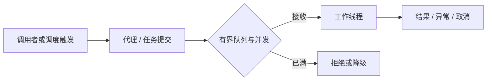

# Async、Scheduled 与后台任务资源管理

异步只把工作从一条执行路径交给另一条，不会让工作量消失。队列无限增长时，HTTP 返回很快也可能只是把故障延后成 OOM。

## 1. 三个不同的组件

`@EnableAsync` 启用相应代理，`@Async` 把调用交给 Executor；`@EnableScheduling` 注册调度设施，`@Scheduled` 定义触发。Scheduler 决定何时触发，Executor 决定何处运行；不是所有调度都默认用同一个业务池。



代理模式的同类自调用可能绕过 Async。调用线程的事务不会自动跨线程传播；后台任务应建立自己的事务，传 ID 或不可变数据，不传带懒加载上下文的实体。

## 2. 显式拥有一个执行器

```java
@Bean("taskExecutor")
ThreadPoolTaskExecutor taskExecutor() {
    var pool = new ThreadPoolTaskExecutor();
    pool.setCorePoolSize(2);
    pool.setMaxPoolSize(4);
    pool.setQueueCapacity(20);
    pool.setThreadNamePrefix("task-work-");
    pool.setWaitForTasksToCompleteOnShutdown(true);
    pool.setAwaitTerminationSeconds(10);
    return pool;
}
```

这是配置类中的 Bean 片段，需要 Task Execution 导入、EnableAsync 及调用方。Spring 管理初始化和销毁，不手工重复 initialize。队列满后如何拒绝要显式理解；CallerRuns 可能让 HTTP 请求线程执行重活，并非无代价。

Boot 的虚拟线程与自动配置会改变默认执行器选择，应检查实际 Bean，不凭旧文档猜。[Boot 任务执行与调度](https://docs.spring.io/spring-boot/reference/features/task-execution-and-scheduling.html)

## 3. 错误与上下文

void 异步方法异常不能像同步调用那样由调用方 catch；应有异常处理和业务状态。Future/CompletableFuture 需要观察完成，不能创建后丢弃。

MDC、安全身份、租户和 trace 不应依赖线程池里残留的 ThreadLocal；通过受控装饰器/上下文机制捕获、设置、finally 清理。传播上下文不是传播数据库连接或扩大权限。

## 4. 定时任务的时间语义

fixedDelay 通常在前次完成后等待，fixedRate 按时间基准触发；cron 受时区与日历影响。实际并发还取决于 scheduler、方法是否又异步转交、任务数量和实现。不要把名字理解为全局不重叠保证。

每个应用副本都可能执行同一 @Scheduled。需要单次全局任务时，选择明确的调度系统、数据库领取或租约协议，并处理持有者失联、时钟、重复和 fencing；仅在代码里加 synchronized 无法跨 Pod。

## 5. 有界后台任务与退出

请求内临时异步和可靠业务任务不同。进程崩溃会丢内存队列，可靠任务先持久化，再用可重领状态和幂等执行。停机先停触发和接收，再限时完成/取消并归还资源。

验证队列满、任务抛异常、取消、停机超时、两副本重复触发和上下文串租户。检查 submitted/completed/rejected、队列长度和最老等待时间，不只看线程数。

## 6. 练习与答案

### 6.1 @Async 方法能继续使用调用方事务吗

通常不能，线程事务绑定不自动跨线程，应在工作线程建立边界。

### 6.2 两个副本为什么各执行一次定时任务

调度注册发生在每个应用进程，框架默认不是分布式单例调度器。

### 6.3 HTTP 返回 202 是否说明任务可靠保存

不说明，若只进内存队列，进程崩溃仍会丢失；需持久化与恢复协议。

## 7. 延伸

- [Java 线程池与拒绝](../../java/03-concurrency/06-线程池队列拒绝与关闭.md)
- [Spring 调度机制](https://docs.spring.io/spring-framework/reference/integration/scheduling.html)
- [Quartz 触发、恢复与集群语义](../../java-components/06-jobs/quartz/01-调度模型触发领取持久化与集群语义.md)
- [Spring Batch 分块、检查点与恢复](../../java-components/06-jobs/spring-batch/01-作业身份分块事务检查点与恢复原理.md)
