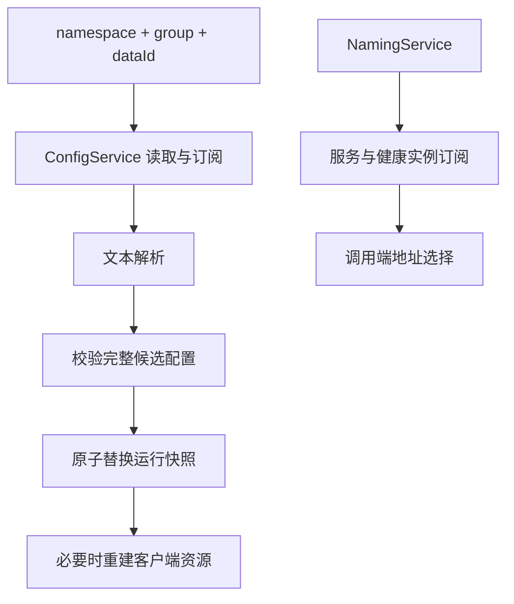

# Nacos 配置、服务发现与客户端生命周期

配置中心回答“应用应该如何运行”，注册中心回答“哪些实例可供调用”。两者可以都由 Nacos 提供，但数据、客户端、权限和失败策略不同。

## 1. 不先假定 Starter 兼容

当前系列基线是 Boot 4.1.1。Spring Cloud、Spring Cloud Alibaba、Nacos SDK 各有版本矩阵，不能复制 Boot 2/3 的 bootstrap 配置后宣称支持 Boot 4。没有验证矩阵时，可先理解原生 SDK 路径，而不是强制覆盖一堆传递依赖。

[Nacos Java SDK 文档](https://nacos.io/en/docs/latest/manual/user/java-sdk/usage/)包含原生接入和 3.x namespace 变化提示。SDK 最低 JDK 要求不等于整个组合已在 JDK 25 验证；服务端/客户端协议、认证、gRPC 端口仍需测试。

## 2. 配置定位与传播



namespace 常用于环境隔离，group/dataId 表达分组与配置名；具体权限必须在服务端控制，不能只靠命名习惯。收到文本变化不意味着现有 Bean 已重新绑定，更不意味着数据库池、TLS 客户端自动重建。

动态配置先解析到候选对象，校验后整体替换，失败保留最后有效版本。逐字段修改共享对象可能让一个请求看到混合版本；高风险参数不应允许未经限制实时改动。

## 3. 原生 SDK 的最小操作

以下是需要相应 nacos-client 依赖和导入的方法片段，不是可直接运行的 Boot 应用：

```java
Properties properties = new Properties();
properties.setProperty("serverAddr", "127.0.0.1:8848");
properties.setProperty("namespace", "learning");
ConfigService config = NacosFactory.createConfigService(properties);
try {
    String text = config.getConfig("task-service.properties", "LAB", 3000);
    if (text == null) throw new IllegalStateException("required config missing");
    // 解析并校验 text，再交给业务；不能直接执行配置文本。
} finally {
    config.shutDown();
}
```

认证从安全配置提供，不在源码放口令。持续订阅时客户端应作为单例生命周期资源，记录 Listener 并在退出时移除/关闭，不能每次请求创建一个。

## 4. 发现不等于请求可达

实例注册包含服务名、地址、端口及相应属性。临时/持久实例的健康机制按当前服务端/客户端模式确认，不能简单把所有版本都说成同一种心跳实现。

注册成功不代表 Pod 网络、Service、TLS 和应用就绪都正常。注册地址若是其他网络不可达的容器 IP，健康列表里存在也无法调用。调用方要理解本地订阅缓存和故障恢复窗口。

## 5. 断开与停机

配置中心不可用时，是启动失败、使用受控本地配置，还是继续最后有效值，要按配置性质决定；密钥撤销与普通显示参数不能同策略处理。

退出时先停止接收新请求，按实际注册方式注销/摘除，再完成在途调用并关闭 SDK。强杀时不会执行所有回调，健康机制仍要兜底。

独立验证服务端断开、订阅恢复、非法配置、权限拒绝、实例下线及两环境隔离。本文不宣称本机已联调 Nacos 或某套 Cloud Starter。

## 6. 练习与答案

### 6.1 配置更新后 DataSource 一定自动切地址吗

不一定。需要明确绑定、刷新与资源重建机制，还要处理在用连接，不能只看配置中心已发布。

### 6.2 注册实例健康说明用户一定访问成功吗

不说明，用户路径还包括网络、网关、TLS、应用和依赖。

### 6.3 SDK 每请求创建再关闭可以吗

不宜，连接、线程与订阅成本很高；应按应用生命周期管理。

## 7. 参考资料 {/* #7-参考 */}

- [Nacos 文档](https://nacos.io/en/docs/latest/)
- [Boot 配置优先级](../01-startup-configuration/05-配置优先级属性绑定校验与多环境.md)
