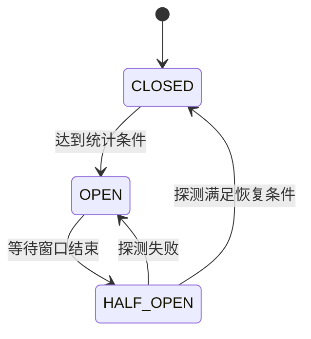

# Resilience4j 的熔断、隔离、限流与时间预算

下游变慢时，只加重试会增加请求；只加超时可能仍留下后台工作；只加熔断又不能限制瞬间并发。不同保护器解决不同问题。

## 1. 五种机制

| 组件 | 限制对象 | 关键误区 |
| --- | --- | --- |
| Retry | 尝试次数、退避与可重试错误 | 把业务拒绝也重试 |
| CircuitBreaker | 根据结果窗口暂停调用 | 以为它限制并发 |
| Bulkhead | 同时执行/排队工作 | 隔离池仍无界 |
| RateLimiter | 时间窗口或周期内许可 | 等同最大在途数 |
| TimeLimiter | 等待异步结果的时间 | 以为远端自动停止 |

每个组件都有独立状态和指标；少量流量时的最小样本数也影响熔断，不是第一次失败就一定打开。

## 2. 熔断状态



CLOSED 允许调用并统计；OPEN 快速拒绝；HALF_OPEN 允许有限探测。慢调用率与错误率也不同：请求最终成功但耗时过长，仍可能是风险信号。

## 3. 装饰顺序改变含义

```text
总 deadline
  → 限流 / 隔离许可
    → 重试控制
      → 熔断结果记录
        → 单次有界下游调用
```

这是一个待验证的策略示例，不是唯一正确顺序。熔断在 Retry 内侧，可能统计每次尝试；外侧可能只统计最终逻辑结果。隔离在外侧可能让退避也持有许可，内侧则每次尝试重新竞争。注解外观相同不能证明实际 AOP 顺序符合预期。

先把保护策略写成可观察的函数组合，再测试次数、统计和并发；不要叠五个注解后靠猜。

## 4. Boot 4 兼容边界

[Resilience4j 的 Boot 指南](https://resilience4j.readme.io/docs/getting-started-3)展示的模块包含明确的 Boot 版本名称。不能把 boot3 Starter 直接宣称为 Boot 4.1.1 的已验证适配。可选用兼容确认后的 Starter，或使用核心模块的程序式装饰，把 Spring 集成与库能力分开验证。

核心 CircuitBreaker 的典型程序式形状如下，依赖版本需固定：

```java
var breaker = CircuitBreaker.ofDefaults("inventory");
Supplier<String> guarded = CircuitBreaker.decorateSupplier(breaker, this::callInventory);
String result = guarded.get();
```

这是节选，需引入核心模块与 Supplier，callInventory 必须自己有超时；熔断器不会自动给同步函数增加截止时间。

## 5. 降级不是伪造成功

可以返回缓存、排队或明确暂不可用，但支付、权限等操作不能用随意默认值假装成功。降级结果应有清楚业务语义，避免监控被 200 掩盖。

区分拒绝许可、熔断拒绝、业务异常、网络失败和超时；重试只覆盖真正可恢复且幂等的情况。一个服务十副本各自限流 100，不是全局 100，分布式配额需另一层协调。

## 6. 验证矩阵

用本地可控调用测试正常、持续失败、慢成功、半开竞争、并发超过许可、取消后资源回落，以及 1 秒总预算内的最大尝试数。断言真实调用次数，而不只断言返回值。

当前任务实验未引入 Resilience4j，不能将本文机制分析理解为所有装饰器已在本机联调。

## 7. 练习与答案

### 7.1 熔断能防止一万个请求同时进下游吗

不一定，在统计触发前可能同时进入，需要 Bulkhead 等并发上限。

### 7.2 TimeLimiter 到期就终止 SQL 吗

不保证。需将取消传递给底层驱动/操作并确认支持，等待结束不等于工作停止。

### 7.3 为什么业务校验失败不应大量重试

相同输入通常不会因重试变合法，只增加负载；应立即给可解释结果。

## 8. 关联

- [HTTP 客户端时间预算](../02-web/06-HTTP客户端连接池超时重试与取消.md)
- [Resilience4j 核心熔断器](https://resilience4j.readme.io/docs/circuitbreaker)
