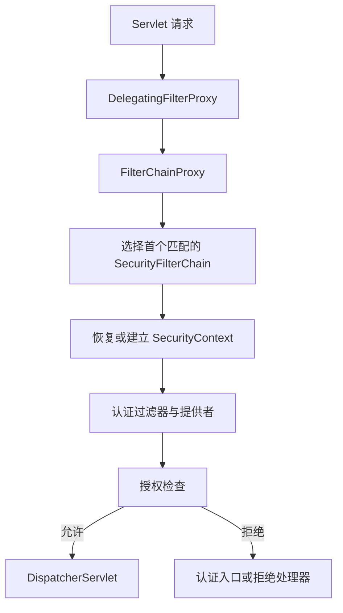

# Spring Security 过滤器链与认证授权

认证回答“你是谁”，授权回答“你能对什么做什么”。登录成功不意味着可读任意任务，返回 403 也不一定说明密码错误。

## 1. 请求如何进入安全链



一条请求选中首个匹配的安全链，不是把所有链顺序执行。链内过滤器顺序有语义，不应随意把自定义认证过滤器加到所有位置。[Spring Security 架构](https://docs.spring.io/spring-security/reference/servlet/architecture.html)

## 2. 认证对象由谁建立

过滤器从 Basic、Bearer、Session 等提取凭据，交给相应 AuthenticationManager/Provider。UserDetailsService 通常提供用户信息，不是独立完成全部认证的组件。

认证后的 Authentication 包含主体与权限，进入 SecurityContext。不要把客户端传入的 `X-User` 或 `X-Tenant` 直接变成可信身份；若上游代理提供身份，必须有可靠信任边界、签名/认证及防伪造路径。

## 3. 显式定义默认拒绝

配套 `SecurityConfiguration` 的核心节选：

```java
return http.authorizeHttpRequests(auth -> auth
    .requestMatchers("/actuator/health", "/actuator/health/**").permitAll()
    .requestMatchers("/actuator/**", "/api/admin/**").hasRole("ADMIN")
    .anyRequest().authenticated())
    .httpBasic(Customizer.withDefaults()).build();
```

这是方法内部片段，完整类在 service-lab。健康端点公开不意味着详细依赖信息公开；metrics 等仅管理员可读，实验没有管理员账号，可由安全测试构造相应权限。

`hasRole("ADMIN")` 通常对应 `ROLE_ADMIN`，与任意字符串 authority 不同。规则按声明顺序匹配，宽泛 allow 放前面可能遮蔽后续限制。

## 4. 多链与方法权限

可为 API 与浏览器页面建立不同链，但要明确 securityMatcher 的覆盖范围与最后兜底链。没有任何链匹配的路径可能绕过预期保护，不能只测试已知业务 URL。

URL 规则保护入口，方法权限保护应用调用边界，数据层条件保护对象范围。后台任务、内部调用或新接口可能绕过某一入口，因此敏感规则不能只写在页面按钮是否显示上。

## 5. 401、403 与异常处理

缺失/无效身份通常由认证入口产生 401 或浏览器重定向；已有身份但权限不足常为 403，CSRF 拒绝也可能是 403。要结合过滤器与日志判断，不只看数字。

MVC Advice 不是所有安全异常的统一出口。需要 JSON 错误时配置 AuthenticationEntryPoint/AccessDeniedHandler，保证不泄露凭据且带关联 ID。

## 6. 验证

service-lab 验证无身份 401、真实 Basic 密码、错误密码、普通用户访问 metrics 403、CSRF、跨租户读取和伪造租户头。带 user 的 MockMvc 测试绕过密码认证本身，所以另有 httpBasic 测试。

## 7. 练习与答案

### 7.1 permitAll 是否完全绕开过滤器

不一定，它主要是授权规则，其他安全过滤器仍可能工作。完全忽略请求与允许匿名访问不是同一概念。

### 7.2 两条安全链都匹配时会怎样

选择按顺序首个匹配的链，不会把两条链的规则自动合并。

### 7.3 有 ROLE_USER 能读全部用户数据吗

不能，角色只是粗粒度权限，还要对象所有权、租户与业务状态检查。

## 8. 下一步

- [Session 与密码](./02-Session密码存储与安全上下文.md)
- [方法权限与租户](./06-方法权限多租户与安全测试.md)
