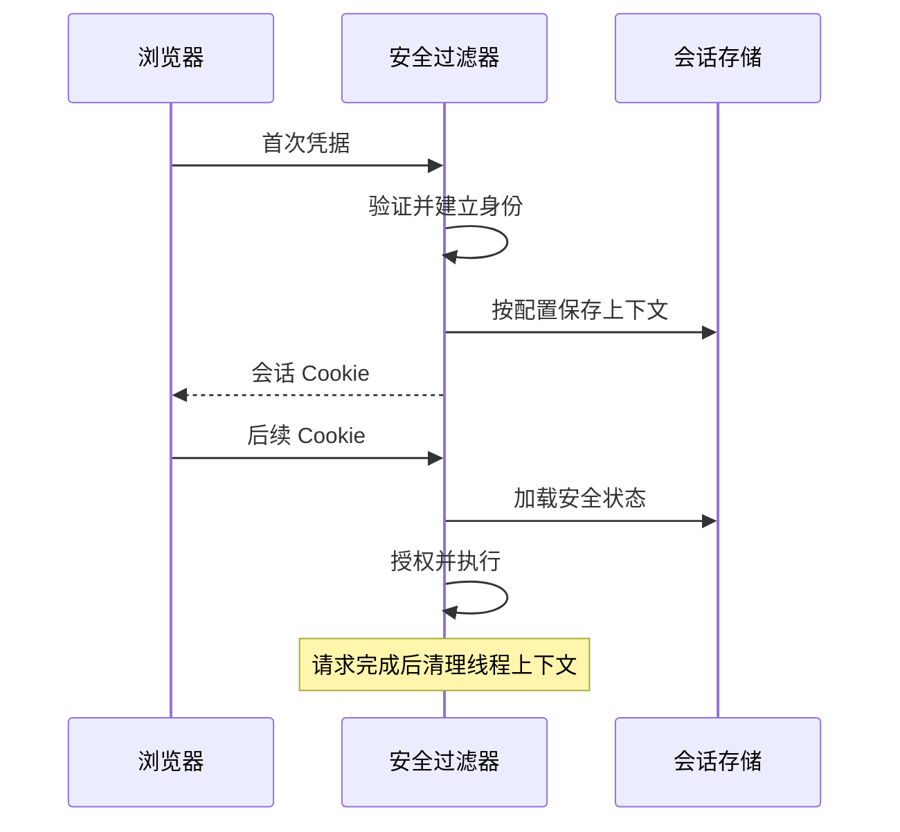

# Session、密码存储与安全上下文

密码用于证明身份，会话用于让后续请求关联到已经建立的身份，SecurityContext 是框架处理当前安全状态的载体。三者不能混为一个“登录 Token”。

## 1. 密码如何验证

不保存明文，不用可逆加密代替密码散列，也不用简单 SHA-256 当作口令存储方案。使用带盐、可调整成本的专用算法，成本按硬件和登录负载校准。

```java
PasswordEncoder encoder = PasswordEncoderFactories.createDelegatingPasswordEncoder();
String encoded = encoder.encode(rawPassword);
boolean matches = encoder.matches(candidate, encoded);
```

需要 Spring Security 对应导入。每次 encode 结果可能不同，不能把新散列与旧字符串直接比较。DelegatingPasswordEncoder 的格式支持算法标识，便于逐步升级已有口令。[密码存储](https://docs.spring.io/spring-security/reference/features/authentication/password-storage.html)

限制登录速率、保护找回流程、避免日志输出密码同样必要。改用昂贵散列后没有限流，攻击流量可能消耗大量 CPU。

## 2. Session 保存的是什么

浏览器携带会话 Cookie，服务器按会话查找状态。认证成功时通常需要防止会话固定，退出时清理安全状态与相关会话；密码修改、账号禁用和会话撤销策略要明确。



保存路径因认证方式与配置不同。手动把 Authentication 放入线程本地变量，不保证后续请求自动持久保存，应使用正确的 SecurityContextRepository 和认证流程。

## 3. 多实例会话

单机内存 Session 在 Pod 替换后可能丢失；粘性会话只改善路由，不保证节点故障恢复。使用 Spring Session + Redis 等共享存储时，要考虑序列化、过期、容量、跨版本与存储故障策略。

共享会话不等于所有用户数据都应该进 Session。只保存必要状态，避免巨大对象图、数据库实体和凭据；会话存储也可能成为高频依赖。

## 4. 安全上下文与线程

Servlet 请求通常在相应上下文策略中处理身份，请求结束要清理。线程池复用时，随意遗留 ThreadLocal 可串用户。异步工作应传递明确主体与授权意图，或采用框架支持的委托执行器，finally 恢复/清理。

继承线程本地变量不能自动适配所有线程池；任务提交时和真正执行时用户权限可能已变化，长任务应决定是否重新授权。

## 5. Basic、Session 与 JWT 不混用结论

实验使用环回 Basic 账号展示真实密码验证，同时保留 CSRF。生产 Basic 必须在 TLS 与明确场景下使用，不能因凭据用 Base64 就认为加密。

JWT 不自动解决退出撤销；Session 也不是落后方案。取舍取决于客户端类型、撤销要求、跨域、身份提供方和依赖成本。

## 6. 验证要点

测试登录前后会话标识、退出后旧会话、密码修改后的策略、多实例切换、过期、权限变化以及并发任务串身份。不要把“拿到 Cookie”当成所有安全边界已通过。

## 7. 练习与答案

### 7.1 盐需要像密码一样保密吗

盐通常和散列一起保存，用于避免相同密码产生相同结果及预计算攻击；它不代替密码、算法成本和存储访问控制。

### 7.2 Redis Session 能避免所有下线吗

不能，还取决于过期、清理、兼容、网络和应用对撤销的策略。

### 7.3 异步任务可以直接复用请求线程的上下文吗

不能默认复用。必须显式、受控地传递并清理，还要判断任务执行时的权限有效性。

## 8. 关联

- [ThreadLocal 与上下文](../../java/03-concurrency/08-ThreadLocal-ScopedValue与上下文.md)
- [Spring Session](https://docs.spring.io/spring-session/reference/)
