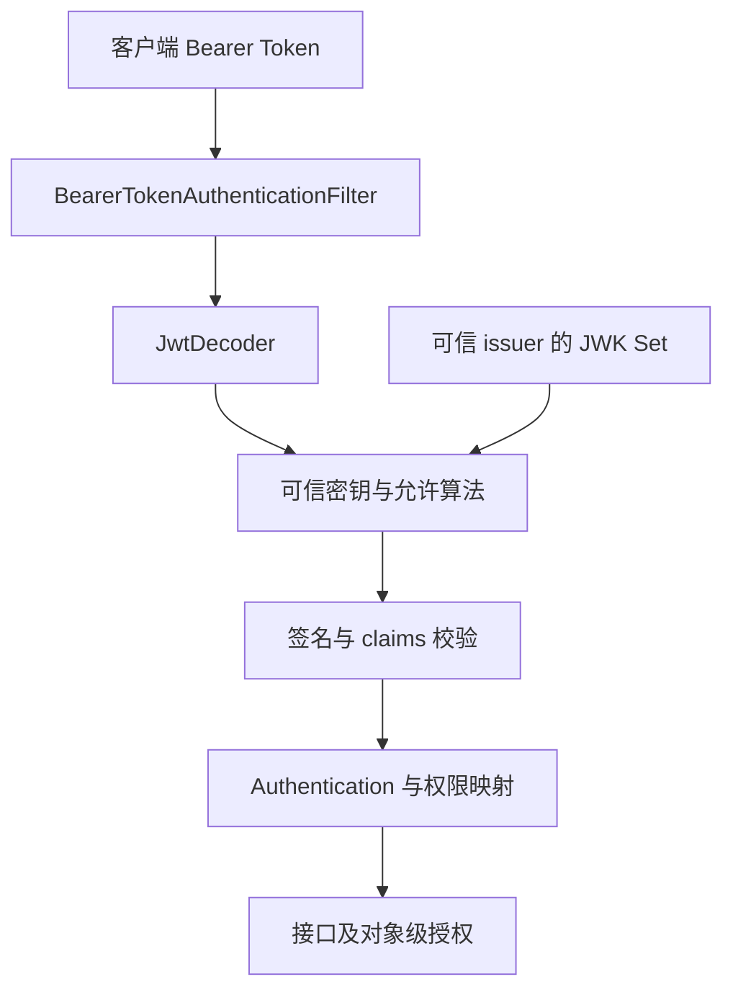

# JWT Resource Server、声明、签名与密钥

JWT 是一种 Token 表达格式，不是“有三段字符串就安全”。Base64 解出 claims 只表示可以读，验证才回答它是否来自可信签发者、是否用于当前服务、是否仍有效。

## 1. 资源服务器不是签发服务器



资源服务器保护 API，授权服务器签发 Token。不要在业务服务手写“解析一下 sub 就登录”，也不要从 Token 自带的任意 URL 下载密钥。

## 2. Boot 接入

使用 `spring-boot-starter-oauth2-resource-server`，配置可信 issuer：

```properties
spring.security.oauth2.resourceserver.jwt.issuer-uri=https://id.example.invalid
spring.security.oauth2.resourceserver.jwt.audiences[0]=task-api
```

这是需要真实身份提供方的配置片段，域名为占位符。对应安全链开启 `oauth2ResourceServer(oauth -> oauth.jwt(Customizer.withDefaults()))`。单独添加依赖不等于所有 API 权限已设计完成。

同时指定可信 JWK 地址可改变发现依赖路径，但仍需校验 issuer。启动期/首次请求是否访问发现与密钥端点，应以具体配置与版本验证。[JWT 资源服务器](https://docs.spring.io/spring-security/reference/servlet/oauth2/resource-server/jwt.html)

## 3. 必须核验的 claims

资源服务器可按操作映射 scope，例如以下配置方法节选；它用于独立 API 安全链，不应和实验 Basic 链不加区分地叠加：

```java
http.authorizeHttpRequests(auth -> auth
    .requestMatchers(HttpMethod.GET, "/api/tasks/**").hasAuthority("SCOPE_task:read")
    .requestMatchers("/api/tasks/**").hasAuthority("SCOPE_task:write")
    .anyRequest().denyAll())
    .oauth2ResourceServer(oauth -> oauth.jwt(Customizer.withDefaults()));
```

需要 HttpMethod、Customizer 和 HttpSecurity 的导入及完整 Bean。健康检查与其他路径由另外明确的规则/链保护；此处故意默认拒绝未列路径。Token 验证与 scope 通过之后，仍要租户和对象级授权。

`iss` 是签发者，`aud` 是目标受众，`exp` 是到期，`nbf` 是尚未生效，`sub` 是主体。检查签名但忽略 audience，可能接受原本签给另一服务的 Token。

时钟偏移容忍应有限且服务时间同步。Token 中租户/角色也要来自可信签发和明确映射，不能把任意 claim 原样当管理员。scope 常映射为 `SCOPE_` 前缀权限，与 ROLE_ 不同。

访问令牌和 OIDC ID Token 用途不同，API 不应因 ID Token 签名正确就当访问授权。

## 4. 密钥轮换与撤销

kid 帮助选择验证密钥，但它不是信任证明。新旧密钥重叠窗口应覆盖有效 Token 与缓存；旧密钥过早撤下会导致仍有效请求失败。密钥不可用、算法不匹配和未知 kid 应可区分诊断。

自包含 Token 通常不能仅凭“退出”立即让所有资源服务器忘掉它。可用短有效期、撤销机制、会话/版本校验或 opaque token introspection，取舍依业务而定。不要为追求无状态牺牲必要撤销能力。

## 5. 测试分层

MockMvc 的 jwt 请求支持可以验证授权映射，不证明签名验证。解码器测试应使用隔离生成的密钥和固定时钟，覆盖错签名、错 issuer/audience、过期、未生效、未知 key 和轮换，再与真实 IdP 做联调。

service-lab 使用 Basic，不包含 JWT 密钥或身份服务；本文配置不是本机已验证 IdP 部署。

## 6. 练习与答案

### 6.1 Token 能解码说明签名有效吗

不能，解码无需私钥，必须由受信解码器验证。

### 6.2 签名正确就能访问所有 API 吗

不能，仍需受众、有效期、权限和对象级授权。

### 6.3 JWT 不存 Session 就绝对没有外部依赖吗

不成立，密钥发现/轮换、撤销和身份策略可能仍依赖外部系统。

## 7. 下一步

- [OAuth2/OIDC 与 PKCE](./04-OAuth2-OIDC授权码PKCE与身份提供方.md)
- [方法权限和安全测试](./06-方法权限多租户与安全测试.md)
