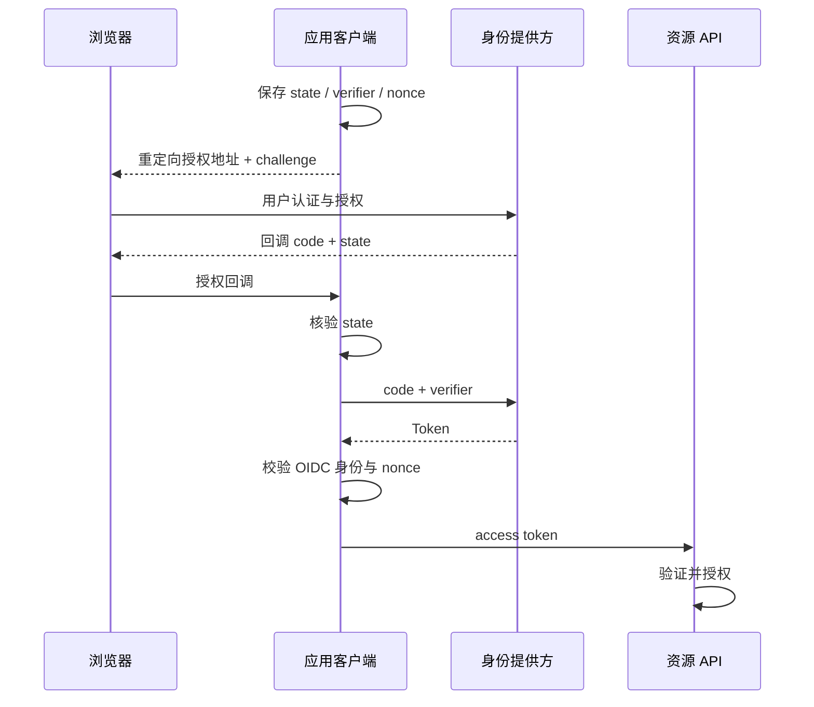

# OAuth2、OIDC、授权码、PKCE 与身份提供方

OAuth2 处理授权委托，OIDC 在其上定义身份层。登录页面在身份提供方，不代表应用不再需要检查回调、安全会话和接口权限。

## 1. 四个角色与三种凭据

用户是资源所有者，客户端发起授权，授权服务器发 Token，资源服务器保护 API。授权码是一次性的中间凭据；access token 用于访问资源；ID Token 用于客户端理解认证身份。refresh token 需要更严格保管，不应泄露到 URL/日志。

## 2. 授权码加 PKCE 的过程



PKCE 用 verifier/challenge 约束换码者，state 绑定请求与回调，nonce 绑定 OIDC 认证响应；三者职责不同。PKCE 不是取消其他检查的理由。机密客户端还应按注册方式进行客户端认证，public client 不能依赖保存在浏览器里的 secret。

## 3. Boot 的客户端模式

使用 `spring-boot-starter-oauth2-client`；下列是注册结构，不含可用凭据：

```yaml
spring:
  security:
    oauth2:
      client:
        provider:
          company:
            issuer-uri: https://id.example.invalid
        registration:
          company:
            provider: company
            client-id: task-web
            client-secret: REPLACE_FROM_SECRET
            authorization-grant-type: authorization_code
            scope: openid,profile
```

Servlet 安全链开启 oauth2Login。注册名影响默认登录入口/回调，redirect URI 要在 IdP 精确登记；反向代理后的 scheme/host 处理需可信代理配置，不能信任来自任意请求的转发头。

PKCE 的启用和客户端类型相关，显式要求时使用该版本支持的授权请求定制器并验证真实授权请求含 S256。不能仅凭用了 authorization_code 就声称 PKCE 已启用。[Spring OAuth2 Login](https://docs.spring.io/spring-security/reference/servlet/oauth2/login/index.html)

## 4. 浏览器、BFF 与服务调用

服务端 Web/BFF 可以把 Token 留在服务端，浏览器只携带受保护会话 Cookie，但仍需 CSRF 防护。SPA 的 Token 保存需要认真评估 XSS、刷新与撤销，不能简单推荐永久写 localStorage。

机器间 client_credentials 表达客户端自身权限，不代表最终用户；不得让下游把机器身份误当用户授权。需要代表用户时应采用明确的委托/交换方案。

## 5. 验证错误分支

验证错 state/nonce、回调重复、code 过期、redirect 不匹配、密钥轮换、用户取消授权、IdP 不可用、退出与多会话。日志记录阶段和关联 ID，不记录 code、access/refresh token。

本文未部署 IdP；在隔离身份环境完成真实浏览器/回调测试，单元 Mock 不能证明整套协议联通。

## 6. 练习与答案

### 6.1 OIDC ID Token 可以直接当任意 API 的 access token 吗

不应，它的受众和用途不同，应按资源服务器约定使用访问令牌。

### 6.2 有 PKCE 可以不校验 state 吗

不能，PKCE 与请求/回调关联防护不是同一职责。

### 6.3 用户退出应用等于退出所有系统吗

不一定，应用 Session、IdP 会话、下游 Token 有各自生命周期，需要明确单点退出与撤销策略。

## 7. 参考资料 {/* #7-参考 */}

- [OAuth2 客户端](https://docs.spring.io/spring-security/reference/servlet/oauth2/client/index.html)
- [OAuth2 安全最佳实践 RFC 9700](https://www.rfc-editor.org/rfc/rfc9700.html)
