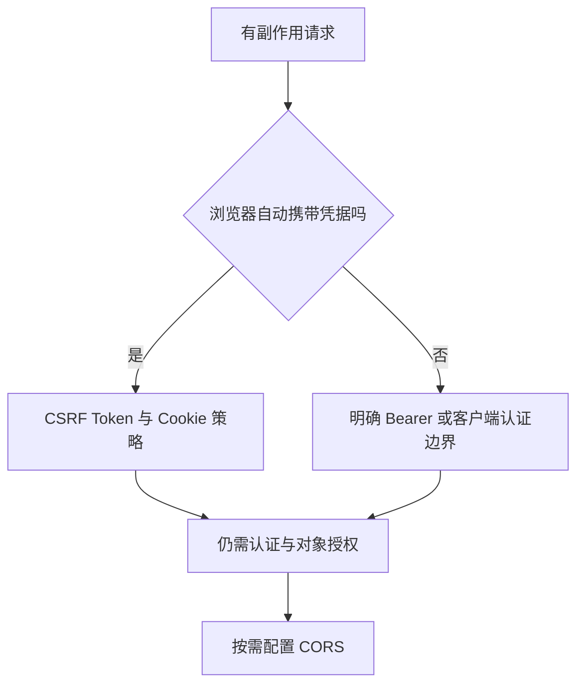

# CSRF、CORS、Cookie 与会话边界

“前端跨域报错就关闭安全”是把不同机制混在一起。需要先知道浏览器会自动带什么凭据，以及目标是否允许调用者读取响应。

## 1. 三个不同的问题

| 机制 | 解决的主要问题 | 不解决什么 |
| --- | --- | --- |
| CSRF Token | 防止借用自动凭据伪造有副作用操作 | XSS、对象越权 |
| CORS | 浏览器跨源读取响应的许可 | 非浏览器访问控制 |
| Cookie 属性 | 凭据发送和脚本访问边界 | 全部认证授权 |

只允许 CORS 特定 Origin，不代表恶意站点绝对不能发出所有形式的请求；阻止读取响应与阻止业务副作用不同。curl 也不会被浏览器 CORS 规则约束。

## 2. 何时需要 CSRF 防护

Session Cookie、某些浏览器自动发送的认证都要考虑。是否“无状态”不是唯一判断标准；若凭据由浏览器自动附带，仍可能有风险。纯 Bearer API 若明确仅接受显式 Authorization、无自动 Cookie 认证，可在其独立链中论证策略，不能全站随手 disable。



安全 Token 的存储、读取、请求头和登录/退出后的更新按当前框架机制处理，不自己造固定全局 Token。[Spring CSRF](https://docs.spring.io/spring-security/reference/servlet/exploits/csrf.html)

## 3. Cookie 属性的含义

Secure 限制安全传输场景，HttpOnly 限制脚本直接读取，SameSite 控制跨站发送条件。站点 site 与 origin 定义不同；同一站点下不同子域也可能跨源。

```properties
server.servlet.session.cookie.http-only=true
server.servlet.session.cookie.secure=true
server.servlet.session.cookie.same-site=lax
```

该片段适用于 HTTPS 部署；环回 HTTP 教学环境不能直接照抄后再奇怪 Cookie 为什么没按预期发送。跨站业务使用 SameSite=None 时通常还需 Secure，并结合浏览器第三方 Cookie 策略测试。

## 4. CORS 精确配置

只允许确需的 Origin、方法和头，带凭据时不要使用通配 origin。预检 OPTIONS 通常没有业务认证凭据，应由正确顺序的 CORS 处理，而非一律返回 401。

配置应在 MVC/Security 间一致，不让网关、应用各返回互相矛盾的头。匹配 Origin 不等于信任其中用户，API 仍需认证授权。

## 5. 验证

service-lab 保留 CSRF，测试缺 Token 写入为 403、合法 Token 写入成功。完整浏览器实验还要覆盖允许/拒绝 Origin、预检、Cookie 属性、登录后 Token、退出和反向代理 HTTPS。

只用 Postman/curl 成功，不能证明浏览器 CORS 正常；只看浏览器“跨域错误”，也不能排除后端实际返回了 500 或被网关拦截。

## 6. 练习与答案

### 6.1 HttpOnly 能解决所有 CSRF 吗

不能，浏览器仍会自动带 Cookie；HttpOnly 主要限制脚本读取。

### 6.2 CORS 拒绝能阻止 curl 访问吗

不能，它是浏览器执行的跨源规则，不是服务端身份验证。

### 6.3 为什么实验 Basic 密码正确，POST 仍为 403

认证通过不代表 CSRF 检查通过。实验有意保留写入防护，测试需提供有效 Token。

## 7. 参考资料 {/* #7-参考 */}

- [Spring Security CORS](https://docs.spring.io/spring-security/reference/servlet/integrations/cors.html)
- [安全过滤器链](./01-SpringSecurity过滤器链与认证授权.md)
