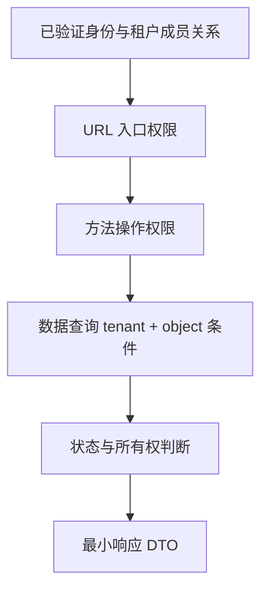

# 方法权限、多租户隔离与安全测试

接口要求登录，只证明调用者有身份。把路径中的 ID 换成另一个人的订单，若依然能读取，就是对象级授权缺失，而不是“登录校验已经足够”。

## 1. 三层授权协同



数据范围不能只靠前端筛选，也不能先查出全量敏感数据再在 Controller 随手过滤。统一入口能降低遗漏，但批处理、消息消费和新接口都可能成为旁路。

## 2. 方法权限怎样运行

启用 `@EnableMethodSecurity` 后，可用 `@PreAuthorize` 等表达式检查调用。默认代理边界仍存在：同对象自调用可能不经过代理，未受 Spring 管理对象也没有相应拦截。

```java
@PreAuthorize("hasAuthority('task:cancel')")
public Task cancel(String tenant, String id, long version) {
    return repository.cancelVisibleTask(tenant, id, version);
}
```

这是设计节选，不是 service-lab 的现有方法。表达式限制操作，repository 仍要限制数据范围。不要通过用户可控参数直接授予 tenant 权限。[方法安全机制](https://docs.spring.io/spring-security/reference/servlet/authorization/method-security.html)

## 3. 租户从哪里来

租户可来自可信身份声明和服务端成员关系。用户选择租户后，服务器核验其成员资格；HTTP 头只是“请求选择”，不是证明。

service-lab 明确将 alice 映射 alpha、bob 映射 beta，未知用户拒绝；所有任务 SQL 带 tenant 条件，客户端 X-Tenant 不参与身份判定。这是最小教学模型，生产需要可维护的成员、角色和撤销机制。

异步任务/消息也必须带经过验证的业务租户信息，并在执行时建立明确上下文。缓存键、幂等键、对象存储路径、搜索索引和审计都要隔离；只给主表加一列并不完成全链路多租户。

## 4. 隔离模型取舍

共享表加 tenant_id 成本低但易遗漏条件，可结合仓储封装、数据库行级策略等减少旁路；独立 schema/数据库增强隔离，也增加迁移、连接池和运维成本。选择需考虑数据敏感度、规模与恢复需求，不以“一个框架注解”代替架构选择。

使用数据库行级策略时，还需验证连接池复用后租户上下文已重置，不能让上一位租户的连接状态泄露到下一请求。

## 5. 安全测试矩阵

测试匿名、错误凭据、无操作权限、有权限但非所有者、其他租户 ID、伪造租户头、批量请求混入不可见 ID、缓存命中和后台任务。删除/导出/统计同样要测试，不只测 GET 单对象。

Mock 用户验证授权路径，不验证密码或签名；真实 Basic、JWT 解码器、IdP 联调各有作用。service-lab 同时测试密码与 tenant 过滤，但未覆盖生产 IdP、数据库行级策略或所有外部存储。

## 6. 练习与答案

### 6.1 管理角色是否天然跨全部租户

不应隐含假定。平台管理员与租户管理员要分开建模，跨租户权限应显式授予并审计。

### 6.2 SQL 有 tenant 条件，缓存可以省略 tenant 吗

不可以，缓存命中可能绕过 SQL，仍可能返回其他租户数据。

### 6.3 方法安全测试通过为何仍可能越权

数据过滤、异步入口、自调用和新接口可能绕开已测路径；需要端到端矩阵和最小权限设计。

## 7. 继续阅读

- [任务服务与可运行测试](../02-web/01-REST接口分层DTO与任务服务.md)
- [测试分层与 Testcontainers](../06-production/01-测试分层切片集成与Testcontainers.md)
