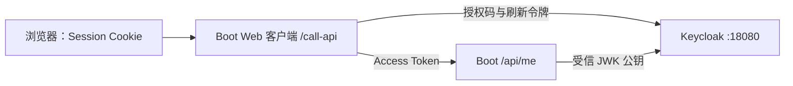

# Keycloak 登录、资源授权、刷新与密钥轮换

OAuth2/OIDC 不只是几项配置。浏览器登录、应用 Session、访问令牌、刷新令牌和验签密钥各有不同生命周期。这里用一个身份提供方、一个服务端客户端和一个资源 API，把它们放在同一条可观察链路中。

## 1. 实验拓扑和源码

完整工程为 [deepening-lab/identity](https://github.com/newswitch/newswitch.github.io/tree/main/examples/spring-boot/deepening-lab/identity)。Keycloak 使用 Compose 固定镜像 26.8.1，并导入 `realm.json`。Boot 使用 4.1.1，客户端与资源服务器位于同一个进程，但安全链分离。



端口只绑定本机，HTTP、短 Token 生命周期、固定演示密码仅用于实验；部署到远程环境必须使用 HTTPS、正式数据库、密钥和可信反向代理配置。[Keycloak Docker 指南](https://www.keycloak.org/getting-started/getting-started-docker)

## 2. 从空身份环境启动

在 `examples/spring-boot/deepening-lab` 下运行：

```bash
docker compose --profile identity up -d keycloak
docker compose --profile identity logs --tail=100 keycloak
curl -f http://localhost:18080/realms/boot-lab/.well-known/openid-configuration
mvn -B -ntp -pl identity verify
java -Xmx384m -jar identity/target/identity-lab-1.0.0.jar --spring.profiles.active=oidc
```

等待 discovery 请求成功后再启动 oidc 模式；不要只凭容器状态 Running 判断 realm 已导入。浏览器统一使用 `localhost`，不要中途换成 127.0.0.1：issuer 是精确标识，Cookie、回调和已登记 redirect URI 也会受主机名影响。

打开 `http://localhost:8082/oauth2/authorization/keycloak`，使用实验用户 alice、密码 `lab-alice-only-not-production` 登录，再访问 `http://localhost:8082/call-api`。合格结果应包含：

```json
{"subject":"<Keycloak 用户的 sub>","tenant":"alpha"}
```

sub 通常是身份系统生成的用户 ID，不应硬编码为用户名 alice。realm 导入为 access token 添加 `aud=task-api`、`tenant=alpha` 和 `task:read` scope；ID Token 不添加该 API audience。

当前本机自动化运行的是隔离 JWK/真实签名与 HTTP 授权测试；上述 Keycloak 容器的浏览器联调需启动 Docker 后执行。它不是 MockMvc 登录模拟能够替代的验收。

另外，BrowserFlowTest 使用受控 OIDC 协议端点实际完成 discovery、带 PKCE 的换码、nonce 验证、刷新和服务端调用 API，并拒绝错误 state。这个测试能发现 oidc Profile 缺依赖、错安全链和回调实现问题，但不处理真实用户交互，也不代表 Keycloak 全部会话/撤销策略已验证。

## 3. 两条安全链为何要分开

ApiSecurity 的优先级更高，只匹配 `/api/**`：不创建 Session，只接受 Bearer JWT，GET `/api/me` 需要 `SCOPE_task:read`，其他 API 默认拒绝。该链关闭 CSRF，是因为不接受 Cookie 会话作为 API 身份，不是“用了 Spring Security 就关闭 CSRF”。

BrowserSecurity 在 oidc Profile 启用，处理授权跳转、回调和 `/call-api`。它保留 CSRF 与 Session；浏览器的 Cookie 不被 API 链当成认证成功。`/call-api` 在服务端取得访问令牌后调用 `/api/me`，不把 Token 返回浏览器。

Boot 4 模块化后，Web MVC Starter 不一定提供 RestClient.Builder 自动配置；工程显式引入 `spring-boot-starter-restclient`，给 API 客户端设置 2 秒连接超时与 3 秒读取超时，且在上下文关闭时关闭自建 HttpClient。仅运行资源服务器测试不会发现这个 oidc Profile 的装配遗漏，因此还要启动完整客户端链。

若以后让 API 同时接受 Session Cookie，上述 CSRF 设计就必须重新审视。路径分链不能省略对象级/租户级授权；目前 API 只返回当前主体，不实现跨租户查询。

## 4. 一次登录经过哪些组件

```text
/oauth2/authorization/keycloak
→ OAuth2AuthorizationRequestRedirectFilter
→ 保存 state、nonce、code_verifier
→ 浏览器到 Keycloak：code_challenge + S256
→ Keycloak 认证用户并返回 code、state
→ /login/oauth2/code/keycloak
→ 验证请求关联并以 code + verifier 换 Token
→ 校验 OIDC 身份与 nonce，建立应用 Session
```

BrowserSecurity 显式使用 `OAuth2AuthorizationRequestCustomizers.withPkce()`，不依赖“机密客户端大概自动有 PKCE”的推断。PkceTest 断言授权请求存在 S256、state、nonce，并确认 verifier 只保存在服务端属性中，没有进入授权 URL。[授权请求与 PKCE](https://docs.spring.io/spring-security/reference/servlet/oauth2/client/authorization-grants.html)

观察浏览器跳转可以看到 challenge 和 state；不要把 code、Token 或完整含敏感参数的 URL 粘贴到日志/工单。代码交换发生在应用和 Keycloak 之间，浏览器 Network 看不到完整服务器到服务器交换，这是正常现象。

## 5. 访问令牌过期后为什么不一定重新登录

导入 realm 将 access token 有效期设为 60 秒。`/call-api` 每次通过 OAuth2AuthorizedClientManager 授权；provider 同时支持 authorization_code 和 refresh_token，检测到令牌需要刷新且存在有效 refresh token 时，向 IdP 申请新访问令牌并保存新的 authorized client。

验证方法是先成功调用，等待超过 access token 有效期，再调用 `/call-api`；结合 Keycloak 的事件和应用的脱敏请求诊断，确认发生刷新而非重新浏览器登录。不要只看到第二次 200 就断言刷新成功，旧 Token 可能仍在时钟偏移容忍范围或根本尚未到期。

realm 启用 refresh token 撤销与 max reuse=0，目的是观察刷新令牌更新。多请求同时刷新、多个应用副本共用旧 authorized client，可能触发竞争；默认进程内会话/客户端保存不是分布式刷新协调方案。多副本还需要可靠 Session、authorized-client 存储及并发控制。

刷新返回 invalid_grant 可能来自撤销、过期、复用或身份会话失效。此时清理失效授权并让用户重新授权，不无限重试旧 refresh token，也不自动退回密码模式。本实验关闭 direct access grants，不采用密码 grant 冒充浏览器登录。

## 6. JWT 验证如何变成真实测试

IdentityTest 在本机临时端口提供 JWK Set，用隔离生成的 RSA 私钥签名 JWT，再向真正运行的 Boot HTTP API 发请求。它不使用 Spring Security 的 `jwt()` 请求模拟来绕过解码器。

| 输入 | 期望结果 | 对应边界 |
| --- | --- | --- |
| 正确签名、issuer、audience、scope、tenant | 200 | 认证和当前接口授权通过 |
| 没有 Bearer | 401 | 未建立 API 身份 |
| 错 audience | 401 | 不是签给 task-api |
| 缺少 scope | 403 | 已认证但没有操作权限 |
| 缺少可信 tenant 映射 | 403 | 业务可见范围无法建立 |
| 错 issuer、过期、未来 nbf、未知签名密钥 | 解码器拒绝 | 签名与 claims 验证 |

时间测试与容忍偏移拉开足够距离，避免刚过期一秒却被允许的误判。字段解码与签名验证是两回事，Token 可读不代表可相信。

## 7. 密钥轮换不是 Token 刷新

Token 刷新产生新的访问授权；签名密钥轮换改变 IdP 用哪把私钥签发 Token。验证端按受信 JWK Set 和 kid 选择公钥。

`newKidTriggersJwksRefreshWithOverlap` 先用旧 JWK 验证旧 Token，再向同一 JWK 地址公布新旧两把公钥。新 kid 的 Token 验证成功后，旧 Token 仍成功。这验证了此配置下的未知 kid 刷新与重叠窗口。

生产不要一生成新密钥就立即删旧公钥。旧 Token 的剩余有效期、验签端缓存、时钟偏差和回滚决定重叠时间；删除 JWK 也不保证所有缓存中的旧公钥瞬间失效。[JWT Resource Server](https://docs.spring.io/spring-security/reference/servlet/oauth2/resource-server/jwt.html)

## 8. 错误分支怎样查

| 症状 | 先查什么 |
| --- | --- |
| 登录入口立即失败 | registration/provider 配置、discovery 可达性与 issuer |
| redirect_uri 不允许 | Keycloak 注册值与最终浏览器 URL 是否精确匹配 |
| callback state 不匹配 | 原 Session Cookie、域名切换、多副本会话与重复回调 |
| ID Token nonce 校验失败 | 请求关联、重复/错误回调、客户端流程是否被改写 |
| API 401 | Bearer、签名、kid、iss、aud、exp/nbf 与时钟 |
| API 403 | scope 映射、tenant 和对象授权 |
| 刷新 invalid_grant | refresh token 生命周期、并发刷新与撤销 |

测试错 state 或重放 callback 时，预期应拒绝，而不是关闭 state/nonce 校验使其“能登录”。人工修改回调仅限本机隔离环境。

## 9. 退出和关闭

应用 POST `/logout` 默认需要 CSRF Token，会清除应用 Session。它不自动等于 Keycloak 单点退出，更不意味着已发放的自包含 access token 被所有资源服务立即拒绝。需要单点退出时，配置相应 RP-initiated/back-channel logout 并验证每种会话与 Token 的实际行为。

结束应用后，在本实验目录执行 `docker compose --profile identity down`。开发模式数据库可丢弃；不要用本实验密码或 `sslRequired=none` 扩展为远程身份服务。

## 10. 练习与答案

### 10.1 浏览器已登录，直接访问 /api/me 为何仍是 401

API 链只接受 Bearer，不信任浏览器 Session Cookie。访问 `/call-api` 才由服务端客户端附加访问令牌调用 API；这种分离是有意的边界。

### 10.2 新密钥已经发布，为何仍保留旧公钥

旧密钥签发的 Token 可能仍有效，且各资源服务器缓存刷新时间不同。保留足够重叠窗口，才能让验证端逐步迁移。

### 10.3 第二次调用成功能否单独证明 refresh token 正常

不能。先证明原 access token 已过期并核对 IdP 刷新事件或脱敏调用证据；响应 200 本身无法区分缓存授权、原 Token 与新 Token。

## 11. 关联与参考

- [JWT 声明与验签](./03-JWT资源服务器声明签名与密钥.md)
- [OIDC 授权码与 PKCE](./04-OAuth2-OIDC授权码PKCE与身份提供方.md)
- [OAuth2 客户端核心](https://docs.spring.io/spring-security/reference/servlet/oauth2/client/core.html)
