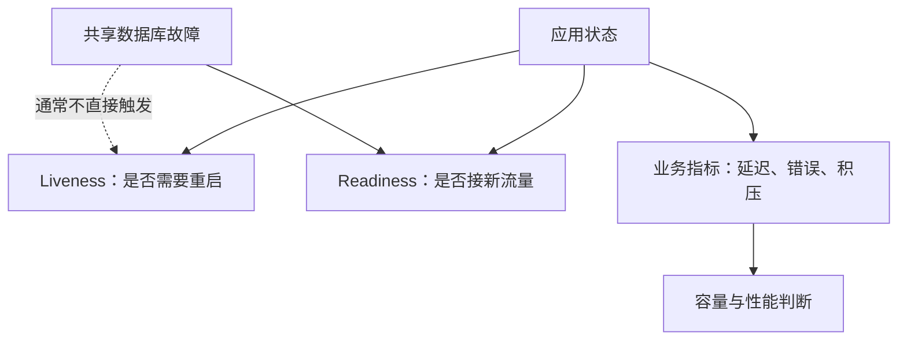

# Actuator、Micrometer、健康检查与指标

进程活着、端口可连、应用就绪、业务质量正常是四种不同判断。一个 health=UP 不能证明所有用户请求的 P99 都达标。

## 1. 三类信号分开设计



共享数据库短暂不可用就把所有实例判死，可能引发重启风暴。readiness 是否依赖外部系统也要按业务取舍，不能把所有依赖机械加入。[Actuator 探针](https://docs.spring.io/spring-boot/reference/actuator/endpoints.html)

## 2. 启用、暴露和授权

添加 Actuator Starter。端点实现存在、端点可访问、通过 HTTP 暴露、调用者有权限不是同一件事。

```properties
management.endpoints.web.exposure.include=health,info,metrics,prometheus
management.endpoint.health.show-details=never
management.endpoint.health.probes.enabled=true
```

Prometheus 端点还需要 `io.micrometer:micrometer-registry-prometheus`。实验 service-lab 没引入该 registry，只开放 health/info/metrics，其中 metrics 需要管理员身份。不能把 `include=*` 暴露到公网，env、heapdump、loggers 等可能包含敏感信息或控制能力。

## 3. Timer 与分位数

Timer 记录次数和耗时，不只是一个平均数。Counter 应表示累计事件，Gauge 表示当前值；会减少的队列长度不应建成只增 Counter。

客户端计算的分位数通常不能直接跨实例求平均。要聚合集群 P99，使用兼容的 histogram bucket 并在后端聚合，再计算分位数。桶边界按业务延迟范围选择，桶太多增加时序成本。

## 4. 标签基数

标签适合路由模板、方法、结果类别、有限依赖名；不适合原始 URL、userId、traceId、幂等键。每增加一个维度可能乘法放大时序数。请求 ID 放日志/Trace，不放指标标签。

需要同时观察请求率、错误率、延迟分布、在途数，以及线程池、连接池、队列、JVM、CPU throttling。HTTP 延迟高但 CPU 低，可能在等数据库连接，不是自动证明 CPU 富余。

## 5. 查看实验结果

```bash
curl -i http://127.0.0.1:8080/actuator/health
curl -i http://127.0.0.1:8080/actuator/health/liveness
curl -i http://127.0.0.1:8080/actuator/health/readiness
curl -i -u alice:lab-only-alice http://127.0.0.1:8080/actuator/metrics
```

正常运行健康端点应通过；最后一个请求应因没有管理员角色被拒绝，而不是看到所有指标。安全测试验证该权限边界；不要为了截图在生产取消保护。

## 6. 告警要能定位

按持续窗口与流量基数判断错误，区分无流量和零错误。readiness 变化关联发布/依赖；连接池等待关联慢请求；Outbox 最老年龄关联发送链路。单个“CPU > 80%”无法代表业务稳定性。

## 7. 练习与答案

### 7.1 health=UP 说明业务延迟正常吗

不说明，健康检查通常覆盖有限状态，需业务延迟与错误指标。

### 7.2 两台机器 P99 平均能代表整体 P99 吗

不能，分位数不是可直接平均的量，应聚合分布再计算。

### 7.3 traceId 放指标标签为什么危险

几乎每请求唯一，会造成高基数；用 Trace/日志关联而非指标维度。

## 8. 深入

- [Boot 指标集成](https://docs.spring.io/spring-boot/reference/actuator/metrics.html)
- [Micrometer 概念](https://docs.micrometer.io/micrometer/reference/concepts.html)
