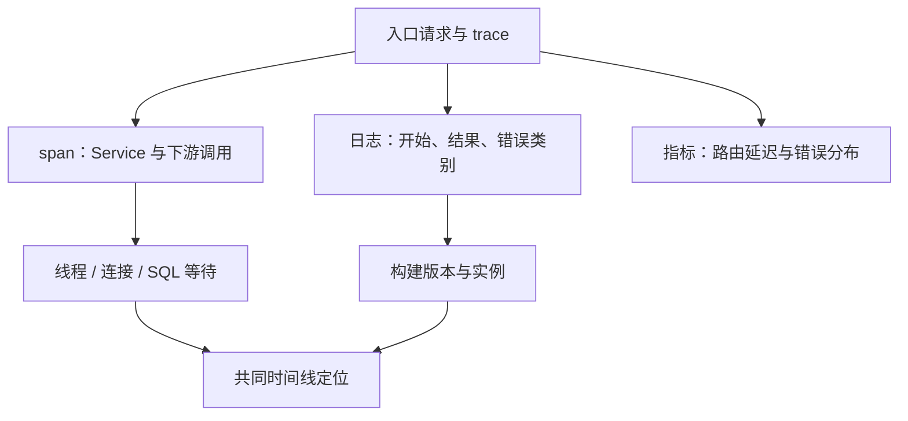

# 结构化日志、MDC、OpenTelemetry 与证据链

日志记录离散事件，指标呈现聚合趋势，Trace 组织请求的跨组件时间关系。三者互补，任何一项都不能自动还原没有记录的事实。

## 1. 一条慢请求需要哪些证据



统一时钟、时区和版本标识很重要。服务器日志的“耗时 2s”若不说明从哪到哪，不能直接等同客户端总延迟。

## 2. 结构化日志

Boot 支持结构化输出，例如：

```properties
logging.structured.format.console=ecs
```

需确认日志后端与采集器支持该格式。字段包括事件时间、级别、logger、实例/版本、trace/span ID 和错误类别。不要同时把完整 JSON 字符串作为普通 message 再二次编码，导致检索困难。[Boot 日志](https://docs.spring.io/spring-boot/reference/features/logging.html)

用户输入不能直接充当任意日志结构；敏感头、密码、Token、完整文件内容应过滤。日志量与 IO 也有成本，调试日志必须限范围和时间。

## 3. MDC 的生命周期

MDC 常由线程局部上下文支持。请求入口建立，finally 清理；进入线程池前捕获必要内容，工作开始恢复，结束后还原/清理。否则线程复用可能把上一请求 ID 带给下一请求。

Reactor、虚拟线程与传统线程池的传播方式不同，不要假定所有框架都靠同一 ThreadLocal 自动完成。安全身份与 trace 可一起传播，但它们的信任级别不同；外部传来的 trace ID 不能当权限凭据。

## 4. Micrometer Tracing 与 OpenTelemetry

在 Boot 4.1.1 中，可使用 `org.springframework.boot:spring-boot-starter-opentelemetry` 选择 OTel/OTLP 路径，再按当前属性配置 exporter 和 Collector。不要直接复制旧版本 `management.otlp.tracing.*` 就认定生效；当前文档使用 `management.opentelemetry.tracing.export.otlp.*`。

```properties
management.tracing.sampling.probability=0.1
```

该采样值仅示意。Collector 的 HTTP/gRPC 接收端口、协议、TLS、鉴权及路径必须匹配导出器，容器中的 localhost 也不代表另一 Pod。先用单条隔离请求检查后端可见，再扩展采样和流量。

Boot 可通过相应桥接/导出依赖建立追踪；另一方案是 OTel Java Agent。两套自动插桩重叠可能产生重复 span，要明确谁负责 HTTP、JDBC、客户端与导出。

传播使用标准 trace context，但跨信任边界要处理外部上下文。Baggage 不宜携带敏感信息或高体积内容，更不能无审查转发到所有下游。[Boot Tracing](https://docs.spring.io/spring-boot/reference/actuator/tracing.html)

## 5. 采样与盲区

未采样请求没有完整 Trace，不等于没发生。高采样增加 CPU、网络和存储，低采样可能漏罕见故障；可以结合错误保留、尾采样与指标，但尾采样也需要缓存和 Collector 容量。

一个很长 span 可能包含租借/排队、网络和计算；只加 Service span 不能区分它们。先检查已有自动指标，再在关键等待边界加少量自定义观察点。

## 6. 验证

发起两个不同请求并跨线程，确认无 ID 串线；访问下游观察父子关系；模拟错误、超时与取消检查结束事件。关闭 Collector 时应用不应无限阻塞，导出队列和丢弃策略需要验证。

service-lab 提供 Boot 默认日志与请求测试，没有启动 OTel Collector，本文不宣称遥测后端已联通。

## 7. 练习与答案

### 7.1 没有 Trace 说明请求没到应用吗

不说明，可能未采样、导出丢失或上下文断裂，需结合入口日志和指标。

### 7.2 MDC 设置一次为什么不能一直留着

线程会复用，残留会把不同请求错误关联，还可能串租户信息。

### 7.3 Trace 显示 DB span 2 秒就一定 SQL 执行 2 秒吗

不一定，span 边界可能含连接等待、网络和结果读取，要查看具体插桩语义。

## 8. 参考资料 {/* #8-参考 */}

- [OpenTelemetry Java](https://opentelemetry.io/docs/languages/java/)
- [慢请求等待分析](./08-慢请求线程池连接池与下游等待.md)
