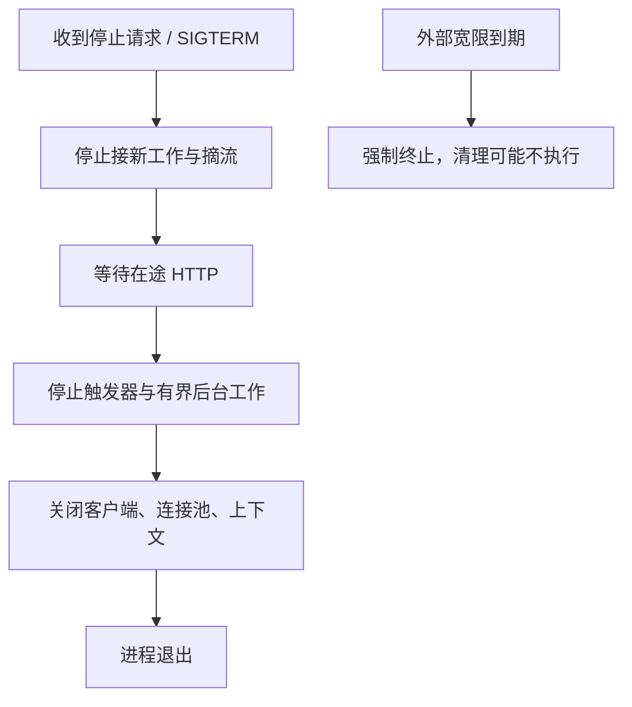

# JAR、systemd、配置、信号与优雅退出

应用部署不仅是后台执行 java -jar。进程应由谁拥有、失败如何重启、配置从哪里来、停止时如何处理在途工作，都影响可恢复性。

## 1. 先确认产物

在 service-lab 执行 `mvn clean verify`，得到 Boot 可执行 JAR。通过 `java -jar` 运行，普通库 JAR 不能直接当 Boot 应用。固定 JDK 主版本、构建版本和产物校验，不在服务器现场手工替换依赖。

```bash
java -jar target/boot-service-lab-1.0.0.jar --server.port=8081
```

默认仅环回地址。真实对外部署前必须替换实验账号、内存数据库与网络配置，本文 systemd 单元只展示托管机制。

## 2. Linux systemd 单元示例

```ini
[Unit]
Description=Task Service
After=network-online.target
Wants=network-online.target

[Service]
Type=simple
User=taskapp
WorkingDirectory=/opt/task-service
EnvironmentFile=/etc/task-service/runtime.env
ExecStart=/opt/jdk-25/bin/java -jar /opt/task-service/app.jar --spring.config.additional-location=file:/etc/task-service/
KillSignal=SIGTERM
TimeoutStopSec=40
Restart=on-failure
RestartSec=5
NoNewPrivileges=true
UMask=0027

[Install]
WantedBy=multi-user.target
```

需先创建低权限用户、路径、配置文件和相应权限，不能直接复制启动。EnvironmentFile 并不是所有场景的安全密钥仓库，凭据应按平台能力使用受控 Secret/credential 机制，不放命令行和 Git。

```bash
sudo systemctl daemon-reload
sudo systemctl start task-service
sudo systemctl status task-service --no-pager
journalctl -u task-service --since "10 minutes ago"
```

以上仅操作自己创建的实验服务，不对已有生产服务执行停启。

## 3. 退出是一段协议



实际组件关闭由生命周期和 phase 组织，不是所有资源严格遵循图中全局串行顺序。Boot 的 Servlet 优雅停机会限制新请求并处理在途请求，具体服务器行为要验证。[Boot 优雅退出](https://docs.spring.io/spring-boot/reference/web/graceful-shutdown.html)

## 4. 时间窗口要协调

```properties
server.shutdown=graceful
spring.lifecycle.timeout-per-shutdown-phase=10s
```

每 phase 超时不是整个应用退出总上限，多个阶段、后台池和摘流传播都要预算。systemd TimeoutStopSec 应覆盖设计窗口并保留余量，不能假定一个 10s 配置覆盖所有工作。

SIGKILL 不能被普通清理回调捕获。可靠业务不能依靠“肯定会执行 finally”，应有持久化任务、租约和重试幂等。

## 5. 验证

在隔离 Linux 环境运行一个有界慢请求，停止服务，观察 readiness、接流、在途结果、资源关闭和退出码；再验证超时后强终止和重启恢复。配套 Windows 自动化实验验证 Boot 构建与请求，不包含 systemd/SIGTERM；Linux 托管需按本节单独验证。

## 6. 练习与答案

### 6.1 network-online 表示数据库可用吗

不表示，仍需连接、认证、重试与应用就绪判断。

### 6.2 kill -9 会执行优雅停机吗

不会，必须按异常终止设计恢复。

### 6.3 为什么不把口令直接写 ExecStart

可能通过进程参数、配置读取和日志暴露，应使用受控秘密注入。

## 7. 后续

- [容器镜像与 JVM](./05-Docker-Buildpacks分层镜像与JVM.md)
- [Spring 生命周期](../../spring/01-container/07-事件SmartLifecycle与资源关闭.md)
