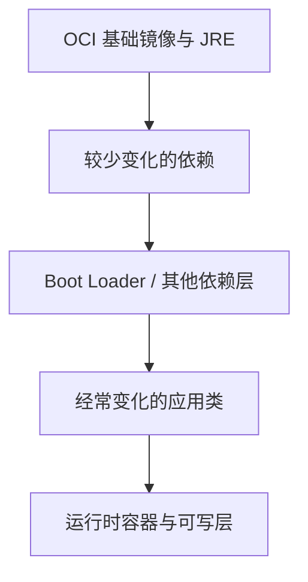

# Docker、Buildpacks、分层镜像与 JVM

容器不替代 JVM，镜像小也不代表运行时内存小。镜像、进程和资源限制是三个需要分别验证的层次。

## 1. 一个简单的 JVM 镜像

下列 Dockerfile 在 service-lab 构建完成后使用；基础镜像标记只是结构示意，实际发布应固定已验证的版本和摘要：

```dockerfile
FROM eclipse-temurin:25-jre
WORKDIR /app
COPY target/boot-service-lab-1.0.0.jar /app/app.jar
USER 10001:10001
ENTRYPOINT ["java", "-jar", "/app/app.jar"]
```

JSON exec 形式避免 shell 留在前台吞掉信号；若自定义启动脚本，最后正确 exec。应用用非 root，所需临时目录和挂载权限要显式准备。

```bash
docker build -t task-service:lab .
docker run --rm --name task-service-lab -p 127.0.0.1:8080:8080 \
  --memory=768m --cpus=1 task-service:lab --server.address=0.0.0.0
```

容器内监听 0.0.0.0，宿主机发布仍限制环回。此例只为连接验证，实验账号和 H2 不用于生产；768m 不是容量结论。

## 2. 为什么分层



Boot JAR 内的分层索引与 OCI 镜像层不是自动等价，需要构建工具提取或由 Buildpacks 处理。目的主要是复用缓存、减少传输，不能让所有依赖在运行时不占内存。[高效镜像](https://docs.spring.io/spring-boot/reference/packaging/container-images/efficient-images.html)

## 3. Buildpacks 的方式

```bash
mvn spring-boot:build-image -Dspring-boot.build-image.imageName=task-service:lab
```

需要可用容器环境。插件选择 builder/buildpacks 和运行镜像，检测应用并生成 OCI 产物；固定 builder/run image、JDK 版本、架构和缓存策略，再检查结果，不把工具默认值当长期供应链策略。

Buildpacks 可计算内存参数，但输入仍需正确，包括容器上限、线程和非堆预算。不要同时塞入互相矛盾的 JVM 参数。[Boot Buildpacks](https://docs.spring.io/spring-boot/reference/packaging/container-images/cloud-native-buildpacks.html)

## 4. 容器内存不是只有 Xmx

进程占用包括堆、元空间、代码缓存、线程栈、直接缓冲、JNI 和运行库，还可能有 cgroup 统计的文件页等。把 Xmx 设成容器 limit，几乎不给非堆留空间。

只读根文件系统需要给 JVM/应用临时文件、上传暂存和转储选择独立可写挂载。heap dump 可能很大且含敏感数据，不能无限写容器层。

## 5. 验证矩阵

确认镜像架构与节点一致、进程 UID、启动命令、监听地址、只读权限、信号退出、资源限制、CA 证书和时区。扫描/SBOM 与签名辅助供应链验证，但不替代运行测试。

配套自动化实验验证 JVM/JAR 路径，不包含容器构建和运行。以上命令是待容器环境验证的示例，不是已发布镜像。

## 6. 练习与答案

### 6.1 镜像只有 200MB，运行内存也只要 200MB 吗

无此关系，运行时堆、线程、缓冲和负载决定内存。

### 6.2 为什么容器启动后端口映射仍访问不了

可能只监听容器环回地址、端口不一致或进程未就绪，要沿监听和网络逐层查。

### 6.3 Buildpacks 免 Dockerfile 是否免维护

不免，builder、运行镜像、依赖、参数和安全更新仍需固定与验证。

## 7. 下一步

- [Kubernetes 探针与摘流](./06-Kubernetes探针资源摘流与滚动更新.md)
- [JVM 容器预算](../../java/04-jvm/08-JVM容器资源CPU与内存预算.md)
