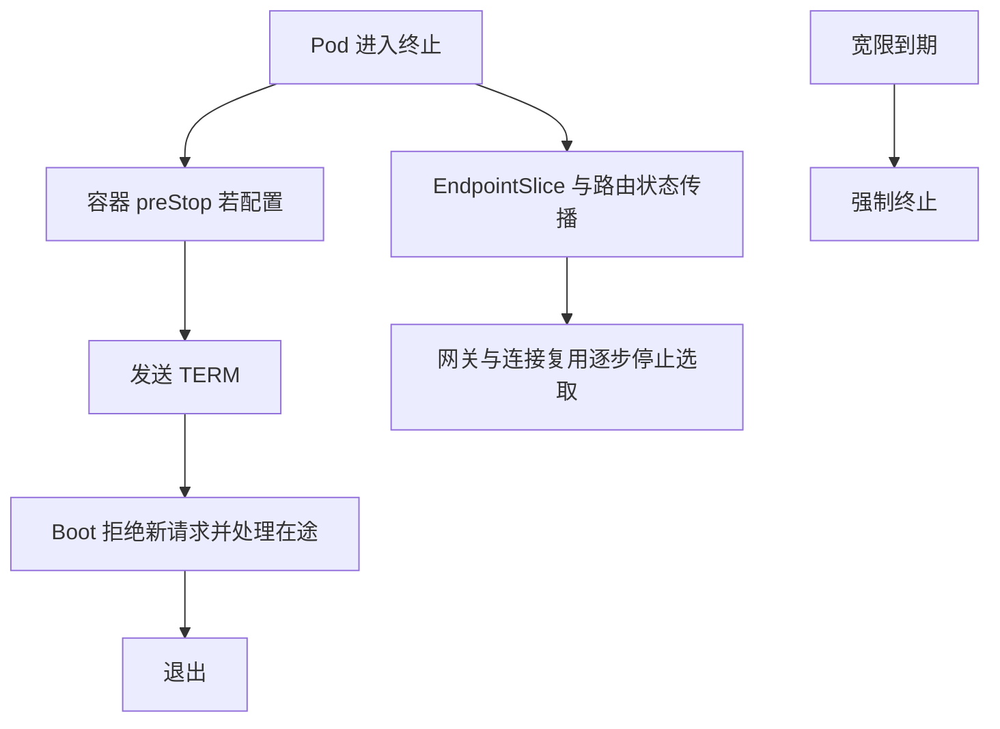

# Kubernetes 探针、资源、摘流与滚动更新

Pod Running 只说明容器进入运行状态，不证明应用初始化完毕。发布不丢请求，需要就绪、路由传播、在途请求和终止窗口协同。

## 1. 三种探针

startupProbe 给启动过程有限保护；readiness 决定是否接新流量；liveness 判断是否需要重启。数据库共享故障不宜直接触发所有 Pod liveness 失败。

管理端口正常、业务端口线程耗尽时，探针可能给出过度乐观结果。可评估把附加探针路径放到主端口，并验证安全配置不会让探针因 401 而失败。

## 2. Deployment 片段

以下是模板，需替换镜像摘要、Secret、数据库和权限，不能把实验账号直接对外部署：

```yaml
apiVersion: apps/v1
kind: Deployment
metadata:
  name: task-service
spec:
  replicas: 2
  strategy:
    rollingUpdate:
      maxSurge: 1
      maxUnavailable: 0
  selector:
    matchLabels: {app: task-service}
  template:
    metadata:
      labels: {app: task-service}
    spec:
      terminationGracePeriodSeconds: 40
      containers:
        - name: app
          image: registry.example.invalid/task-service:REPLACE_WITH_VERIFIED_TAG
          args: ["--server.address=0.0.0.0"]
          ports:
            - {name: http, containerPort: 8080}
          resources:
            requests: {cpu: "500m", memory: "512Mi"}
            limits: {cpu: "1", memory: "768Mi"}
          startupProbe:
            httpGet: {path: /actuator/health/liveness, port: http}
            periodSeconds: 2
            failureThreshold: 60
          readinessProbe:
            httpGet: {path: /actuator/health/readiness, port: http}
            periodSeconds: 3
          livenessProbe:
            httpGet: {path: /actuator/health/liveness, port: http}
            periodSeconds: 10
```

上限与阈值只是实验起点。还需要 Service、配置/Secret 注入、服务账号和网络策略；H2 内存库不能用作多副本业务数据源。

## 3. 终止不是绝对串行



摘流更新与容器关闭不是保证严格先后的单一路径；已有连接也可能继续携带请求。preStop 的执行计入终止宽限，sleep 不会自动保证所有代理已摘流。结合实测传播时间和流量决定策略。[Pod 生命周期](https://kubernetes.io/docs/concepts/workloads/pods/pod-lifecycle/)

## 4. 发布容量与资源

maxSurge=1 会临时增加副本，数据库连接、缓存和节点资源都要计入。maxUnavailable=0 也不能保证依赖和应用永远无错误。

CPU limit 可能造成 throttling，内存 limit 可能导致 OOMKill；requests 影响调度，不等于进程保留了同样多物理内存。JVM 需要明确堆与非堆预算。

## 5. 验证

持续发有界请求并滚动发布，记录成功/错误、连接关闭、Pod readiness、EndpointSlice、SIGTERM 到退出时间。再测慢请求、SSE、依赖启动慢和新版本失败。只看 rollout status 成功无法证明零业务错误。

该清单需在隔离测试集群中验证，配套自动化实验不包含 Kubernetes 部署。

## 6. 练习与答案

### 6.1 readiness 失败会直接重启容器吗

不会，主要影响接流；liveness/startup 失败有不同处理。

### 6.2 preStop 等 30 秒，宽限 30 秒是否合理

可能几乎不给真正应用关闭留时间，应整体预算。

### 6.3 为什么发布时数据库连接突然超标

新旧副本重叠，多个连接池同时存在，要按发布峰值计算。

## 7. 关联

- [JAR 与优雅退出](./04-JAR-systemd信号与优雅退出.md)
- [Actuator 健康检查](./02-Actuator-Micrometer健康检查与指标.md)
