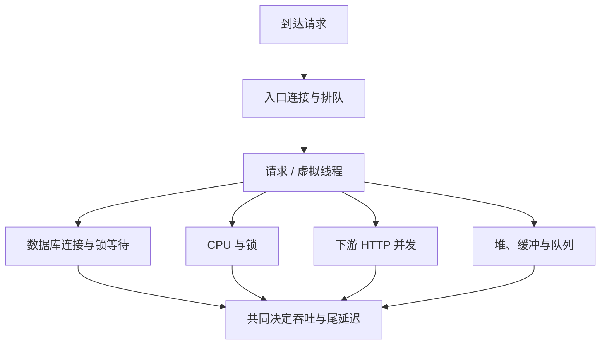

# 压测与请求、线程、连接、CPU、内存容量

“单实例能跑 1000 QPS”缺少场景就没有意义。请求大小、读写比例、热点、依赖延迟和允许的 P99 不同，容量结论可能完全相反。

## 1. 先定义负载与合格条件

明确路由比例、数据规模、认证方式、请求/响应大小、并发、到达速率、缓存命中、突发和持续时间。容量标准同时包含吞吐、错误率、P95/P99、资源与恢复，不以 CPU 100% 作为唯一终点。

闭环模型中客户端收到结果才发下一次，请求慢时自动降低压力；开放模型按到达速率发送，更容易暴露排队与过载。协调遗漏会低估用户本应遭遇的等待，工具统计口径要读清。

## 2. 平均关系与上限

在稳定区间可用 Little 定律理解平均在途：

```text
平均在途 L ≈ 到达率 λ × 平均系统停留时间 W
例如 200 请求/秒 × 0.2 秒 ≈ 40 个平均在途请求
```

这不是 P99 推导公式，也不能用于系统持续积压的非稳定阶段。线程、数据库连接、HTTP 连接占用时间不同，应分别计算，不能把 40 同时当所有池大小。

## 3. 找到最先饱和的资源



虚拟线程降低某些阻塞线程成本，但不增加数据库连接、CPU、文件描述符和下游配额。无限并发会把等待对象和上下文放进内存，仍可能 OOM。

## 4. 分阶段实验

先验证功能与数据清理，预热到 JIT/缓存相对稳定，逐级增加速率，保持足够观察窗口，再做突发和恢复。测出延迟陡增、错误或积压持续增长的拐点后，生产容量应留出故障/发布余量。

每档记录 offered、accepted、completed 请求率，P99、错误类别、在途、线程、连接等待、CPU throttling、GC、RSS 和依赖负载。只记录完成 QPS 会掩盖被拒绝或根本没发出来的压力。

不要直接对现有生产或第三方接口压测；使用授权隔离环境。service-lab 是正确性实验，不提供性能数字，H2 的结果不能代表远程业务数据库。

## 5. 多副本和成本

扩容 n 倍不一定吞吐 n 倍，数据库、热点键、共享锁和带宽可能先饱和。容量要按一个副本故障、滚动发布重叠、冷启动/缓存回源和流量偏斜验证。

比较优化时固定数据、版本、JVM、负载和依赖；一次只改变可归因因素。若多项改动同时上线，只能报告整体结果，不能把全部收益归给某个参数。

## 6. 练习与答案

### 6.1 平均 200ms 能推出 P99 吗

不能，平均值没有描述尾部分布，需要实际分布与负载模型。

### 6.2 CPU 只有 30%，是不是还有很多 QPS 余量

不一定，连接、锁、下游或带宽可能已饱和。

### 6.3 为什么过载解除后还恢复很慢

积压、重试、缓存回源和连接占用仍在持续，应限制队列与重试并观察恢复时间。

## 7. 继续阅读

- [慢请求与等待链](./08-慢请求线程池连接池与下游等待.md)
- [虚拟线程资源边界](../../java/03-concurrency/09-虚拟线程载体线程与资源上限.md)
- [k6 到达率模型](https://grafana.com/docs/k6/latest/using-k6/scenarios/concepts/arrival-rate-vu-allocation/)
