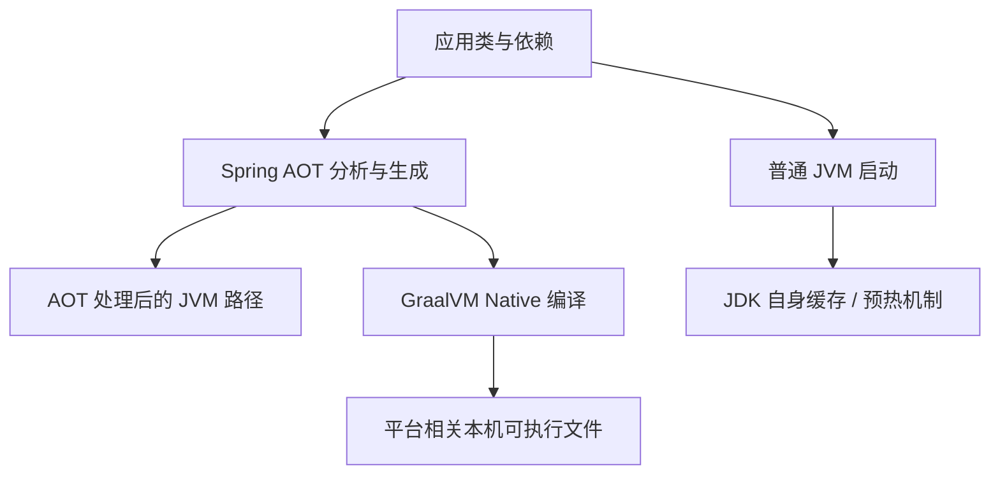

# Spring AOT 与 Native Image

AOT 是把部分工作提前，不是单一技术。Spring AOT、GraalVM Native Image 和 JDK 的 AOT 缓存作用层不同，不能看到名字相同就认为产物可互换。

## 1. 三条路径



普通 JVM 仍可 JIT；Spring AOT 提前生成部分容器基础设施；Native Image 基于封闭世界分析构建本机程序。JDK CDS/AOT 缓存另见 [JVM 缓存](../../java/04-jvm/09-CDS-AppCDS与AOT缓存.md)。

## 2. 封闭世界意味着什么

构建时需要知道可达类型、反射、资源、代理和序列化。运行期任意扫描新 JAR、动态生成类、加载未知插件，不一定符合本机镜像假设。不是“Java 不能反射”，而是动态访问需要可被分析或显式声明。

Spring Runtime Hints 可以声明反射、资源等需求，条件需对应真实代码。乱加“保留全部类型”可能让镜像膨胀，也掩盖真实依赖。[Native Image 基础](https://docs.spring.io/spring-boot/reference/packaging/native-image/introducing-graalvm-native-images.html)

## 3. 构建配置与运行配置

某些 Bean 图和条件在 AOT 构建阶段已决定，运行时改 Profile/条件不能期待像普通动态 JVM 那样重塑所有定义。密钥、环境地址等运行配置仍应外部化，不能让构建时环境意外烘焙秘密。

类初始化时机也有影响：构建机上的状态不应错误进入运行镜像。使用本地库、字体、时区、证书和驱动时需验证目标系统。

## 4. 一个构建入口

在继承 Boot parent 的工程里，还需声明 Native Build Tools 插件；不能只输入 goal 却没有对应构建配置：

```xml
<plugin>
  <groupId>org.graalvm.buildtools</groupId>
  <artifactId>native-maven-plugin</artifactId>
</plugin>
```

将它放在 build/plugins，与 Boot Maven Plugin 配合，版本遵循 parent 的插件管理并检查 effective-pom。不是所有第三方 parent 都有相同 native profile，先确认实际 POM。

在满足官方要求、具有匹配 GraalVM 与本机工具链的隔离环境，Boot parent 工程可按插件支持评估：

```bash
mvn -Pnative native:compile
```

也可用支持 Native 的 Buildpacks 构建。命令不是“装 JDK 25 就能运行”：需要所选 Boot/GraalVM/插件的兼容版本、平台编译器和足够构建资源。普通 JDK 的 java 可运行 JAR，不等于具备 native-image。

当前 service-lab 只验证 JVM 路径，未进行本机编译。先验证相关第三方库，再把此命令用于实际项目，不宣称所有中间件 Starter 都支持 Native。

## 5. 如何比较收益

比较启动到 readiness、首请求、稳定吞吐、尾延迟、峰值/RSS、镜像和构建时间；固定硬件、依赖和负载。更快启动不保证长时间高吞吐更好，缺少动态能力或诊断手段也可能增加运维成本。

Native 二进制与目标 OS/架构/运行库相关，不能把 Linux x86 构建直接放到 ARM 麒麟环境。镜像多架构元数据正确也不保证内含二进制架构正确。

## 6. 测试与诊断边界

JVM 测试通过不能证明 native 资源/反射完整。必须在产物上实际请求，覆盖错误、序列化、数据库驱动、TLS、权限和退出；诊断工具能力也需单独确认，不能默认 jcmd 全套照常可用。

## 7. 练习与答案

### 7.1 Spring AOT 等于没有 JVM 吗

不等于，AOT 处理结果也可有 JVM 路径，Native 是进一步编译选择。

### 7.2 运行时加 Profile 一定能新增 Bean 吗

不能保证，AOT 已固定的图和条件限制需要按构建模型理解。

### 7.3 Native 启动快就应替换全部服务吗

不应，仅在真实负载、兼容、诊断与成本验证后选择。

## 8. 深入

- [Native 高级主题与 Hints](https://docs.spring.io/spring-boot/reference/packaging/native-image/advanced-topics.html)
- [依赖升级与回归](./12-依赖兼容行为变化与升级回归.md)
