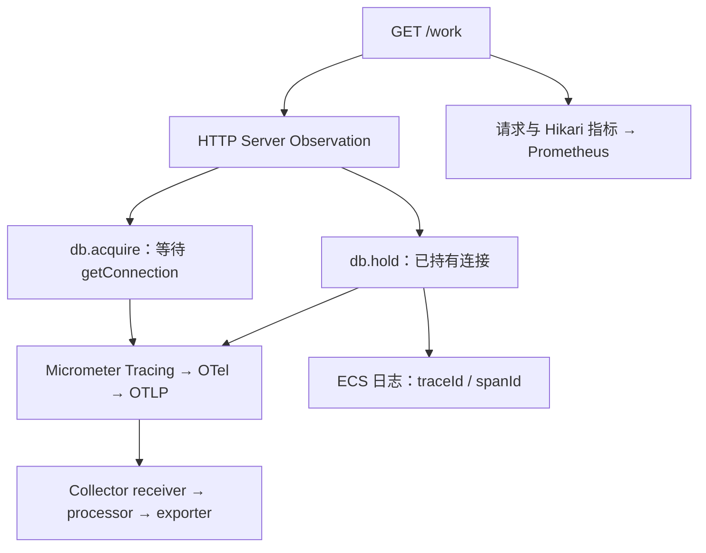

# OTLP 链路导出、指标日志与等待分解实战

一个请求耗时 500ms，只记录总时长无法判断它在执行 SQL，还是根本没有拿到连接。可观测性设计要先决定需要区分的时间边界，再选日志、指标和 span，而不是依赖装得越多越好。

## 1. 运行工程和自动化实验

源码位于 [deepening-lab/telemetry](https://github.com/newswitch/newswitch.github.io/tree/main/examples/spring-boot/deepening-lab/telemetry)。使用 JDK 25 与 Boot 4.1.1：

```bash
mvn -B -ntp -f examples/spring-boot/deepening-lab/pom.xml -pl telemetry verify
```

4 项测试覆盖真实 HTTP 请求、OTLP protobuf 导出、span 关系、导出拒绝、Prometheus 内容与非法参数。测试启动临时本机 OTLP 接收器，解析 ExportTraceServiceRequest，不是只断言“exporter Bean 存在”。接收器用于协议验证，不是具有存储、检索、鉴权和容灾能力的 Collector 后端。

`holdMs` 在 0～200ms 之间，是人为保持 JDBC 连接的时间；它不是生产数据库 SQL 执行耗时，不应用本实验推断真实数据库性能。

## 2. 从请求到三个观测平面



HTTP server span 是父节点，db.acquire 和 db.hold 是同一请求的两个子节点。数据库获取成功后，acquire 已结束才进入 hold，不将整个连接使用时间错误地标记成“拿连接等待”。

## 3. 版本属性和传输协议

使用 `spring-boot-starter-opentelemetry`，由 Boot 管理桥接和导出依赖。当前实验配置：

```properties
management.tracing.sampling.probability=1
management.opentelemetry.tracing.export.otlp.endpoint=http://127.0.0.1:14318/v1/traces
management.opentelemetry.tracing.export.otlp.timeout=1s
management.otlp.metrics.export.enabled=false
management.logging.export.otlp.enabled=false
logging.structured.format.console=ecs
```

这里将 tracing 经 OTLP/HTTP protobuf 发送；指标通过 Prometheus 拉取；日志写标准输出。显式关闭额外 OTLP 指标和日志导出，避免 Starter 引入的默认导出器向另一个 localhost 端点发送数据。

这些是 Boot 4.1.1 的属性；升级时核对当前配置元数据和弃用记录，不凭属性名“看起来合理”认定生效。HTTP 的 `/v1/traces` 与 gRPC 的目标格式不同，不能只互换端口。[Boot Tracing](https://docs.spring.io/spring-boot/reference/actuator/tracing.html)

## 4. 连接获取与连接占用怎样划界

Work 控制器先启动 db.acquire，打开该 Observation 的作用域，调用 DataSource.getConnection。无论成功或异常都在 finally 停止；失败时设置 error。成功后用 try-with-resources 管理连接，启动 db.hold，等待指定时间并执行 `SELECT 1`，最后停止 span 并归还连接。

作用域控制“此时哪个 span 是当前上下文”，stop 控制“这个 span 已经结束”。只关闭 scope 不代表结束 observation，只调用 stop 而不管理上下文又可能留下错误关联。使用框架 API 管理两者，不手工给每个线程永久塞 MDC。

例如：

```text
HTTP server span
├─ db.acquire：约 240ms
└─ db.hold：约 80ms
```

这组数值只用于说明读图：请求主要在等连接，不是 SELECT 1 执行了 320ms。若 acquire 很短、hold 很长，再查事务中锁、下游、结果读取和应用逻辑。子 span 有并行关系时，不能直接将它们全部求和当总耗时。

## 5. 真正连到 Collector

在实验根目录执行：

```bash
docker compose --profile telemetry up -d collector
java -Xmx384m -jar telemetry/target/telemetry-lab-1.0.0.jar
```

另一个终端：

```bash
curl -f "http://127.0.0.1:8083/work?holdMs=80"
curl -f http://127.0.0.1:8083/actuator/prometheus
docker compose --profile telemetry logs --tail=150 collector
```

Collector 配置是 OTLP receiver → memory_limiter → batch → debug exporter，只接 traces。debug 输出用于检查 service.name、traceId、spanId、parentSpanId 和 span 名称，不保存长期查询数据。生产应改为目标后端 exporter，并配置 TLS、鉴权、队列、重试和敏感属性过滤。[Collector 配置](https://opentelemetry.io/docs/collector/configuration/)

容器内 receiver 监听 0.0.0.0，宿主机映射限制为 127.0.0.1；如果改成应用也在容器中，应用的 localhost 不再指向 Collector，需要使用对应服务名与容器端口。当前 Docker 未运行环境仍可执行自动化本机接收器测试，但不能将其称为已联通 Collector 容器。

## 6. 如何证明父子关系没有串线

TelemetryTest 发真实 `/work`，等待响应后对 SdkTracerProvider 执行有限 forceFlush，再解析接收的 protobuf。测试断言 db.acquire 与 db.hold：

- traceId 相同。
- parentSpanId 相同且非空。
- hold 的持续时间不小于设置的 10ms。

这是对实际导出内容的断言，不是从日志文本猜测。若以后增加异步工作，必须再验证跨线程传播；当前同步实验不能证明任意线程池、Reactor 或消息链路自动正确传播。

## 7. 指标和日志怎样补足 Trace

Prometheus 暴露 Hikari 最大连接数等指标，以及 `lab_work_attempts_total`、拒绝数、数据库错误数和 HTTP 请求统计。指标名由 MeterRegistry 转换，配置中的点号不一定原样出现在 exposition 文本中。

数据库连接数最多 2，本身不是异常；active=2、pending 增长、acquire span 变长才组成一个等待证据链。实验还可观察 connection timeout 产生的 503 与数据库错误计数。

ECS 日志包含 traceId、spanId 和 `lab_work_complete hold_ms=...`。日志发生在 db.hold 作用域内，因此其 spanId 应指向持有阶段。不要将 Token、租户具体数据、SQL 参数或任意用户 ID 加进低基数指标标签；诊断粒度与隐私、存储成本需要一起设计。

## 8. 导出失败和采样不能影响主业务无上限等待

OTel 通常通过有界批处理导出。Collector 不可用时，队列、重试和丢弃可能使 Trace 不完整；收到应用 200 不代表 Trace 已持久化，没查到 Trace 也不代表请求没发生。

实验可在隔离环境停止 Collector，再发少量请求，核对应用响应、导出错误和恢复后的新 Trace。超时、队列和内存必须有上限；不要让每个业务请求同步等待遥测后端，也不要用无限队列换取表面“不丢数据”。

100% 采样是为了小规模教学观测。生产采样要结合错误/尾采样、成本和容量；改采样率后，应保留足够指标与日志解释未采样请求。

## 9. 练习与答案

### 9.1 db.acquire 和 db.hold 的 parent 相同是什么意思

它们是同一 HTTP server span 下的兄弟阶段，不是 acquire 包住整个连接使用。这样更容易区分排队与持有。

### 9.2 为什么不同时默认导出三种 OTLP 信号

实验只提供 traces pipeline，指标使用 Prometheus，日志使用 ECS 标准输出。额外默认导出器会产生无效网络请求、错误和开销，应按实际后端配置。

### 9.3 看到很长 db.hold，能否认定 SQL 慢

不能。该 span 明确包含人为占用时间和 SQL；生产还可能包含事务内应用等待。必须核对插桩边界并结合数据库执行证据。

## 10. 关联与参考

- [结构化日志与上下文](./03-结构化日志MDC与OpenTelemetry.md)
- [容量对照实验](./14-连接池排队准入控制与容量对照实验.md)
- [Micrometer Observation](https://docs.micrometer.io/micrometer/reference/observation.html)
