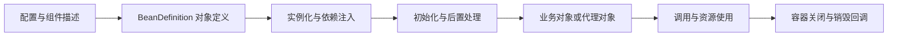

# Spring Framework 学习路线

一个服务会同时使用业务对象、数据库客户端、配置和后台执行器。当每个对象自行创建依赖时，替换实现、测试和统一关闭资源会越来越困难。Spring 容器集中描述对象及其关系，在生命周期中完成创建、注入、增强和关闭；Web、事务等能力以此为基础协作。

Spring Framework 是核心框架。Spring Boot 使用它，并提供自动配置和应用启动约定。理解 Spring，首先要能看清一个业务调用涉及哪些对象，哪些对象被代理，以及状态和资源属于谁。

## 1. 前置知识

先完成 [Java 基础主线](../java/00-Java与JVM学习路线.md)中的对象、接口、异常、反射和测试。事务部分再补 JDBC 和数据库事务；Web 部分补 HTTP 与 Servlet；响应式部分补并发、取消和背压。

不必先背诵整个源码仓库。可以先手动装配两个类，再通过容器装配同一组对象，观察行为相同而创建与管理方式不同。

## 2. 先观察一个对象如何被管理

这是一条学习用主路径，不代表每种 Bean 都立即创建。懒加载、不同 Scope、FactoryBean 和代理会改变实际对象、创建时刻与持有者，后续实验需要逐一确认。

## 3. 四个专题与 28 篇技术文章

当前发布本学习路线；下列正文按阶段逐步提供。

| 目录 | 篇数 | 学习问题 |
| --- | --- | --- |
| `01-container` | 7 | 对象如何定义、创建、注入、共享、初始化和关闭 |
| `02-aop-transactions` | 7 | 代理如何包住调用，事务何时生效和结束 |
| `03-web` | 7 | Servlet/MVC 与响应式请求分别怎样运行 |
| `04-internals` | 7 | 用源码验证容器、代理、事务和 Web 的状态变化 |

### 3.1 容器

1. 从手动创建对象到 IoC 与依赖注入。
2. 配置类、组件扫描、自动注入与依赖选择。
3. BeanDefinition、BeanFactory 与 ApplicationContext。
4. Bean 生命周期、Scope 与线程安全。
5. BeanFactoryPostProcessor、BeanPostProcessor 与 FactoryBean。
6. Environment、PropertySource、Profile 与配置条件。
7. 事件、容器生命周期与资源关闭。

关键实验是替换一个执行器而不修改业务类，并证明 Singleton 不自动提供线程安全；Prototype 对象也不能简单假设由容器统一完成全部销毁。

### 3.2 AOP 与事务

1. JDK 动态代理与 CGLIB。
2. 切点、通知、拦截链与执行顺序。
3. 事务管理器、连接、提交、回滚与资源绑定。
4. REQUIRED、REQUIRES_NEW 与 NESTED。
5. 隔离级别、数据库锁与并发实验。
6. 自调用、异常、代理与线程边界导致的事务失效。
7. 编程式事务、事务事件与提交后的动作。

应同时观察业务数据和连接行为。独立事务可能需要额外连接，代理生效也不等于所有外部操作都能一起回滚。

### 3.3 Web

1. Servlet、Tomcat、线程与请求生命周期。
2. DispatcherServlet、HandlerMapping 与 HandlerAdapter。
3. 参数绑定、消息转换、校验与异常处理。
4. Filter、Interceptor、ControllerAdvice 与 AOP。
5. 异步请求、SSE 与 WebSocket。
6. Reactor、背压、Scheduler 与取消。
7. WebFlux、Netty 与 WebClient。

MVC 与 WebFlux分别沿自己的执行路径分析。响应式 API 返回类型不能证明整个调用链没有阻塞，还需要核对线程、数据库驱动和外部客户端。

### 3.4 源码阅读

1. `ApplicationContext.refresh()`。
2. Bean 创建、依赖解析、提前引用与循环依赖。
3. 配置类解析、ImportSelector 与注册机制。
4. 自动代理与 AOP 拦截链。
5. 事务拦截器的开启、提交和回滚路径。
6. MVC 请求从入口到响应的调用路径。
7. Spring TestContext、上下文缓存与测试隔离。

每篇固定源码 tag，以“入口、关键对象、状态变化、退出条件”为阅读顺序。方法名用于定位证据，正文主要解释它们之间的责任关系。

## 4. 与 Spring Boot 的交叉顺序

学完容器基础后就可以创建 Boot 服务。第一次请求能够运行后，再分析 MVC；接入数据库时回到事务；出现配置和启动问题时再深入源码。

Spring 独立示例采用 7.x 中固定的正式版本；Boot 工程以其 BOM 管理兼容依赖，不能为了让版本号看起来更新而单独替换核心 JAR。

## 5. 验收任务

- 用纯 Java 和容器分别装配同一个业务对象，验证可替换性。
- 记录 Bean 初始化、代理创建和销毁的顺序。
- 以数据库记录证明事务提交、回滚、自调用和新事务的区别。
- 给同一次请求标记 Filter、DispatcherServlet、Controller、Service 和响应转换。
- 从测试或日志确定实际执行对象、线程和连接，而不是仅根据注解猜测。

## 6. 练习与答案

### 6.1 IoC 是否意味着不用 new

不是。对象仍要被构造，容器可能调用构造方法或工厂。变化在于依赖关系和生命周期由容器协调。局部值对象通常仍由业务代码正常创建。

### 6.2 一个 Bean 是 Singleton，其字段是否能随意修改

不能。多个请求可能访问同一实例。Singleton 描述容器中的实例共享方式，不是锁或线程隔离策略；请求状态宜放在局部变量或明确隔离的对象中。

### 6.3 为什么能执行方法却没有开启事务

方法执行和事务增强是两件事。必须确定调用是否经过正确代理、是否符合拦截条件、事务管理器是否正确，以及异常和线程边界。仅看方法上的注解不足以判定。

## 7. 关联文章与官方资料

- [Java 与 JVM 学习路线](../java/00-Java与JVM学习路线.md)
- [Spring Boot 学习路线](../spring-boot/00-SpringBoot学习路线.md)
- [Spring Framework 文档](https://docs.spring.io/spring-framework/reference/index.html)
- [IoC 容器](https://docs.spring.io/spring-framework/reference/core/beans.html)
- [Spring 源码与正式版本](https://github.com/spring-projects/spring-framework/tags)
