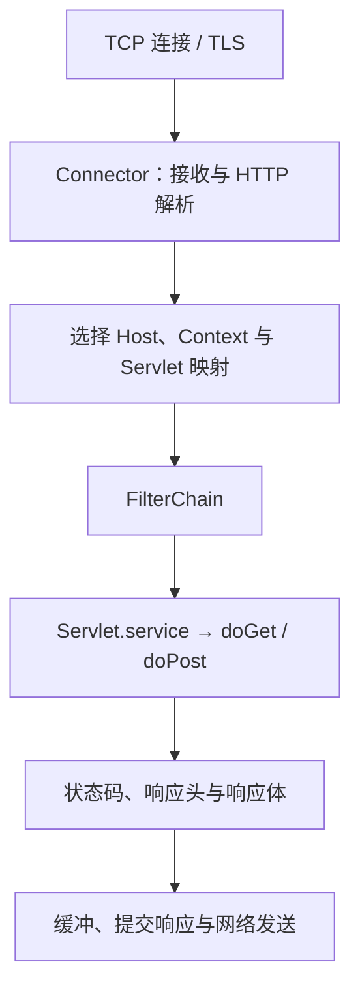

# Servlet、Tomcat、线程与请求生命周期

浏览器访问一个 Java 服务，首先到达的不是 Controller，而是监听端口的服务器。Tomcat 接收连接、解析 HTTP，再把请求交给 Servlet。Spring MVC 的入口 DispatcherServlet 本身就是一个 Servlet。

理解这一层，才能区分“连接建不起来”“请求正在等线程”“Controller 执行很慢”和“响应写不出去”。它们都可能表现为超时，却需要检查不同证据。

## 1. 连接、请求和线程不是同一个对象

| 对象 | 描述 | 不能据此推断 |
| --- | --- | --- |
| TCP 连接 | 客户端与服务端之间的传输通道 | 一条连接只处理一个请求 |
| HTTP 请求 | 方法、目标、请求头和可选请求体 | 一个请求一直占用同一线程 |
| 工作线程 | 运行解析后的业务处理代码 | 有多少连接就必须有多少线程 |
| Servlet 实例 | 容器管理的处理对象 | 每个请求都有一个 Servlet 实例 |

HTTP/1.1 Keep-Alive 可以复用连接。HTTP/2 还可以在一条连接上复用多个流。连接等待网络事件时，NIO 模型不必为每条空闲连接占用一个业务工作线程。

但“连接使用 NIO”不等于“业务没有阻塞”。普通同步 Servlet 在等待 JDBC、远端 HTTP 或锁时，工作线程仍可能被占住。

## 2. 一次同步请求经过什么



Connector 是 Tomcat 的协议入口；Context 是一个 Web 应用，不是某个 Spring Bean。URL 映射确定 Servlet 后，过滤器链才把请求送入它。

`HttpServlet.service()` 根据 HTTP 方法分派到 `doGet()`、`doPost()` 等方法。使用 Spring MVC 时，DispatcherServlet 接管后面的映射与调用，不要求为每个业务 URL 创建一个 Servlet。

响应也不是在 `return` 的瞬间才出现。刷新缓冲区、缓冲区写满或请求处理结束，都可能使响应提交。提交后再改状态码或响应头通常已经太晚；客户端断开也可能在写响应时才被发现。

## 3. Servlet 的生命周期与共享状态

容器负责创建 Servlet、调用 `init()`，在服务期间并发调用 `service()`，关闭时调用 `destroy()`。通常一个注册的 Servlet 实例服务多个请求。

因此下面的设计有竞争风险：把当前用户、请求参数或一个可变列表放到 Servlet 实例字段，随后在每个请求中修改。一个用户的值可能被另一个请求覆盖。

请求数据应优先保存在局部变量或请求属性中。确实需要共享的缓存和计数器，应有明确的并发策略和容量上限。把 Controller 注册为 Singleton 时，也有同样的状态边界。

`ThreadLocal` 也不是请求存储的天然答案。线程会被复用，异步处理会换线程；若使用它承载追踪信息，必须在 `finally` 清理，并显式处理跨线程传播。

## 4. 建立纯 Spring Web 实验工程

本专题使用 JDK 25、Maven 3.9.14、Spring Framework 7.0.9，不依赖 Spring Boot。Servlet 示例使用 Tomcat 11.0.24 与 Jakarta Servlet 6.1；JSON 使用 Jackson 3.0.4；Reactor 使用 BOM 2025.0.7。版本参照 [Spring 7.0.9 平台依赖声明](https://github.com/spring-projects/spring-framework/blob/v7.0.9/framework-platform/framework-platform.gradle)，固定用于复现实验，不宣称它们永远是最新版本。

完整工程在仓库 `examples/spring/web-lab/`。后续七个主类共用下面的 POM。`spring-test` 在这个学习工程中参与主类编译，是为了直接运行 MockMvc 演示；普通生产项目通常将它放在测试作用域。

<details>
<summary>完整 pom.xml</summary>

```xml title="pom.xml"
<?xml version="1.0" encoding="UTF-8"?>
<project xmlns="http://maven.apache.org/POM/4.0.0"
         xmlns:xsi="http://www.w3.org/2001/XMLSchema-instance"
         xsi:schemaLocation="http://maven.apache.org/POM/4.0.0 https://maven.apache.org/xsd/maven-4.0.0.xsd">
  <modelVersion>4.0.0</modelVersion>
  <groupId>io.newswitch.learning</groupId><artifactId>spring-web-lab</artifactId><version>1.0.0</version>
  <properties>
    <project.build.sourceEncoding>UTF-8</project.build.sourceEncoding>
    <maven.compiler.release>25</maven.compiler.release>
  </properties>
  <dependencyManagement><dependencies>
    <dependency><groupId>org.springframework</groupId><artifactId>spring-framework-bom</artifactId><version>7.0.9</version><type>pom</type><scope>import</scope></dependency>
    <dependency><groupId>tools.jackson</groupId><artifactId>jackson-bom</artifactId><version>3.0.4</version><type>pom</type><scope>import</scope></dependency>
    <dependency><groupId>io.projectreactor</groupId><artifactId>reactor-bom</artifactId><version>2025.0.7</version><type>pom</type><scope>import</scope></dependency>
    <dependency><groupId>org.junit</groupId><artifactId>junit-bom</artifactId><version>6.0.3</version><type>pom</type><scope>import</scope></dependency>
  </dependencies></dependencyManagement>
  <dependencies>
    <dependency><groupId>org.springframework</groupId><artifactId>spring-webmvc</artifactId></dependency>
    <dependency><groupId>org.springframework</groupId><artifactId>spring-webflux</artifactId></dependency>
    <dependency><groupId>org.springframework</groupId><artifactId>spring-websocket</artifactId></dependency>
    <dependency><groupId>org.springframework</groupId><artifactId>spring-test</artifactId></dependency>
    <dependency><groupId>tools.jackson.core</groupId><artifactId>jackson-databind</artifactId></dependency>
    <dependency><groupId>org.apache.tomcat.embed</groupId><artifactId>tomcat-embed-core</artifactId><version>11.0.24</version></dependency>
    <dependency><groupId>org.apache.tomcat.embed</groupId><artifactId>tomcat-embed-websocket</artifactId><version>11.0.24</version></dependency>
    <dependency><groupId>org.hibernate.validator</groupId><artifactId>hibernate-validator</artifactId><version>9.1.3.Final</version></dependency>
    <dependency><groupId>org.glassfish.expressly</groupId><artifactId>expressly</artifactId><version>6.0.0</version></dependency>
    <dependency><groupId>org.aspectj</groupId><artifactId>aspectjweaver</artifactId><version>1.9.25</version></dependency>
    <dependency><groupId>io.projectreactor.netty</groupId><artifactId>reactor-netty-http</artifactId></dependency>
    <dependency><groupId>io.projectreactor</groupId><artifactId>reactor-test</artifactId><scope>test</scope></dependency>
    <dependency><groupId>org.junit.jupiter</groupId><artifactId>junit-jupiter</artifactId><scope>test</scope></dependency>
  </dependencies>
  <build><plugins>
    <plugin><groupId>org.apache.maven.plugins</groupId><artifactId>maven-clean-plugin</artifactId><version>3.4.1</version></plugin>
    <plugin><groupId>org.apache.maven.plugins</groupId><artifactId>maven-resources-plugin</artifactId><version>3.3.1</version></plugin>
    <plugin><groupId>org.apache.maven.plugins</groupId><artifactId>maven-compiler-plugin</artifactId><version>3.14.1</version><configuration><parameters>true</parameters></configuration></plugin>
    <plugin><groupId>org.apache.maven.plugins</groupId><artifactId>maven-surefire-plugin</artifactId><version>3.5.4</version><configuration><failIfNoTests>true</failIfNoTests></configuration></plugin>
    <plugin><groupId>org.apache.maven.plugins</groupId><artifactId>maven-jar-plugin</artifactId><version>3.4.2</version></plugin>
    <plugin><groupId>org.apache.maven.plugins</groupId><artifactId>maven-dependency-plugin</artifactId><version>3.8.1</version></plugin>
  </plugins></build>
</project>
```

</details>

注意包名是 `jakarta.servlet`，不能把旧文章中的 `javax.servlet` JAR 混入 Tomcat 11。Jackson 3 的核心 Java 包是 `tools.jackson`；不能只改版本号而保持全部 Jackson 2 导入不变。

## 5. 运行真实 HTTP 请求

实验服务器只绑定 `127.0.0.1`，端口设为 `0`，由操作系统分配临时端口。请求完成后关闭服务器、客户端与专用临时目录，不需要常驻进程。

下面的包装类供后续 MVC 实验复用。它限制线程数，在启动失败时也执行清理；删除操作只接受自己创建的临时目录。

<details>
<summary>嵌入式 Tomcat 的创建与关闭</summary>

```java title="src/main/java/demo/web/support/EmbeddedTomcat.java"
package demo.web.support;

import jakarta.servlet.http.HttpServlet;
import org.apache.catalina.Context;
import org.apache.catalina.startup.Tomcat;
import org.apache.tomcat.websocket.server.WsSci;
import java.net.URI;
import java.nio.file.*;
import java.util.Comparator;
import java.util.Set;

public final class EmbeddedTomcat implements AutoCloseable {
    private final Path base = Files.createTempDirectory("spring-web-tomcat-");
    private final Tomcat tomcat = new Tomcat();
    private final Context context;
    public EmbeddedTomcat() throws Exception {
        tomcat.setBaseDir(base.toString());
        tomcat.setPort(0);
        tomcat.getConnector().setProperty("address", "127.0.0.1");
        tomcat.getConnector().setProperty("maxThreads", "4");
        tomcat.getConnector().setProperty("minSpareThreads", "1");
        tomcat.getConnector().setProperty("acceptCount", "8");
        context = tomcat.addContext("", base.toString());
        context.setParentClassLoader(EmbeddedTomcat.class.getClassLoader());
    }
    public void servlet(String name, String mapping, HttpServlet servlet) {
        var wrapper = Tomcat.addServlet(context, name, servlet);
        wrapper.setLoadOnStartup(1);
        wrapper.setAsyncSupported(true);
        context.addServletMappingDecoded(mapping, name);
    }
    public void enableWebSocket() {
        context.addServletContainerInitializer(new WsSci(), Set.of());
    }
    public void start() throws Exception { tomcat.start(); }
    public URI baseUri() {
        return URI.create("http://127.0.0.1:" + tomcat.getConnector().getLocalPort());
    }
    @Override public void close() throws Exception {
        try { tomcat.stop(); }
        finally {
            try { tomcat.destroy(); }
            finally {
                Path expected = Path.of(System.getProperty("java.io.tmpdir")).toRealPath();
                if (!base.getParent().toRealPath().equals(expected)
                        || !base.getFileName().toString().startsWith("spring-web-tomcat-"))
                    throw new IllegalStateException("Unexpected cleanup path: " + base);
                try (var files = Files.walk(base)) {
                    for (Path file : files.sorted(Comparator.reverseOrder()).toList()) Files.delete(file);
                }
            }
        }
    }
}
```

</details>

主程序注册一个 Servlet，再通过 JDK HttpClient 发起真正的 TCP/HTTP 请求：

```java title="src/main/java/demo/web/servlet/ServletDemo.java"
package demo.web.servlet;

import demo.web.support.EmbeddedTomcat;
import jakarta.servlet.http.*;
import java.io.IOException;
import java.net.http.*;
import java.time.Duration;
import java.util.concurrent.atomic.AtomicReference;

public final class ServletDemo {
    public static void main(String[] args) throws Exception {
        var worker = new AtomicReference<Thread>();
        try (var server = new EmbeddedTomcat(); var client = HttpClient.newHttpClient()) {
            server.servlet("hello", "/hello", new HttpServlet() {
                @Override protected void doGet(HttpServletRequest request, HttpServletResponse response)
                        throws IOException {
                    worker.set(Thread.currentThread());
                    response.setContentType("text/plain;charset=UTF-8");
                    response.getWriter().write("hello");
                }
            });
            server.start();
            var request = HttpRequest.newBuilder(server.baseUri().resolve("/hello"))
                    .timeout(Duration.ofSeconds(3)).GET().build();
            var response = client.send(request, HttpResponse.BodyHandlers.ofString());
            System.out.println("status=" + response.statusCode());
            System.out.println("body=" + response.body());
            System.out.println("separateThread=" + (worker.get() != Thread.currentThread()));
        }
    }
}
```

在工程目录执行：

```bash
mvn -B -ntp clean verify dependency:copy-dependencies -DincludeScope=runtime
java -cp "target/classes:target/dependency/*" demo.web.servlet.ServletDemo
```

Windows 的 classpath 分隔符改为分号：`"target/classes;target/dependency/*"`。确保 `java -version` 与 Maven 实际使用的都是 JDK 25。

业务标准输出如下；Tomcat 启停日志另外输出，不属于这三行：

```text title="expected-output"
status=200
body=hello
separateThread=true
```

它证明请求确实经过服务器工作线程，但没有证明高并发能力、TLS 配置或公网可达性。`maxThreads=4` 是这个小实验的资源限制，不是生产推荐值。

## 6. 请求变慢时沿生命周期取证

先比较客户端 DNS、连接、TLS、首字节与总耗时，再关联服务器的接收量、活跃线程、排队、处理时长和下游耗时。

大量工作线程等待数据库连接，通常应检查数据库池与慢查询，而不是先扩大 Tomcat 线程池。盲目加线程可能把更多请求同时压向已经饱和的下游。

连接超时、读取超时、服务端异步超时和网关超时也不是同一个时钟。要确认谁先计时、限制哪个阶段、到期后是否取消剩余工作。第 5 篇再分析 Servlet 异步如何释放原请求线程。

## 7. 练习与答案

### 7.1 有一万个 Keep-Alive 连接，是否必须有一万个业务线程

不必须。事件驱动的连接管理可以复用少量线程处理网络就绪事件。但同步业务处理中真正阻塞的请求仍消耗工作线程，必须分别统计连接数与正在执行的请求数。

### 7.2 把用户 ID 放在 Servlet 字段为什么不安全

同一个实例可能并发处理多个请求，字段会互相覆盖。用户 ID 应放在本次调用的局部变量或请求上下文；共享实例字段只保存明确线程安全的公共依赖与状态。

### 7.3 返回 200 后客户端仍报读取异常，是否说明 Controller 没运行

不说明。响应可能已提交，随后连接断开、代理超时或写响应失败。需要关联服务器执行记录、响应提交和客户端接收情况，不能仅凭一个状态码推断完整交付。

## 8. 继续阅读与资料

- 下一篇：[DispatcherServlet 映射与请求执行链](./02-DispatcherServlet映射与请求执行链.md)。
- [Tomcat 11 HTTP Connector](https://tomcat.apache.org/tomcat-11.0-doc/config/http.html)
- [Jakarta Servlet 6.1 规范](https://jakarta.ee/specifications/servlet/6.1/)
- [Spring MVC DispatcherServlet](https://docs.spring.io/spring-framework/reference/web/webmvc/mvc-servlet.html)
