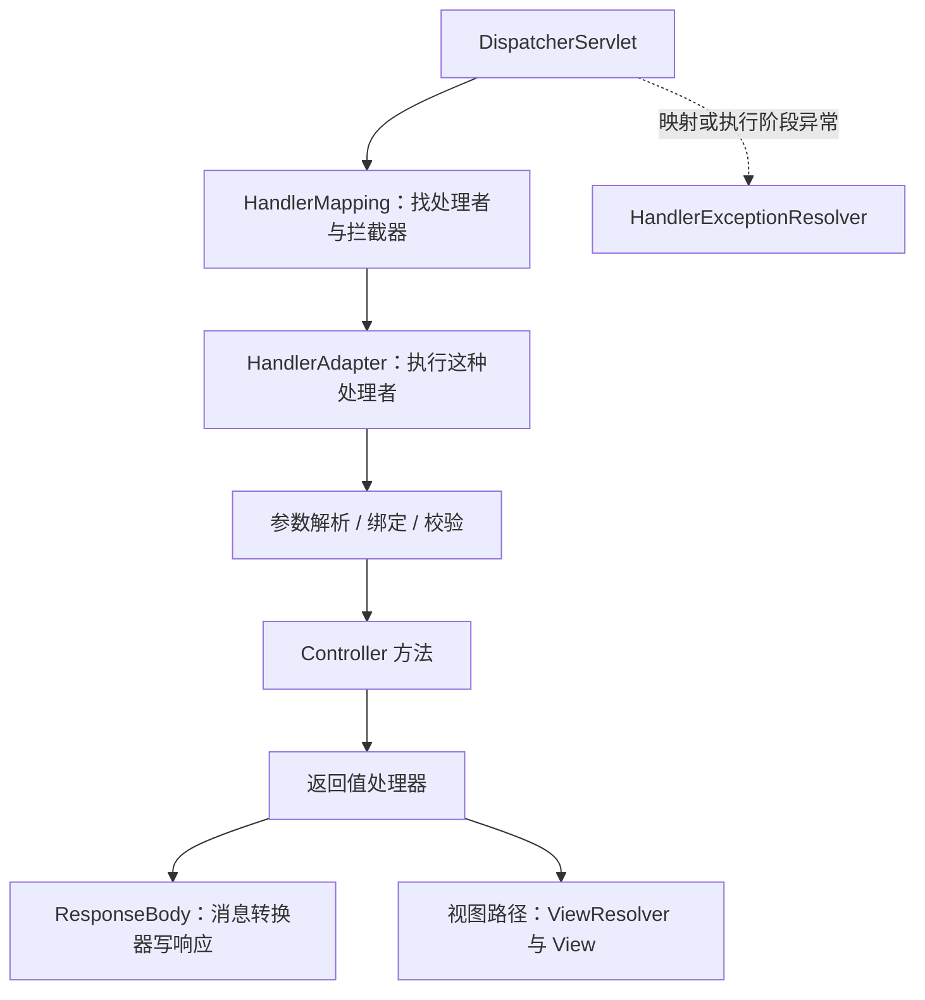

# DispatcherServlet、映射与请求执行链

`GET /tasks/7` 为什么能调用 `get(long id)`？不是 Tomcat 看懂了 `@GetMapping`，而是 Tomcat 把请求送到 DispatcherServlet，Spring MVC 再查找处理方法、准备参数并处理返回值。

这些步骤由不同策略对象承担。把它们分开，才能解释“URL 找不到”“参数不合法”“方法执行了但序列化失败”为什么属于不同阶段。

## 1. 先建立责任地图



| 组件 | 主要问题 | 注解 MVC 中的常见实现 |
| --- | --- | --- |
| HandlerMapping | 谁处理这个方法、路径和媒体类型组合 | RequestMappingHandlerMapping |
| HandlerAdapter | 怎样调用这种处理者 | RequestMappingHandlerAdapter |
| 参数解析器 | 一个方法形参从哪里来 | PathVariable、RequestParam、RequestBody 对应解析器 |
| 返回值处理器 | 返回值表示响应体、视图还是异步结果 | ResponseBody、ModelAndView、异步类型对应处理器 |
| 异常解析器 | 异常能否转成有语义的 HTTP 响应 | ExceptionHandlerExceptionResolver 等 |

Mapping 返回的不只是一个方法，通常是包含处理者和拦截器的 `HandlerExecutionChain`。Adapter 则处理执行协议，不负责重新搜索所有 URL。

## 2. 映射在启动时建立，不是每次反射扫描全部类

启用 MVC 配置后，框架在初始化阶段检查 Controller 的映射，建立请求条件到 `HandlerMethod` 的注册信息。请求到来后，根据方法、路径、参数、请求头、`consumes` 和 `produces` 等条件匹配。

因此同一个路径可能有不同 HTTP 方法对应不同方法；路径存在也不保证当前请求能执行。常见结果包括：路径不存在是 404，已知路径不支持当前方法是 405，输入或输出媒体类型不满足约束则可能是 415 或 406。

两个方法的条件若无法区分，可能在启动注册或请求匹配时产生歧义。给方法起不同 Java 名称不能解决相同 HTTP 映射冲突。

## 3. 从字符串变成方法参数

请求中的 `7` 最初是路径文本。参数解析器取出路径变量，使用转换体系得到 `long`，必要时完成绑定和校验，然后 Adapter 才调用业务方法。

读取请求体又是另一条路径：消息转换器依据媒体类型把 JSON 解码成 DTO。`@RequestParam` 不等于“读取 JSON 任意字段”；`@RequestBody` 也不等于“从 URL 查询参数拼对象”。下一篇专门验证这些边界。

编译参数名是一个容易遗漏的条件。本专题设置 Maven `parameters=true`，同时示例显式写出 `@PathVariable("id")`，避免把参数名称发现机制误当成 URL 映射本身。

## 4. 返回字符串究竟是什么意思

普通 `@Controller` 方法返回字符串，可能把它当作视图名；`@ResponseBody` 方法返回字符串，则交给消息转换器写响应体。`@RestController` 组合了 `@Controller` 与 `@ResponseBody`。

这也不意味着所有响应都是 JSON。示例明确产生 `text/plain`，返回值为字符串，所以响应体就是 `task:7`。返回 DTO 并具备 JSON 转换器时，才会使用相应的 JSON 编码路径。

## 5. 不靠 Boot，手动接好 Tomcat 与 MVC

复用[上一篇](./01-Servlet-Tomcat线程与请求生命周期.md)的 POM 和 `EmbeddedTomcat`。下面把一个 WebApplicationContext 交给 DispatcherServlet，再将这个 Servlet 映射到 `/`。

<details>
<summary>MVC 服务器包装类</summary>

```java title="src/main/java/demo/web/support/RunningMvc.java"
package demo.web.support;

import org.springframework.web.context.support.AnnotationConfigWebApplicationContext;
import org.springframework.web.servlet.DispatcherServlet;
import java.net.URI;

public final class RunningMvc implements AutoCloseable {
    private final EmbeddedTomcat server;
    private final AnnotationConfigWebApplicationContext context;
    public RunningMvc(Class<?> configuration) throws Exception { this(configuration, false); }
    public RunningMvc(Class<?> configuration, boolean webSocket) throws Exception {
        server = new EmbeddedTomcat();
        context = new AnnotationConfigWebApplicationContext();
        context.register(configuration);
        try {
            if (webSocket) server.enableWebSocket();
            server.servlet("mvc", "/", new DispatcherServlet(context));
            server.start();
            if (!context.isActive()) throw new IllegalStateException("MVC context did not start");
        } catch (Exception error) {
            try { close(); } catch (Exception cleanup) { error.addSuppressed(cleanup); }
            throw error;
        }
    }
    public URI baseUri() { return server.baseUri(); }
    public AnnotationConfigWebApplicationContext context() { return context; }
    @Override public void close() throws Exception {
        try { server.close(); } finally { context.close(); }
    }
}
```

</details>

DispatcherServlet 初始化时会为尚未刷新的 Web 上下文设置 ServletContext 并刷新。不要为了“提前创建 Bean”随意在没有 ServletContext 时手动刷新 MVC 上下文。

```java title="src/main/java/demo/web/mvc/DispatchDemo.java"
package demo.web.mvc;

import demo.web.support.RunningMvc;
import org.springframework.context.annotation.*;
import org.springframework.web.bind.annotation.*;
import org.springframework.web.servlet.config.annotation.EnableWebMvc;
import org.springframework.web.servlet.mvc.method.annotation.*;
import java.net.http.*;
import java.time.Duration;

public final class DispatchDemo {
    @Configuration(proxyBeanMethods = false) @EnableWebMvc
    public static class Config {
        @Bean public Tasks tasks() { return new Tasks(); }
    }
    @RestController @RequestMapping("/tasks")
    public static class Tasks {
        @GetMapping(value = "/{id}", produces = "text/plain")
        public String get(@PathVariable("id") long id) { return "task:" + id; }
    }
    public static void main(String[] args) throws Exception {
        try (var server = new RunningMvc(Config.class); var client = HttpClient.newHttpClient()) {
            System.out.println("mapping=" + server.context().getBean(RequestMappingHandlerMapping.class).getClass().getSimpleName());
            System.out.println("adapter=" + server.context().getBean(RequestMappingHandlerAdapter.class).getClass().getSimpleName());
            var uri = server.baseUri().resolve("/tasks/7");
            var get = client.send(HttpRequest.newBuilder(uri).timeout(Duration.ofSeconds(3)).GET().build(),
                    HttpResponse.BodyHandlers.ofString());
            System.out.println("status=" + get.statusCode());
            System.out.println("body=" + get.body());
            var post = client.send(HttpRequest.newBuilder(uri).timeout(Duration.ofSeconds(3))
                    .POST(HttpRequest.BodyPublishers.noBody()).build(), HttpResponse.BodyHandlers.discarding());
            System.out.println("wrongMethod=" + post.statusCode());
        }
    }
}
```

用上一篇的构建与 classpath 命令运行 `demo.web.mvc.DispatchDemo`：

```text title="expected-output"
mapping=RequestMappingHandlerMapping
adapter=RequestMappingHandlerAdapter
status=200
body=task:7
wrongMethod=405
```

这里真实启动了 Tomcat；GET 和 POST 确实从网络进入 DispatcherServlet。打印到 Mapping Bean 只能证明它被创建，业务响应与 405 才是执行路径上的另一组证据。

## 6. 父子上下文与部署边界

传统多 Servlet 应用可以用根上下文管理公共业务对象，让各 DispatcherServlet 的子上下文管理自己的 Controller。子上下文可以查找父上下文，父上下文不能反向依赖子上下文中的对象。

本实验只有一个 Servlet 上下文，没有为了展示层次而增加根上下文。Spring Boot 创建 Web 服务时有自己的启动和自动配置机制；不能根据这里手动使用 `@EnableWebMvc`，就推导出 Boot 项目也应该无条件添加它。

排查映射问题时，先确认 Controller 是否在正确上下文中，再确认 MVC 配置、扫描范围和映射条件。不要把“Bean 已存在”和“已注册为当前 DispatcherServlet 的处理者”当成完全等价。

## 7. 练习与答案

### 7.1 HandlerMapping 是否负责调用 Controller

不负责完整调用。它查找处理者与拦截链，DispatcherServlet 再选择支持这个处理者的 HandlerAdapter。注解 MVC 的 Adapter 才组织参数解析、方法调用和返回值处理。

### 7.2 Controller 返回字符串，为什么有时返回正文，有时寻找模板

返回值语义取决于注解和处理器。`@ResponseBody` 或 `@RestController` 走响应体处理；普通视图 Controller 的字符串常被视为视图名。还需要核对实际媒体类型与转换器。

### 7.3 Controller 的日志已经出现，响应却是 500，应查哪里

业务方法之后仍有返回值处理、序列化和网络写入等阶段。先看异常与响应是否提交，再查转换器、对象序列化、拦截器和写响应路径，而不是认定 Controller 日志等于请求成功。

## 8. 继续阅读与资料

- 下一篇：[参数绑定、消息转换、校验与异常处理](./03-参数绑定消息转换校验与异常处理.md)。
- [DispatcherServlet](https://docs.spring.io/spring-framework/reference/web/webmvc/mvc-servlet.html)
- [Annotated Controllers](https://docs.spring.io/spring-framework/reference/web/webmvc/mvc-controller.html)
- [MVC 源码：DispatcherServlet 7.0.9](https://github.com/spring-projects/spring-framework/blob/v7.0.9/spring-webmvc/src/main/java/org/springframework/web/servlet/DispatcherServlet.java)
