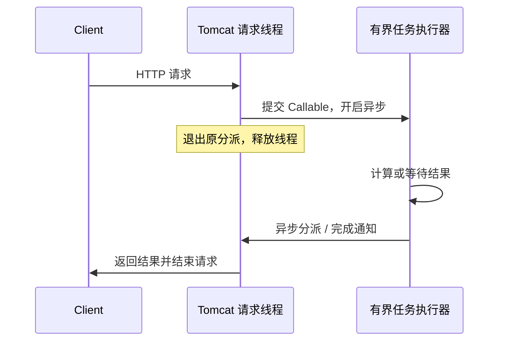

# Servlet 异步请求、SSE 与 WebSocket

生成一份报表需要几秒，推理服务要持续返回 Token，协作应用需要双向消息。这三个需求都涉及“等待”，但等待结果、流式响应和双向通道不是一种机制。

## 1. 异步首先改变线程占用，不自动改变工作量

同步 MVC 请求等待远端结果时，原工作线程通常仍被占用。Servlet 异步允许暂时保留请求/响应，释放原容器线程，等结果就绪后再继续处理。



Callable 如果在另一个线程里阻塞，阻塞只是转移了，不是消失了。异步期间连接、内存、任务队列和下游资源仍有成本。它有助于隔离容器工作线程，不等于无限并发。

Servlet 与途经的 Filter 必须支持异步，参与的分派类型也要正确注册。只返回异步类型，不能补救一个不支持异步的过滤器链。

## 2. Callable、DeferredResult 与超时

| 类型 | 谁生产结果 | 适合什么 |
| --- | --- | --- |
| Callable | MVC 的 AsyncTaskExecutor 执行任务 | 有明确任务边界的单个结果 |
| DeferredResult | 应用的其他线程或事件完成结果 | 回调、事件驱动的单个结果 |
| WebAsyncTask | Callable 加单请求配置 | 需要指定超时或执行器的任务 |
| SseEmitter / ResponseBodyEmitter | 应用持续写出事件或数据 | 单次 HTTP 响应中的流式输出 |

超时后给客户端返回错误，不保证数据库、推理或后台任务已经停止。取消需要传播到真正执行工作的组件；阻塞驱动可能只在特定操作点响应中断。

要同时限制执行器线程、排队数、请求等待时长与下游超时。过载时应明确拒绝或降级，而不是改成无界队列。生产还应定义异步超时与拒绝时的响应契约。

## 3. SSE 是一条 HTTP 响应，不是可靠消息队列

SSE 使用 `text/event-stream`，服务端发送文本事件，浏览器可以用 EventSource 接收。一个事件由字段行和空行分隔，可携带 `event`、`id`、`data`、`retry`。

它适合 Token、进度与通知。浏览器能够重连，不代表服务端自动实现了事件持久化、断点续传或恰好一次投递。`Last-Event-ID` 要与事件存储和重放逻辑配合才有意义。

还要检查代理缓冲、压缩策略、空闲超时和心跳。服务器已经调用 `send()`，不证明用户立即收到；代理可能仍在聚合数据。慢客户端也可能拖慢 MVC 写出线程，需要有界生产速率、队列和断开策略。

## 4. WebSocket 是握手后建立双向消息通道

典型 HTTP/1.1 场景先完成 Upgrade 握手，之后双方都能发送消息。它不同于 SSE 的服务端单向 HTTP 事件流，也不会自动提供持久化、重试和业务顺序协议。

鉴权、Origin 检查、消息大小、分片、慢客户端与连接清理都要设计。WebSocket 的 Origin 校验与一般 CORS 响应头不是同一套保证。跨域部署应显式配置可信来源，不能简单对所有来源放开。

## 5. 三种机制的真实网络实验

复用[RunningMvc](./02-DispatcherServlet映射与请求执行链.md)，启动时启用 Tomcat 的 WebSocket 初始化器。执行器只有两个线程和四个排队位置，由 Spring 在上下文关闭时释放。

<details>
<summary>Callable、两个 SSE 事件与 WebSocket 回显</summary>

```java title="src/main/java/demo/web/async/AsyncDemo.java"
package demo.web.async;

import demo.web.support.RunningMvc;
import org.springframework.context.annotation.*;
import org.springframework.scheduling.concurrent.ThreadPoolTaskExecutor;
import org.springframework.web.bind.annotation.*;
import org.springframework.web.servlet.config.annotation.*;
import org.springframework.web.servlet.mvc.method.annotation.SseEmitter;
import org.springframework.web.socket.*;
import org.springframework.web.socket.config.annotation.*;
import org.springframework.web.socket.handler.TextWebSocketHandler;
import java.net.URI;
import java.net.http.*;
import java.time.Duration;
import java.util.concurrent.*;
import java.util.concurrent.atomic.AtomicBoolean;
import java.util.concurrent.atomic.AtomicReference;

public final class AsyncDemo {
    @Configuration(proxyBeanMethods = false) @EnableWebMvc @EnableWebSocket
    public static class Config {
        @Bean public ThreadPoolTaskExecutor webTasks() {
            var executor = new ThreadPoolTaskExecutor();
            executor.setCorePoolSize(2); executor.setMaxPoolSize(2); executor.setQueueCapacity(4);
            executor.setThreadNamePrefix("web-task-"); executor.setAwaitTerminationSeconds(2);
            return executor;
        }
        @Bean public Tasks tasks(ThreadPoolTaskExecutor webTasks) { return new Tasks(webTasks); }
        @Bean public WebMvcConfigurer async(ThreadPoolTaskExecutor webTasks) {
            return new WebMvcConfigurer() {
                @Override public void configureAsyncSupport(AsyncSupportConfigurer config) {
                    config.setTaskExecutor(webTasks); config.setDefaultTimeout(2000);
                }
            };
        }
        @Bean public WebSocketConfigurer sockets() {
            return registry -> registry.addHandler(new TextWebSocketHandler() {
                @Override protected void handleTextMessage(WebSocketSession session, TextMessage message)
                        throws Exception { session.sendMessage(new TextMessage("echo:" + message.getPayload())); }
            }, "/ws");
        }
    }
    @RestController public static class Tasks {
        private final ThreadPoolTaskExecutor executor;
        public Tasks(ThreadPoolTaskExecutor executor) { this.executor = executor; }
        @GetMapping("/callable") public Callable<String> callable() { return () -> "async"; }
        @GetMapping(value = "/events", produces = "text/event-stream") public SseEmitter events() {
            var emitter = new SseEmitter(2000L);
            var future = new AtomicReference<Future<?>>();
            var stopped = new AtomicBoolean();
            Runnable cancel = () -> {
                stopped.set(true); var task = future.get(); if (task != null) task.cancel(true);
            };
            emitter.onTimeout(cancel); emitter.onCompletion(cancel); emitter.onError(error -> cancel.run());
            future.set(executor.submit(() -> {
                try {
                    emitter.send(SseEmitter.event().name("task").data("one"));
                    emitter.send(SseEmitter.event().name("task").data("two"));
                    emitter.complete();
                } catch (Exception error) { emitter.completeWithError(error); }
            }));
            if (stopped.get()) future.get().cancel(true);
            return emitter;
        }
    }
    public static String echo(HttpClient client, URI uri) throws Exception {
        var reply = new CompletableFuture<String>();
        var socket = client.newWebSocketBuilder().connectTimeout(Duration.ofSeconds(3))
                .buildAsync(uri, new java.net.http.WebSocket.Listener() {
                    private final StringBuilder text = new StringBuilder();
                    @Override public void onOpen(java.net.http.WebSocket ws) { ws.request(1); }
                    @Override public CompletionStage<?> onText(java.net.http.WebSocket ws, CharSequence data, boolean last) {
                        text.append(data);
                        if (last) reply.complete(text.toString());
                        ws.request(1); return CompletableFuture.completedFuture(null);
                    }
                    @Override public void onError(java.net.http.WebSocket ws, Throwable error) { reply.completeExceptionally(error); }
                }).get(3, TimeUnit.SECONDS);
        try {
            socket.sendText("hello", true).get(3, TimeUnit.SECONDS);
            return reply.get(3, TimeUnit.SECONDS);
        } finally { socket.abort(); }
    }
    public static void main(String[] args) throws Exception {
        try (var server = new RunningMvc(Config.class, true); var client = HttpClient.newHttpClient()) {
            var callable = client.send(HttpRequest.newBuilder(server.baseUri().resolve("/callable"))
                    .timeout(Duration.ofSeconds(3)).GET().build(), HttpResponse.BodyHandlers.ofString());
            System.out.println("callable=" + callable.body());
            var events = client.send(HttpRequest.newBuilder(server.baseUri().resolve("/events"))
                    .timeout(Duration.ofSeconds(3)).GET().build(), HttpResponse.BodyHandlers.ofString());
            System.out.println("sseEvents=" + events.body().lines().filter(line -> line.startsWith("data:")).count());
            System.out.println("websocket=" + echo(client, URI.create(server.baseUri().toString().replace("http:", "ws:") + "/ws")));
        }
    }
}
```

</details>

这里的 SSE 只有两个事件，故 JDK 客户端可以等待响应结束再统计；真实无限流不能一直用 `ofString()` 聚合。取消标记与 Future 发布后的复查处理了“回调先于 Future 发布”的竞争，但底层工作是否响应中断仍由具体任务决定；本例有限任务不依赖取消才能退出。

WebSocket 收到完整消息后主动断开，便于实验及时回收资源；生产应尽可能完成正常关闭握手，并保留强制终止的兜底期限。

运行 `demo.web.async.AsyncDemo`：

```text title="expected-output"
callable=async
sseEvents=2
websocket=echo:hello
```

三条请求真实经过本机 Tomcat。测试不覆盖代理、浏览器重连、掉线检测时长或大规模长连接容量，不能从三个成功输出推断生产容量。

## 6. 长连接异常时检查什么

请求一直等待：检查任务是否执行、队列是否饱和、结果是否完成以及超时回调。SSE 延迟成批到达：比较服务端事件时间和客户端接收时间，检查代理缓冲与刷新。

连接断开后任务仍执行：检查取消是否真正传到下游，是否存在无法中断的调用。连接数持续增加：检查完成、错误、超时和客户端断开四条清理路径，并观察每条连接对应的缓冲与订阅资源。

## 7. 练习与答案

### 7.1 Callable 内部调用阻塞 JDBC，是否已经变成非阻塞服务

没有。原 Tomcat 请求线程可能被释放，但执行器线程仍等待 JDBC。并发上限还受执行器、数据库连接池与数据库能力限制。

### 7.2 SSE 自动重连是否能避免丢事件

不能单独保证。需要可恢复的事件 ID、保留策略、重放和去重语义；否则断开期间产生的事件仍可能丢失，重放也可能重复。

### 7.3 服务端超时返回后，后台任务是否一定结束

不一定。HTTP 生命周期和任务生命周期不同。应显式取消，设置下游超时，验证驱动的取消行为，并为无法及时停止的工作设置资源和退出边界。

## 8. 继续阅读与资料

- 下一篇：[Reactor、背压、Scheduler 与取消](./06-Reactor背压Scheduler与取消.md)。
- [MVC 异步与流式请求](https://docs.spring.io/spring-framework/reference/web/webmvc/mvc-ann-async.html)
- [Spring WebSocket API](https://docs.spring.io/spring-framework/reference/web/websocket/server.html)
- [SSE：HTML 标准](https://html.spec.whatwg.org/multipage/server-sent-events.html)
