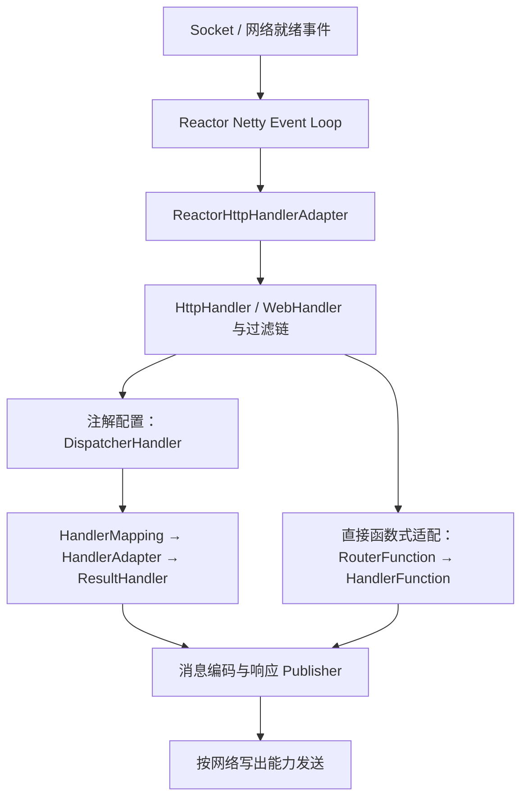

# WebFlux、Netty 与 WebClient 执行链

Reactor 描述信号与执行组合，Netty 处理网络事件，WebFlux 提供 Web 编程模型，WebClient 提供响应式 HTTP 客户端。它们协作，但不是四个可以互换的名称。

## 1. 从 Socket 到业务处理者



注解 WebFlux 的入口是 DispatcherHandler，不是 Servlet DispatcherServlet。函数式端点也可以通过 WebFlux 的 Mapping/Adapter 体系运行；但本实验直接调用 `RouterFunctions.toHttpHandler`，走精简适配路径，不声称一定经过 DispatcherHandler。

WebFlux 不只支持 Netty，WebClient 也不只能在 WebFlux 服务中使用。MVC 服务同样可以用 WebClient 调用远端；选型要看整个链路，而不是类名。

## 2. 事件循环为什么怕阻塞

Event Loop 用少量线程管理多个连接的就绪事件和回调。某次回调阻塞几秒，同一循环负责的其他连接就可能一起等待。

返回 `Mono` 但在创建它之前执行阻塞 JDBC，仍会阻塞当前线程。即使把阻塞调用转移到专门 Scheduler，数据库与连接池容量仍不会凭空增加。

CPU 密集计算也不能长期占据事件循环。响应式适合控制大量等待型任务的资源，但不是让 CPU 密集任务自动变快的算法，也不保证比清晰的 MVC 加有界并发更合适。

## 3. WebClient 的四种资源边界

| 边界 | 解决什么 | 与其他边界的关系 |
| --- | --- | --- |
| 连接池 | 最多多少连接、多少请求排队 | 不限制所有业务扇出的总数 |
| 超时 | 等连接、建连、读响应、整个操作 | 各阶段时钟不同，应有总预算 |
| 解码缓冲上限 | 聚合响应时的内存预算 | 不等于整个进程内存限制 |
| 订阅与响应体 | 谁消费、取消或释放响应 | 不消费可能影响连接复用与资源回收 |

`retrieve()` 适合常规正文读取和错误映射；`exchangeToMono`/`exchangeToFlux` 适合按状态选择处理方式。使用后者时，应在回调内消费或释放正文，不要把一个未消费的底层响应随意留给不明确的持有者。

重试会重新订阅请求。只有明确幂等、可重放、次数和退避受控，并符合总时间预算时才适合自动重试；不能为所有 POST 加无限 retry。

## 4. 真实网络实验：JSON、404 与 SSE

这个独立程序只创建本机临时端口、各一组专用服务端/客户端事件循环和一个有界连接池。关闭时只回收自己的资源，不调用全局 `HttpResources` 关闭方法影响同进程其他客户端。

<details>
<summary>函数式服务器与 WebClient 完整代码</summary>

```java title="src/main/java/demo/web/reactive/WebFluxDemo.java"
package demo.web.reactive;

import io.netty.channel.ChannelOption;
import org.springframework.http.MediaType;
import org.springframework.http.client.reactive.ReactorClientHttpConnector;
import org.springframework.http.server.reactive.ReactorHttpHandlerAdapter;
import org.springframework.web.reactive.function.client.WebClient;
import org.springframework.web.reactive.function.server.*;
import reactor.core.publisher.*;
import reactor.netty.DisposableServer;
import reactor.netty.http.client.HttpClient;
import reactor.netty.http.server.HttpServer;
import reactor.netty.resources.*;
import java.time.Duration;
import static org.springframework.web.reactive.function.server.RequestPredicates.GET;

public final class WebFluxDemo {
    public record Task(long id, String state) {}
    public static final class Network implements AutoCloseable {
        private final LoopResources serverLoops = LoopResources.create("lab-server", 1, true);
        private final LoopResources clientLoops = LoopResources.create("lab-client", 1, true);
        private final ConnectionProvider pool = ConnectionProvider.builder("lab-pool").maxConnections(2)
                .pendingAcquireMaxCount(4).pendingAcquireTimeout(Duration.ofSeconds(2)).build();
        private DisposableServer server;
        private final WebClient client;
        public Network() {
            try {
                var routes = RouterFunctions.route(GET("/tasks/{id}"), request -> {
                    try {
                        long id = Long.parseLong(request.pathVariable("id"));
                        return ServerResponse.ok().contentType(MediaType.APPLICATION_JSON).bodyValue(new Task(id, "ready"));
                    } catch (NumberFormatException error) { return ServerResponse.badRequest().build(); }
                }).andRoute(GET("/events"), request -> ServerResponse.ok().contentType(MediaType.TEXT_EVENT_STREAM)
                        .body(Flux.just("one", "two"), String.class))
                  .andRoute(GET("/large"), request -> ServerResponse.ok().bodyValue("x".repeat(32 * 1024)))
                  .andRoute(GET("/slow"), request -> Mono.never());
                var adapter = new ReactorHttpHandlerAdapter(RouterFunctions.toHttpHandler(routes));
                server = HttpServer.create().host("127.0.0.1").port(0).runOn(serverLoops)
                        .handle(adapter).bindNow(Duration.ofSeconds(5));
                var http = HttpClient.create(pool).runOn(clientLoops).option(ChannelOption.CONNECT_TIMEOUT_MILLIS, 1000)
                        .responseTimeout(Duration.ofSeconds(2));
                client = WebClient.builder().baseUrl("http://127.0.0.1:" + server.port())
                        .clientConnector(new ReactorClientHttpConnector(http))
                        .codecs(codecs -> codecs.defaultCodecs().maxInMemorySize(16 * 1024)).build();
            } catch (RuntimeException error) {
                try { close(); } catch (RuntimeException cleanup) { error.addSuppressed(cleanup); }
                throw error;
            }
        }
        public WebClient client() { return client; }
        @Override public void close() {
            try { pool.disposeLater().block(Duration.ofSeconds(4)); }
            finally {
                try { if (server != null) server.disposeNow(Duration.ofSeconds(4)); }
                finally {
                    try { clientLoops.disposeLater(Duration.ZERO, Duration.ofSeconds(2)).block(Duration.ofSeconds(4)); }
                    finally { serverLoops.disposeLater(Duration.ZERO, Duration.ofSeconds(2)).block(Duration.ofSeconds(4)); }
                }
            }
        }
    }
    public static void main(String[] args) {
        try (var network = new Network()) {
            var client = network.client();
            Task task = client.get().uri("/tasks/7").retrieve().bodyToMono(Task.class)
                    .timeout(Duration.ofSeconds(3)).block(Duration.ofSeconds(4));
            System.out.println("task=" + task.id() + ":" + task.state());
            Integer missing = client.get().uri("/missing").exchangeToMono(response ->
                    response.releaseBody().thenReturn(response.statusCode().value())).block(Duration.ofSeconds(4));
            System.out.println("missing=" + missing);
            var first = client.get().uri("/events").accept(MediaType.TEXT_EVENT_STREAM).retrieve()
                    .bodyToFlux(String.class).take(1).collectList().block(Duration.ofSeconds(4));
            System.out.println("firstEvent=" + first);
        }
    }
}
```

</details>

运行 `demo.web.reactive.WebFluxDemo`：

```text title="expected-output"
task=7:ready
missing=404
firstEvent=[one]
```

JSON 确实经过 HTTP 编解码，404 分支显式释放正文；SSE 客户端只交付第一个事件后取消。它不证明服务端只生产过一个事件，也不证明取消能撤销已发送字节。

`/large` 和 `/slow` 是配套测试的受控边界：前者验证聚合缓冲超限，后者验证客户端总超时。两者只存在于本机短生命周期实验，不是建议在生产开放的诊断接口。

## 5. 如何判断问题位于哪一层

连接池 pending 上升，可能是连接占满、响应体没消费、下游变慢或入口扇出过大。要把排队、连接建立、首字节和正文消费时长分开看。

事件循环线程出现 JDBC、文件阻塞或长计算堆栈，应检查是否把阻塞工作放到了错误线程。聚合时出现 `DataBufferLimitException`，先判断数据是否应该流式处理，而不是直接无限放大上限。

只看“CPU 不高”不能排除这些问题：请求可能都在等待池、锁、下游或事件循环。先画出实际调用链，再把每个等待点关联到线程、队列和连接。

## 6. MVC 与 WebFlux 怎么选

已有阻塞 JDBC、团队熟悉同步调用且容量可控的服务，可以继续使用 MVC，并做好线程、连接和超时预算。MVC 也能提供异步请求和 SSE，并不需要为了流式输出就重写全部技术栈。

大量并发等待、端到端非阻塞客户端与驱动、需要组合多条异步流时，WebFlux 可以提供一致的模型。收益必须通过真实负载验证；不能只比较少量本机请求，或把切换框架当成下游容量不足的修复。

## 7. 练习与答案

### 7.1 WebClient 必须配合 WebFlux Controller 吗

不必须。它是独立 HTTP 客户端，可以在 MVC 应用中使用。关键是怎样组合返回结果、在哪个线程等待，以及谁管理底层连接与事件循环。

### 7.2 KiB 缓冲限制是否说明整个客户端最多使用 16 KiB {/* #72-16-kib-缓冲限制是否说明整个客户端最多使用-16-kib */}

不是。这是相应编解码聚合操作的限制，不包括所有并发响应、连接缓冲、对象与线程。总预算要结合并发数、响应大小、流式策略和其他资源计算。

### 7.3 返回 Mono 的 Controller 是否肯定不会阻塞事件循环

不是。构造 Mono 前可能已经阻塞，操作符回调内也可能阻塞。要检查实际驱动与线程栈，并把无法避免的阻塞限制在明确、有界的执行资源中。

## 8. 关联文章与资料

- [Spring Framework 学习路线](../00-Spring学习路线.md)：下一专题进入容器、代理、事务与 Web 的源码路径。
- [Spring WebFlux](https://docs.spring.io/spring-framework/reference/web/webflux.html)
- [WebClient 配置与资源](https://docs.spring.io/spring-framework/reference/web/webflux-webclient/client-builder.html)
- [Reactor Netty HTTP Client](https://projectreactor.io/docs/netty/release/reference/http-client.html)
