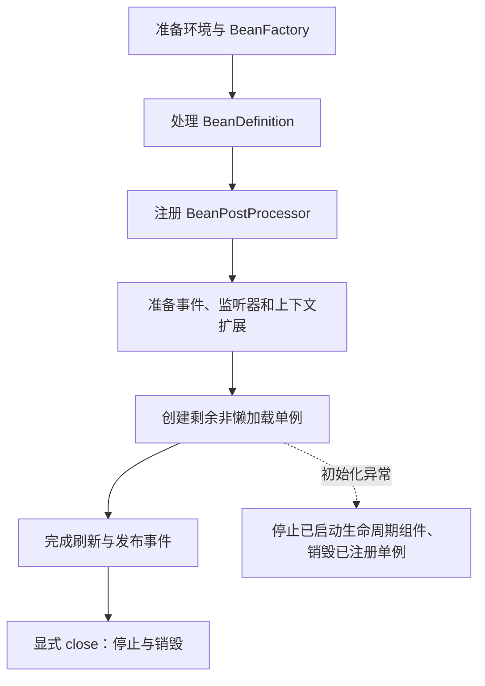

# ApplicationContext 刷新、状态与失败清理

前面的容器实验已经能创建和关闭对象。深入源码时，问题变成：为什么定义处理要先于实例创建？刷新失败后已创建的资源归谁释放？`isActive()` 为 true 是否表示应用已经可以接收流量？

本专题固定 Spring Framework `v7.0.9`，使用普通 JVM 运行路径，不分析 AOT 生成代码替代的启动分支。源码方法是定位入口，重点是每一步允许什么状态、失败后怎样退出，而不是逐行背实现。

## 1. 从 refresh 看四类状态变化



这张图是默认主线，不是“此前一个 Bean 都没创建”的承诺。后置处理器本身也要实例化；自定义扩展若过早调用 `getBean()`，还可能把业务对象提前拉入创建过程。

在 [AbstractApplicationContext.refresh](https://github.com/spring-projects/spring-framework/blob/v7.0.9/spring-context/src/main/java/org/springframework/context/support/AbstractApplicationContext.java) 中，可以按以下职责阅读：

| 入口 | 负责的变化 | 阅读时检查什么 |
| --- | --- | --- |
| prepareRefresh | 准备环境与活动状态 | 必需属性、早期事件、状态标志 |
| obtainFreshBeanFactory / prepareBeanFactory | 取得工厂并接入上下文能力 | 具体 Context 子类如何提供工厂 |
| invokeBeanFactoryPostProcessors | 修改或增加定义 | 配置类解析、注册处理器的先后关系 |
| registerBeanPostProcessors | 安装实例扩展 | 后续对象会经过哪些处理器 |
| finishBeanFactoryInitialization | 完成工厂初始化和单例创建 | 哪些对象仍懒加载，谁先被依赖拉起 |
| finishRefresh | 启动相应生命周期并发布刷新事件 | 监听器失败是否会影响刷新结果 |

同名方法在不同子类中的行为可能不同。GenericApplicationContext 不支持反复刷新；不能因基类设计了刷新模板，就推断所有 Context 都支持热重载。

## 2. 定义处理和实例处理为什么分开

BeanDefinition 描述“怎样创建”，Bean 是“已经创建的对象”。先处理定义，才能在实例化前完成扫描、导入、作用域和依赖信息准备；BeanPostProcessor 再参与对象注入、初始化和包装。

如果 BeanFactoryPostProcessor 为了改一个属性而直接获取业务 Bean，可能使它在全部实例处理器就绪前创建。此时会出现没有预期代理或扩展未生效的问题。应修改定义，而不是把定义阶段写成业务启动入口。

容器扩展的发现与调用顺序可继续定位 [PostProcessorRegistrationDelegate](https://github.com/spring-projects/spring-framework/blob/v7.0.9/spring-context/src/main/java/org/springframework/context/support/PostProcessorRegistrationDelegate.java)。不能把所有 Ordered、程序式注册和分阶段发现简单解释成“全局排序一次”。

## 3. active 不是业务就绪证明

活动标志在刷新准备阶段就会设置，它不等于“所有单例已成功创建”。`refresh()` 正常返回比单独读取活动标志更强，但仍不证明外部依赖、网关路由或业务数据就绪。

`ContextRefreshedEvent` 也不是 Spring Boot 的全部就绪语义。服务是否可接流量，还要结合应用自己的初始化与健康检查边界。

## 4. 失败时清理什么，不清理什么

刷新主体捕获运行时异常或 Error 时，会尝试停止已启动的生命周期处理，再销毁已注册的单例并取消活动状态。正常 `close()` 也有对应的停止、事件与销毁路径。

但容器无法自动撤销已经发出的 HTTP 请求，也不一定掌握一个构造函数在抛异常前创建却没有交出的资源。资源应尽量在可回收的生命周期内取得，局部创建失败时用 `try/finally` 自行关闭，不能把容器清理等同于全局事务回滚。

## 5. 建立源码实验工程

仓库工程是 `examples/spring/internals-lab/`，使用 JDK 25、Maven 3.9.14、Spring 7.0.9、JUnit 6.0.3。事务固定 H2 2.4.240 和 AspectJ 1.9.25，MVC 使用 Jakarta Servlet 6.1 与 Jackson 3.0.4。它们是复现基线，不是对外部署时永远不变的版本建议。

<details>
<summary>完整 Maven 工程配置</summary>

```xml title="pom.xml"
<?xml version="1.0" encoding="UTF-8"?>
<project xmlns="http://maven.apache.org/POM/4.0.0"
         xmlns:xsi="http://www.w3.org/2001/XMLSchema-instance"
         xsi:schemaLocation="http://maven.apache.org/POM/4.0.0 https://maven.apache.org/xsd/maven-4.0.0.xsd">
  <modelVersion>4.0.0</modelVersion>
  <groupId>io.newswitch.learning</groupId><artifactId>spring-internals-lab</artifactId><version>1.0.0</version>
  <properties><project.build.sourceEncoding>UTF-8</project.build.sourceEncoding><maven.compiler.release>25</maven.compiler.release></properties>
  <dependencyManagement><dependencies>
    <dependency><groupId>org.springframework</groupId><artifactId>spring-framework-bom</artifactId><version>7.0.9</version><type>pom</type><scope>import</scope></dependency>
    <dependency><groupId>tools.jackson</groupId><artifactId>jackson-bom</artifactId><version>3.0.4</version><type>pom</type><scope>import</scope></dependency>
    <dependency><groupId>org.junit</groupId><artifactId>junit-bom</artifactId><version>6.0.3</version><type>pom</type><scope>import</scope></dependency>
  </dependencies></dependencyManagement>
  <dependencies>
    <dependency><groupId>org.springframework</groupId><artifactId>spring-context</artifactId></dependency>
    <dependency><groupId>org.springframework</groupId><artifactId>spring-jdbc</artifactId></dependency>
    <dependency><groupId>org.springframework</groupId><artifactId>spring-webmvc</artifactId></dependency>
    <dependency><groupId>org.springframework</groupId><artifactId>spring-test</artifactId></dependency>
    <dependency><groupId>jakarta.servlet</groupId><artifactId>jakarta.servlet-api</artifactId><version>6.1.0</version></dependency>
    <dependency><groupId>tools.jackson.core</groupId><artifactId>jackson-databind</artifactId></dependency>
    <dependency><groupId>org.aspectj</groupId><artifactId>aspectjweaver</artifactId><version>1.9.25</version></dependency>
    <dependency><groupId>com.h2database</groupId><artifactId>h2</artifactId><version>2.4.240</version></dependency>
    <dependency><groupId>org.junit.jupiter</groupId><artifactId>junit-jupiter</artifactId><scope>test</scope></dependency>
  </dependencies>
  <build><plugins>
    <plugin><groupId>org.apache.maven.plugins</groupId><artifactId>maven-clean-plugin</artifactId><version>3.4.1</version></plugin>
    <plugin><groupId>org.apache.maven.plugins</groupId><artifactId>maven-resources-plugin</artifactId><version>3.3.1</version></plugin>
    <plugin><groupId>org.apache.maven.plugins</groupId><artifactId>maven-compiler-plugin</artifactId><version>3.14.1</version><configuration><parameters>true</parameters></configuration></plugin>
    <plugin><groupId>org.apache.maven.plugins</groupId><artifactId>maven-surefire-plugin</artifactId><version>3.5.4</version><configuration><failIfNoTests>true</failIfNoTests></configuration></plugin>
    <plugin><groupId>org.apache.maven.plugins</groupId><artifactId>maven-jar-plugin</artifactId><version>3.4.2</version></plugin>
    <plugin><groupId>org.apache.maven.plugins</groupId><artifactId>maven-dependency-plugin</artifactId><version>3.8.1</version></plugin>
  </plugins></build>
</project>
```

</details>

这里让 `spring-test` 参与主类编译，是为了独立运行 MockMvc 和 TestContext 演示；生产应用通常只在测试作用域引入它。

## 6. 用受保护扩展点观察实际阶段

示例只记录实际经过的扩展点，不把这些日志冒充每一个框架内部方法的完整跟踪。默认配置未开启并行 Bean 引导，记录按当前同步实验解释。

```java title="src/main/java/demo/internals/refresh/RefreshDemo.java"
package demo.internals.refresh;

import org.springframework.beans.factory.*;
import org.springframework.beans.factory.config.ConfigurableListableBeanFactory;
import org.springframework.context.annotation.AnnotationConfigApplicationContext;
import org.springframework.context.event.ContextRefreshedEvent;
import java.util.*;

public final class RefreshDemo {
    public static class Resource implements InitializingBean, DisposableBean {
        private final List<String> events;
        public Resource(List<String> events) { this.events = events; events.add("construct"); }
        @Override public void afterPropertiesSet() { events.add("init"); }
        @Override public void destroy() { events.add("destroy"); }
    }
    public static class TracingContext extends AnnotationConfigApplicationContext {
        private final List<String> events;
        public TracingContext(List<String> events) { this.events = events; }
        @Override protected void postProcessBeanFactory(ConfigurableListableBeanFactory factory) {
            events.add("factoryHook"); super.postProcessBeanFactory(factory);
        }
        @Override protected void onRefresh() { events.add("onRefresh"); super.onRefresh(); }
        @Override protected void finishBeanFactoryInitialization(ConfigurableListableBeanFactory factory) {
            events.add("instantiate"); super.finishBeanFactoryInitialization(factory);
        }
    }
    public static void main(String[] args) {
        var events = new ArrayList<String>();
        try (var context = new TracingContext(events)) {
            context.addBeanFactoryPostProcessor(factory -> events.add("factoryProcessor"));
            context.registerBean("resource", Resource.class, () -> new Resource(events));
            context.addApplicationListener(event -> {
                if (event instanceof ContextRefreshedEvent) events.add("refreshedEvent");
            });
            context.refresh();
            System.out.println("phases=" + String.join(",", events));
            System.out.println("active=" + context.isActive());
        }
        System.out.println("last=" + events.getLast());
    }
}
```

在工程目录运行：

```bash
mvn -B -ntp clean verify dependency:copy-dependencies -DincludeScope=runtime
java -cp "target/classes:target/dependency/*" demo.internals.refresh.RefreshDemo
```

Windows 将 classpath 中的冒号改成分号。其他六篇使用相同构建方式，只替换主类。预期业务标准输出如下，框架诊断日志另计：

```text title="expected-output"
phases=factoryHook,factoryProcessor,onRefresh,instantiate,construct,init,refreshedEvent
active=true
last=destroy
```

## 7. 调试时怎样设置断点

让 IDE 为 Maven 的 7.0.9 依赖附加同版本 sources，再在 `refresh()`、`finishBeanFactoryInitialization()` 和 `destroyBeans()` 设置方法断点。进入工厂后逐步缩小到当前业务 Bean 名称，避免每个基础设施对象都停一次。

观察注册表、实例是否存在、当前创建中的对象以及异常最初抛出位置。方法断点只是调试入口；跨版本行号、同步与并行引导分支不能直接照搬。

## 8. 练习与答案

### 8.1 active 为 true，是否能证明全部对象创建成功

不能。活动标志在准备阶段就会设置。应先确认 refresh 是否正常返回，再判断业务自己的就绪条件。

### 8.2 刷新失败是否会撤销初始化期间发出的消息

不会自动撤销。容器清理针对自己管理的生命周期与资源，不是外部系统的分布式回滚。不可逆操作需要独立设计幂等、补偿或可靠提交机制。

### 8.3 为什么不在工厂后置处理器里获取业务服务并初始化数据

它可能过早创建实例，使部分实例后置处理器或代理尚未就绪。定义阶段应处理元数据，业务初始化应放到明确的生命周期阶段，并为失败和重入设计边界。

## 9. 继续阅读

- [Bean 创建、依赖解析、提前引用与循环依赖](./02-Bean创建依赖解析提前引用与循环依赖.md)
- [容器基础与生命周期](../01-container/04-Bean生命周期Scope与线程安全.md)
- [AbstractApplicationContext 源码](https://github.com/spring-projects/spring-framework/blob/v7.0.9/spring-context/src/main/java/org/springframework/context/support/AbstractApplicationContext.java)
