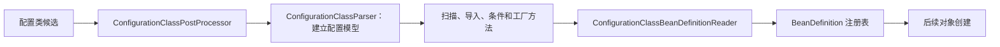

# 配置类解析、ImportSelector 与定义注册

配置类上的注解不会自行执行。Spring 先把配置类作为定义候选交给处理器，解析注解、导入与工厂方法，再把结果登记成 BeanDefinition。之后才进入通常的实例创建路径。

## 1. 从一个配置类到一组对象定义



入口是 [ConfigurationClassPostProcessor](https://github.com/spring-projects/spring-framework/blob/v7.0.9/spring-context/src/main/java/org/springframework/context/annotation/ConfigurationClassPostProcessor.java)。它在定义注册阶段解析配置，也会在工厂后置处理阶段准备需要增强的配置类。

“解析注解”和“执行 `@Bean` 方法”不是同一个时刻。读取元数据可以知道方法签名与条件，不必立即创建这个方法返回的业务对象。

## 2. 导入的三种常见形式

| 导入目标 | 给容器什么信息 | 适合什么 |
| --- | --- | --- |
| 普通配置或组件类 | 继续解析的类型 | 固定的一组配置 |
| ImportSelector | 需要导入的类名 | 根据启用注解或环境选择配置 |
| ImportBeanDefinitionRegistrar | 直接注册定义的回调 | 需要程序式构造名称、属性或定义 |

Selector 返回类名，不是返回实例；Registrar 写入注册表，也不应顺手把整个业务图实例化。处理分支可以定位到 [ConfigurationClassParser.processImports](https://github.com/spring-projects/spring-framework/blob/v7.0.9/spring-context/src/main/java/org/springframework/context/annotation/ConfigurationClassParser.java)。

DeferredImportSelector 会把选择安排到延后的处理阶段，还可以参与分组。延后不意味着它就是 Boot 自动配置，也不构成所有配置之间绝对的“最后执行”保证。

## 3. 条件判断与后续实例获取要分开

条件可以根据元数据和环境决定某个配置或定义是否参与。某些条件面向解析阶段，某些面向定义注册阶段，不能把一次启动里看见的顺序当成所有 Condition 的统一调用契约。

条件不满足时，后续 `getBean()` 才报找不到对象，并不意味着容器忘记执行 `@Bean`。可能这个定义根本没有进入注册表。排查顺序应是环境与条件、导入结果、定义是否存在，最后才是实例创建。

解析结果转为定义的工作见 [ConfigurationClassBeanDefinitionReader](https://github.com/spring-projects/spring-framework/blob/v7.0.9/spring-context/src/main/java/org/springframework/context/annotation/ConfigurationClassBeanDefinitionReader.java)。

## 4. 配置类增强不是业务 AOP

默认 `@Configuration` 的完整模式会增强配置类，让某些 `@Bean` 方法之间的调用转向容器对象获取。`proxyBeanMethods=false` 的轻量模式则按普通 Java 调用执行这些直接方法调用。

两者都可以注册单例 Bean。轻量模式下出现额外对象，是直接调用工厂方法绕过容器获取的结果，不是容器把 Singleton 改成了 Prototype。

配置增强的实现位于 [ConfigurationClassEnhancer](https://github.com/spring-projects/spring-framework/blob/v7.0.9/spring-context/src/main/java/org/springframework/context/annotation/ConfigurationClassEnhancer.java)。它与业务 AOP 可能都使用 CGLIB，但职责与拦截逻辑不同，不能用 `@EnableAspectJAutoProxy` 解释全部配置类增强。

## 5. 实验：导入选择、定义注册与对象身份

实验先通过一个启用注解选择大写问候配置，并由 Registrar 注册标记对象，再比较两种配置模式。条件通过 `feature.enabled` 控制导入配置是否生效。

<details>
<summary>完整配置解析实验</summary>

```java title="src/main/java/demo/internals/config/ConfigurationDemo.java"
package demo.internals.config;

import org.springframework.beans.factory.support.*;
import org.springframework.context.annotation.*;
import org.springframework.core.type.AnnotationMetadata;
import org.springframework.core.type.AnnotatedTypeMetadata;
import java.lang.annotation.*;

public final class ConfigurationDemo {
    @Retention(RetentionPolicy.RUNTIME) @Target(ElementType.TYPE)
    @Import({ModeSelector.class, MarkerRegistrar.class})
    public @interface EnableGreeting { boolean upper() default false; }
    public static class ModeSelector implements ImportSelector {
        @Override public String[] selectImports(AnnotationMetadata metadata) {
            var attributes = metadata.getAnnotationAttributes(EnableGreeting.class.getName());
            return new String[]{Boolean.TRUE.equals(attributes.get("upper"))
                    ? Upper.class.getName() : Plain.class.getName()};
        }
    }
    public static class Marker {}
    public static class MarkerRegistrar implements ImportBeanDefinitionRegistrar {
        @Override public void registerBeanDefinitions(AnnotationMetadata metadata, BeanDefinitionRegistry registry) {
            registry.registerBeanDefinition("marker", new RootBeanDefinition(Marker.class));
        }
    }
    public static class Enabled implements Condition {
        @Override public boolean matches(ConditionContext context, AnnotatedTypeMetadata metadata) {
            return context.getEnvironment().getProperty("feature.enabled", Boolean.class, true);
        }
    }
    public record Greeting(String text) {}
    @Configuration(proxyBeanMethods = false) @Conditional(Enabled.class)
    public static class Upper { @Bean public Greeting greeting() { return new Greeting("HELLO"); } }
    @Configuration(proxyBeanMethods = false) @Conditional(Enabled.class)
    public static class Plain { @Bean public Greeting greeting() { return new Greeting("hello"); } }
    @Configuration(proxyBeanMethods = false) @EnableGreeting(upper = true)
    public static class EnabledConfig {}
    public static class Token {}
    public record Holder(Token token) {}
    @Configuration public static class Full {
        @Bean public Token token() { return new Token(); }
        @Bean public Holder holder() { return new Holder(token()); }
    }
    @Configuration(proxyBeanMethods = false) public static class Lite {
        @Bean public Token token() { return new Token(); }
        @Bean public Holder holder() { return new Holder(token()); }
    }
    public static boolean sameToken(Class<?> config) {
        try (var context = new AnnotationConfigApplicationContext(config)) {
            return context.getBean(Token.class) == context.getBean(Holder.class).token();
        }
    }
    public static void main(String[] args) {
        try (var context = new AnnotationConfigApplicationContext(EnabledConfig.class)) {
            System.out.println("greeting=" + context.getBean(Greeting.class).text());
            System.out.println("marker=" + context.containsBean("marker"));
        }
        System.out.println("fullSame=" + sameToken(Full.class));
        System.out.println("liteSame=" + sameToken(Lite.class));
    }
}
```

</details>

运行 `demo.internals.config.ConfigurationDemo`：

```text title="expected-output"
greeting=HELLO
marker=true
fullSame=true
liteSame=false
```

轻量配置更稳妥的写法是让 `holder(Token token)` 由容器注入参数，而不是直接调用 `token()`。这样不依赖配置增强，也不会无意创建一个未由容器管理的额外对象。

## 6. 沿源码确认自己的配置为何没生效

在配置后置处理器里确认候选配置，在 Parser 里确认导入和条件，在 Reader 后确认目标 BeanDefinition。不要只在业务构造器打断点：没有定义时，构造器自然永远不会进入。

如果定义存在却无法创建，转到[依赖解析与实例化](./02-Bean创建依赖解析提前引用与循环依赖.md)；如果创建成功却不是预期对象，检查配置方法直接调用、重复定义、作用域和代理边界。

## 7. 练习与答案

### 7.1 ImportSelector 应该返回业务对象还是类名

返回需要导入的类名。容器随后继续解析或注册对应定义，再按正常生命周期创建实例；Selector 不是一个普通业务工厂。

### 7.2 liteSame=false 是否说明轻量配置的单例无效

不是。容器管理的 token 仍是单例，但 holder 直接调用了普通 Java 工厂方法，又创建了一个 Token。改用方法参数注入即可避免这个额外对象。

### 7.3 为什么不能只看构造函数判断条件是否生效

条件失败可能在定义阶段就把配置排除。应检查环境、元数据、条件结果与注册表；实例阶段只反映已注册定义的后续行为。

## 8. 继续阅读

- [自动代理创建、Advisor 匹配与调用链](./04-自动代理创建Advisor匹配与调用链.md)
- [配置、Profile 与条件基础](../01-container/06-Environment-PropertySource-Profile与条件配置.md)
