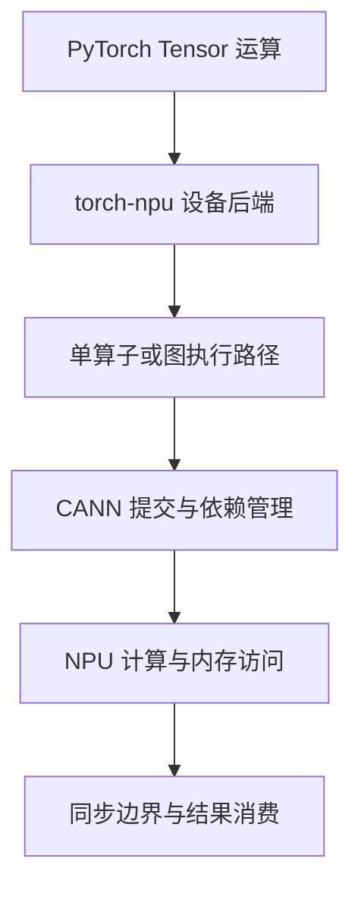

# CANN 软件栈组件与计算调用链

CANN 的官方名称包含“昇腾异构计算架构”，但部署排障时，主要面对的是它提供的编译、运行、算子、图与通信软件能力。它不是 NPU 内部 Cube、Vector、MTE 等硬件模块的另一种称呼，也不是装好后就能自动运行所有 CUDA 程序的翻译器。

本篇以 CANN 9.1 系列安装与 API 文档的组件划分为参考，同时解释旧环境里常见名称。实际采用哪一版，仍需与芯片、Driver/Firmware、框架和引擎匹配；新版本的包名不能直接替换旧环境的全部安装步骤。

## 1. 三个容易混淆的层次

| 层次 | 例子 | 主要职责 |
| --- | --- | --- |
| 设备与平台 | Atlas、Ascend NPU、HBM、设备互联 | 提供计算、存储、连接、供电与散热 |
| 设备使能与计算软件 | Driver/Firmware、CANN | 设备管理、任务提交、算子及相关工具 |
| 框架与模型服务 | PyTorch/torch-npu、MindSpore、vLLM-Ascend、MindIE | 张量语义、模型执行、请求调度与服务 |

Atlas 是整机，NPU 是设备，CANN 是计算软件栈，vLLM-Ascend 是上层推理适配。把它们都叫“运行时”，会让安装位置和错误归属变得模糊。

例如，`npu-smi` 能管理设备，不证明当前 Python 能找到 CANN；CANN 基础调用成功，也不证明某个模型所需的融合 Attention 已存在。

## 2. 组件各自负责什么

| 组件或术语 | 可以怎样理解 | 不应混淆为 |
| --- | --- | --- |
| Driver / Firmware | 设备与操作系统之间的底层使能 | Python 虚拟环境中的普通包 |
| CANN Runtime | 设备、内存、Stream、Event 和任务执行相关能力 | HTTP 服务框架或容器运行时 |
| AscendCL / ACL API | 应用调用设备计算能力的接口体系 | 所有操作都必须转换为离线模型 |
| ACLNN | 单算子执行相关 API 与库接口 | 一个新的物理计算单元 |
| GE 图引擎 | 相应路径中的图构建、优化与执行能力 | 每个 Eager 算子的强制必经环节 |
| ops 算子包 | 与目标硬件相关的算子及配套实现 | 只装 Toolkit 就一定具备的所有 Kernel |
| Ascend C | 面向昇腾算子开发的编程体系 | 把任意 CUDA Kernel 改后缀即可运行 |
| HCCL | 多设备集合通信能力 | HCCS/RoCE 这些物理连接本身 |
| NNAL / ATB | 按版本提供大模型等加速库能力 | 所有模型无条件必装、必用的同一路径 |

这里区分的是接口与职责，不保证每个术语永远对应一个独立安装包或一个 `.so`。CANN 的组合包、子组件发布和 API 目录会演进，安装以目标版本的实际包清单为准。

## 3. 一次 NPU 矩阵运算经历什么

假设模型已经在 NPU 上，执行 `y = x @ w`。PyTorch 先根据 Tensor 的设备、数据类型和算子语义分派，torch-npu 提供相应设备后端；具体路径再选择单算子接口、专用实现或已编译执行形式，最终提交到设备。

这张图省略具体版本中的函数与线程细节。它不表示每个算子都先进入 GE，也不表示一条 Python 语句必然只产生一个设备任务。

任务可以包含计算、搬运和通信。Host 提交成功与 Device 执行完成是两个时刻；在异步执行中，后续同步才可能观察到更早的错误。深入机制见 [torch-npu 与 CANN 异步执行](../../ai-systems/inference/vllm-ascend/07-torch-npu与CANN异步执行链路.md)。

## 4. Eager、图编译与图回放不是同一件事

Eager 侧重按算子执行；图编译将一部分计算表示交给编译与优化体系；图捕获/回放则关注复用相应执行序列、减少 Host 提交开销。它们可以在一个框架中组合，不是只能三选一。

| 路径 | 主要关注点 | 典型约束 |
| --- | --- | --- |
| Eager 算子执行 | 每个算子的支持、分派和提交 | 算子、dtype、Shape、布局 |
| 图编译 | 图转换、融合、代码生成与缓存 | 编译后端、动态形状、图中断及版本 |
| 设备图回放 | 捕获后的执行关系与参数复用 | 地址、Shape、内存生命周期及支持的操作 |

不能把“关闭图后能运行”直接解释为“硬件没问题、图实现一定有 Bug”。关闭图可能同时改变分配时机、工作区、同步与算子路径，仍需逐项归因。

相关源码路径见 [ACLGraph 与 npugraph_ex](../../ai-systems/inference/vllm-ascend/08-ACLGraph与npugraph_ex源码执行路径.md)。本篇不将所有 NPU 软件统一称为 ACLGraph，也不假定每个引擎采用同一图后端。

## 5. 算子支持为什么不止看名称

`matmul` 或 Attention 有实现，不表示其全部输入都能使用同一路径。实现还可能约束类型、维度、对齐、布局、量化方式、芯片能力和计算模式。

教学推演：模型的小输入成功，长输入失败。可以分别提出几个待验证假设：新 Shape 触发另一 Kernel；峰值工作区增大；编译缓存出现新条目；图模式与动态输入不兼容。不能只因为框架报出同一个算子名，就认定前后执行完全一致。

专用融合算子还能改变中间数据的保存和搬运。更少的 Python 算子或设备任务不自动等于更快，需要测量计算、访存、同步及端到端收益。

## 6. HCCL、HCCS 与设备网络各是哪一层

HCCL 组织 AllReduce、AllGather 等通信操作；节点内设备互联和跨机 RoCE 提供它可能采用的硬件路径。HCCL 接口耗时还可能包含等待其他 Rank 到达，不能直接等同于链路搬运耗时。

如果一个 Rank 提前因算子失败退出，其他 Rank 可能最后报通信超时。此时最晚出现的 HCCL 错误并不一定是根因。需要按时间关联 Worker、CANN、设备与网络证据，见 [HCCL 与慢 Rank 排查](../../ai-systems/inference/vllm-ascend/12-HCCL-HCCS与TP慢Rank故障排查.md)。

## 7. 为什么 CUDA 模型不能只换一个包名

模型权重与数学语义往往具有可移植性，但扩展二进制、CUDA Kernel、设备内存布局、通信和图机制不因此自动可用。需要分别检查：

1. 模型代码是否写死 `.cuda()`、CUDA Stream 或扩展导入；
2. PyTorch 算子是否有目标设备实现，是否覆盖所用输入；
3. 自定义或融合算子是否已有昇腾适配；
4. 编译、图模式和通信是否使用受支持组合；
5. 数值、内存和性能是否通过目标负载验证。

所以“同样使用 PyTorch”意味着可以复用一部分上层抽象，不意味着底层 CUDA 二进制与 NPU 可互换。对应框架层见 [PyTorch 后端选择与适配](../../ai-systems/runtime/01-PyTorch后端选择CUDA与torch-npu适配.md)。

## 8. 错误所属组件与首错原因

| 观察到的阶段 | 需要补充的证据 |
| --- | --- |
| 导入 torch-npu 失败 | Python/CPU 架构、包版本、依赖库与实际导入路径 |
| 初始化设备失败 | 设备访问、Driver/Firmware、Runtime 与容器映射 |
| 编译或算子选择失败 | 首条具体错误、Shape、dtype、芯片支持及包清单 |
| 执行后同步失败 | 更早的任务日志、设备事件、异步时间关系 |
| 多卡等待 | 各 Rank 首错、初始化顺序、实际连接路径 |

组件名和错误码帮助缩小范围，但不能取代上下文。同一个上层“执行失败”可以由缺库、输入不支持、资源不足或设备故障触发；不要为每种错误都套用“重新安装 CANN”。

## 9. 练习与答案

**问题一：CANN 与 NPU 内部的 Cube、Vector 是同一层吗？**

答案：不是。后者属于设备执行硬件；本篇所说 CANN 是提供编译、运行、算子和通信能力的软件栈。软件最终利用硬件能力，但软件组件不是物理单元。

**问题二：torch-npu 的每个 Eager 算子是否一定经过 GE 图编译？**

答案：不是。存在单算子及其他专用路径，具体执行形式由版本、框架与算子决定。不能把某种图模式画成所有运算的强制流程。

**问题三：HCCL 超时是否证明 RoCE 链路坏了？**

答案：不能。慢 Rank、其他 Rank 提前退出、设备首错或初始化顺序都可能让通信等不到完成。应先关联各进程首错，再判断通信路径。

**问题四：PyTorch 模型可以保存为同一种权重格式，为什么仍需要 NPU 适配？**

答案：权重格式与设备执行实现不同。代码中的设备 API、自定义 Kernel、图、布局与通信可能依赖 CUDA，需要目标实现和完整数值、功能验证。

## 10. 官方参考与延伸阅读

- [CANN 组件与文档入口](https://www.hiascend.com/cann)
- [CANN 9.1 快速安装与 Toolkit/ops 关系](https://www.hiascend.com/doc_center/source/zh/CANNCommunityEdition/910/softwareinst/instg/instg_0050.html)
- [CANN 9.1 应用 API 分类](https://www.hiascend.com/doc_center/source/en/CANNCommunityEdition/910/others/acldevg/aclcppdevg_000523.html)
- [Ascend Extension for PyTorch](https://github.com/Ascend/pytorch)
- [CANN 安装形态与环境隔离](./05-CANN安装形态版本证据与环境隔离.md)
- [910B AI Core 与片上存储](./03-Ascend-910B-AI-Core与片上存储执行路径.md)
