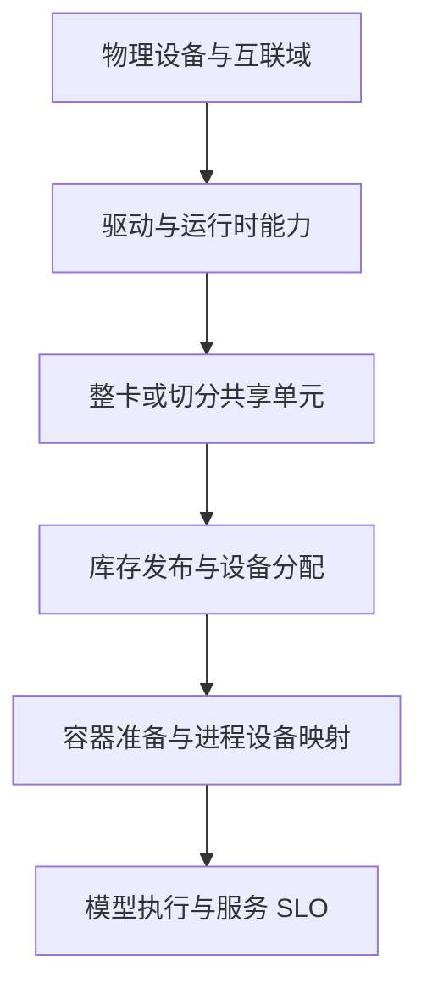

# GPU 与 NPU 资源池化学习路线

十台服务器接入同一个 Kubernetes 集群之后，可以统一申请它们的 GPU/NPU，但不会自动获得一块更大的显存，也不会让 NVIDIA 与昇腾运行同一套设备代码。**资源池首先是可发现、可分配、可观察和可回收的设备集合；执行能力仍受具体硬件与软件栈约束。**

本模块以 NVIDIA GPU 与昇腾 NPU 为对象，先建立资源模型，再分别学习共享与切分，最后连接整机拓扑和调度。容器安装、Device Plugin 和 DRA 的详细配置保留在原有专题中。

## 1. “池化”可能指五种不同的事

| 含义 | 实际改变 | 没有自动改变 |
| --- | --- | --- |
| 统一纳管 | 资产、健康、版本和配额集中管理 | 设备还是分别连接在不同 Host 或 Fabric 域中 |
| 按需分配 | 将空闲设备交给满足约束的任务 | 型号、指令集、驱动与算子支持范围 |
| 切分与共享 | 一台物理设备承载多个资源单元或客户端 | 是否硬隔离、是否能多卡通信，需要分别确认 |
| 远程服务 | 客户端通过 RPC/API 请求远端执行 | 客户端不因此获得本地 CUDA/NPU 设备 |
| 扩大的高速互联域 | 更多设备通过专用互联交换数据 | 不等于所有内存都变成本地 HBM 或单一分配空间 |

例如，应用调用远端 vLLM API，属于服务级算力使用；把本机 GPU 交给 Pod，属于设备交付；在 NVL72 内启动跨计算托盘的多 Rank 作业，属于利用机架级互联。这三种方案的调用语义、故障处理和性能模型都不同。

判断一个“池化方案”时，先问应用拿到的是 API 地址、设备句柄、虚拟设备，还是一组分布式 Rank，再讨论它的收益。

## 2. 从物理设备到模型服务分成六层

图表示依赖关系，不表示模型 Tensor 必须流经调度器。调度器交换的是资源需求、库存和分配状态；稳态 Tensor 数据主要沿设备内存、设备互联与网络传输。

每一层都有独立失败方式。物理设备存在，但驱动不可用；驱动正常，但没有发布资源；Pod 已分配，但设备没正确注入；进程能计算，但多 Rank 通信失败；请求能返回，但 P99 已经失控。只观察最后一层或只观察设备数量，都不足以解释完整系统。

## 3. 学习顺序与现有专题分工

| 顺序 | 文章 | 要解决的问题 |
| --- | --- | --- |
| 1 | [资源池设备模型、分配与回收](./01-资源池设备模型分配与回收原理.md) | 数量、身份、生命周期与资源归属怎样对应 |
| 2 | [整卡、Time-Slicing、MPS 与 MIG](../sharing/07-GPU%20整卡独占、Time-Slicing、MPS%20与%20MIG%20对比.md) | NVIDIA 四种模式提供什么、不提供什么 |
| 3 | [昇腾 NPU 硬件虚拟化与软切分](./02-昇腾NPU硬件虚拟化与软切分.md) | HDK vNPU 与 vCANN-RT 为什么不是一回事 |
| 4 | [GPU 集群拓扑感知调度](../scheduling/12-GPU%20集群拓扑感知调度.md) | 有足够设备为什么仍然放不下或运行慢 |
| 5 | [GB200/GB300 NVL72 机架级架构](../../servers/nvidia-dgx/03-GB200-GB300-NVL72机架级架构.md) | 操作系统节点、调度节点与高速互联域为什么可能不同 |
| 6 | [DRA 核心对象](../dra/01-Kubernetes%20DRA%20概念与核心%20API（v1.35+）.md) | 更丰富的设备属性怎样进入资源申领与分配 |

设备交付细节分别见 [NVIDIA Device Plugin](../device-management/02-NVIDIA-Device-Plugin部署与配置.md)、[Ascend Device Plugin](../../../ai-systems/inference/vllm-ascend/06-Ascend-Device-Plugin资源发现与Pod设备注入.md)、[昇腾容器注入](../../driver-runtime/08-昇腾容器运行时设备注入与权限边界.md)。学习 DRA 时固定集群小版本、API 和驱动版本，不将新版本的共享能力套到所有旧集群。

## 4. 容量至少要看四本账

以下为教学例子，不是产品规格：集群有两台节点，每台四张 GPU。每张配置四个 Time-Slicing 访问份额，则有八张物理 GPU、32 个逻辑份额。它们既不是 32 张独立 GPU，也不是 32 份有显存硬保证的小 GPU。

| 账本 | 示例 | 用途 |
| --- | --- | --- |
| 物理库存 | 8 张 GPU | 资产、故障与基础容量 |
| 可分配单元 | 32 个共享份额 | 调度计数，必须附带共享模式 |
| 已分配资源 | 24 个份额 | 分配率与租户归属 |
| 有效服务能力 | 满足给定延迟和错误率的请求量 | 业务容量，必须通过负载验证 |

`24 ÷ 32 = 75%` 只表示共享份额分配率。它不能推出 GPU 利用率 75%，也不能推出显存还剩 25%。同样，设备空闲也不意味着新作业可用：剩余设备可能不在同一互联域，或没有所需切分 Profile。

容量规划继续阅读 [GPU 有效利用率](../governance/07-GPU分配率活跃率SM利用率与有效利用率.md)与 [资源碎片](../governance/11-GPU碎片空闲资源与调度装箱效率.md)。

## 5. NVIDIA 与昇腾怎样统一又不混淆

可以统一描述请求者、配额、任务优先级、设备健康、分配状态和服务指标。不能用一个“卡数”字段抹平设备差异。

同样写“1 个资源”，可能分别表示一张整卡、一次共享访问、一个 MIG 实例、一个静态 vNPU；部分昇腾软切分清单中的请求数字还可能表示 AICore 百分比。请求的解释必须与资源键、插件模式和版本一起保存。

运行层也有差异。NVIDIA 路线依赖相容的 Driver、CUDA、NCCL 和框架后端；昇腾路线依赖相容的驱动固件、CANN、HCCL 和框架后端。统一入口可以把不同副本路由到两种设备，但不会把 CUDA Kernel 转换成 CANN Kernel，也不会自动建立跨厂商的 NCCL/HCCL 通信组。

## 6. 如何判断池化是否真的有效

先固定模型版本、请求分布、上下文长度、并行策略和 SLO，再比较不同分配方式。不要只用 Pod 密度证明共享成功。

需要同时观察：每租户延迟与错误、设备内存峰值、计算/内存访问繁忙程度、通信等待、回收时间、冷启动，以及同机其他租户的影响。如果共享后吞吐增加，但关键租户的 P99 超出目标，池化只提高了装箱密度，没有提高对应 SLO 下的容量。

重新分配不等于透明迁移运行状态。模型权重可以重载；KV Cache、训练优化器状态、随机数状态和未完成请求，需要应用自己的持久化或恢复机制。调度器重新启动一个 Pod，并不会自动恢复这些内容。

## 7. 练习与答案

**问题一：八张 GPU 配出 32 个共享份额，是否得到四倍算力？**

答案：没有。逻辑份额增加了访问许可数量，物理计算与内存系统没有变为四倍。还要看共享方式是否限额、工作负载是否互补，以及给定 SLO 下的实测收益。

**问题二：客户端通过 API 使用远端 GPU，为什么本地 `nvidia-smi` 不会出现它？**

答案：API 传递请求与响应，不是在本地枚举远端设备。计算发生在服务端进程和驱动中，客户端的设备发现路径没有改变。

**问题三：NVIDIA 与昇腾可以共用一个模型网关，是否也能直接组成同一个 TP 通信组？**

答案：前者是服务路由，后者要求框架、设备执行和通信实现协同。统一网关不提供跨后端的 Tensor Parallel 实现，不能据此混组。

**问题四：Pod 重调度成功，为什么用户会话仍可能丢失？**

答案：资源分配和进程重建没有自动迁移应用内存。会话、KV、在途请求和训练状态是否恢复，取决于应用的状态保存、请求重试与恢复协议。

## 8. 官方参考

- [Kubernetes Device Plugins](https://kubernetes.io/docs/concepts/extend-kubernetes/compute-storage-net/device-plugins/)
- [Kubernetes Dynamic Resource Allocation](https://kubernetes.io/docs/concepts/resource-management/dynamic-resource-allocation/)
- [NVIDIA GPU Operator 共享模式](https://docs.nvidia.com/datacenter/cloud-native/gpu-operator/latest/gpu-sharing.html)
- [MindCluster HDK 虚拟化实例](https://github.com/Ascend/mind-cluster/blob/master/docs/zh/scheduling/04_usage/02_virtual_instance/00_virtual_instance_with_hdk/01_description.md)
