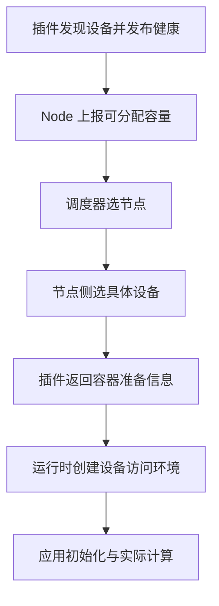

# 资源池设备模型分配与回收原理

资源池中最容易出问题的不是“少算一张卡”，而是把不同对象当作同一个对象：调度器记录 GPU 1，容器内也看到设备 1，但两者可能不是同一张物理设备；Pod 已删除，旧进程却仍持有设备；切分布局改变后，监控还把旧实例指标归给原租户。

解决这些问题需要同时理解**身份映射、分配状态和实际执行**。本文沿一次任务的生命周期分析它们，具体安装仍见 [Device Plugin](../device-management/03-Pod如何使用上GPU：Device%20Plugin与Container%20Toolkit.md)和 [DRA](../dra/01-Kubernetes%20DRA%20概念与核心%20API（v1.35+）.md)。

## 1. 五类对象不能只用一个设备编号

| 对象 | 标识示例 | 为什么要单独记录 |
| --- | --- | --- |
| 物理设备 | GPU UUID、厂商序列标识、PCI BDF | 稳定归属、维修与拓扑关联 |
| 切分实例 | MIG GI/CI、vNPU ID 与父设备 | 实例可被重建，容量不是整卡容量 |
| 调度单元 | 扩展资源份额，或驱动/池/设备名称 | 代表分配合同，不一定是独立硬件 |
| 容器可见设备 | 容器内逻辑编号 | 可能重新从 0 编号 |
| 应用设备 | local rank、global rank、框架 ordinal | 用于进程组与 Tensor 放置 |

PCI BDF 反映当前枚举位置，重装或平台变化后可能改变；容器 ordinal 和 Rank 更不适合作为资产主键。切分实例还要带上布局代次或采集时间，避免把重建后的同名实例与旧实例混为一谈。

教学映射可以写成：`物理 GPU UUID-A → MIG 实例 M-A → Pod UID-P / container C → cuda:0 → global rank 3`。这里 `cuda:0` 只表示这个进程所见的第一个 CUDA 设备，不表示宿主机物理 GPU 0。

## 2. Device Plugin 的分配经过哪些环节

传统 Device Plugin 先向 kubelet 注册并持续上报设备及健康；kubelet 将相应扩展资源容量发布到 Node。默认调度器主要依据请求数量和节点约束选节点，节点侧 Device Manager 再选择具体设备，并调用插件准备容器所需信息。`GetPreferredAllocation` 是可选建议接口，不是所有插件都会实现或由它最终决定全局放置。[接口职责见 Kubernetes Device Plugins](https://kubernetes.io/docs/concepts/extend-kubernetes/compute-storage-net/device-plugins/)。



需要拆开两个容易混淆的概念：

- **数量约束**：节点能否接纳申请一个资源的 Pod。
- **设备集合约束**：选中的几张设备是否具有所需互联、分区与健康属性。

只有数量、没有设备集合约束时，四张可用 GPU 也可能分散在两个低带宽互联区域。节点已选中，不代表具体设备组合已经满足应用通信需求。

## 3. DRA 改变了什么，没有改变什么

DRA 通过 ResourceSlice 发布设备描述，DeviceClass 表达类别，ResourceClaim 表达请求与分配结果；节点侧插件负责准备和取消准备设备。它让设备属性、约束与声明式申领进入分配链路，但**不会替驱动实现硬件切分，也不会替框架迁移显存**。[对象与生命周期见 DRA 官方文档](https://kubernetes.io/docs/concepts/resource-management/dynamic-resource-allocation/)。

| 维度 | Device Plugin 典型路径 | DRA 路径 |
| --- | --- | --- |
| 库存 | Node 扩展资源计数，插件维护设备详情 | ResourceSlice 中的设备描述 |
| 请求 | Pod 的扩展资源数量 | ResourceClaim 或模板 |
| 具体分配 | 节点侧 Device Manager 与插件 | Claim 分配与驱动相关准备 |
| 容器准备 | Allocate 响应、运行时和可能的 CDI | 节点 Prepare、CDI 等驱动实现 |
| 回收 | kubelet/运行时与插件自身机制 | Claim 生命周期及 Unprepare 等机制 |

具体共享、容量消费、设备绑定和扩展资源互通能力依赖小版本、feature gate 与驱动。不能从“集群支持 DRA”推出“任何 GPU 都支持任意比例切分”。同一物理设备若被两个库存发布器独立当作空闲设备出售，还可能发生双重分配；必须明确每类资源由谁管理。

## 4. 从分配成功到服务就绪还差四步

### 4.1 访问环境准备

运行时需要使进程获得正确的设备节点、驱动用户态依赖与访问权限。环境变量是选择机制的一部分，不是权限系统本身。修改 `CUDA_VISIBLE_DEVICES` 或 `ASCEND_RT_VISIBLE_DEVICES` 不应绕过节点分配；特权容器、过宽的 `/dev` 挂载还可能破坏原有边界。

### 4.2 Runtime 初始化

应用加载实际使用的库并初始化设备。Driver 与容器版本不匹配、权限不足、动态库被覆盖，都可能在这里失败。`nvidia-smi` 或 `npu-smi` 能查询管理信息，不代表框架算子和设备代码可执行。

### 4.3 模型与通信组初始化

每个 Rank 还要装载分片、分配内存、建立通信组。显存余量、图捕获和集合通信各有独立条件。所有进程都拿到设备，但某个 Rank 迟迟没有加入，也会使其他进程等待。

### 4.4 服务验收

模型实例 Ready 之后，还要看正确性、延迟、吞吐和错误率。申请一个“25% 算力”的软件共享份额，并不等于获得某个固定 tokens/s。配额约束可使用的资源，业务性能还受算子、内存访问与邻居争用影响。

## 5. 回收为什么不是删掉一个 API 对象

回收包含停止接收请求、终止执行、释放进程引用、清理临时设备/配置、更新分配记录，以及重新确认设备可用。不同模式的实现顺序不同，不能把下面的逻辑状态当成某个厂商真实 API 枚举：

```text
可分配 → 已预留 → 准备中 → 使用中
                           ↓
                     释放中 → 可分配
                           ↓
                       隔离待检查
```

关键不变量是：**旧使用者尚未释放且不能确认安全时，不把同一独占单元交给新使用者。** 控制面记录与节点实际状态短暂不一致时，宁可暂时减少可用容量，也不要凭超时就让第二个任务访问旧设备。

Device Plugin 标准 API 不提供与 DRA `NodeUnprepareResources` 等价的通用反向回调。插件的临时资源清理，需要结合 kubelet、运行时、Pod 观察与厂商实现；不能假设每次 Pod 删除都会触发一个标准 `Deallocate` 接口。

## 6. 三种典型异常如何建立证据

| 现象 | 先对照什么 | 不能直接下的结论 |
| --- | --- | --- |
| Pod 删除后设备内存仍占用 | Pod UID、容器 ID、Host PID、设备进程与时间线 | “内核泄漏，重启就好” |
| 节点重启后虚拟实例数量异常 | 原布局、当前父设备/子实例、插件发布库存 | “原来的逻辑 ID 一定还指同一实例” |
| 两个 Pod 指向同一父设备 | 是否共享模式、是否不同切分实例、插件配置 | “一定发生了重复分配” |

共享场景多个客户端指向同一父设备是设计行为；独占场景两个无关任务指向同一单元才需要重点追查。重启后还应区分设备残留、插件库存未刷新和监控标签未更新，而不是只比较总数。

### 6.1 只读采集入口

以下为 Bash 命令模板。先填入目标节点与 Pod，不创建任务、不清理设备：

```bash
NODE='replace-with-node'
NS='replace-with-namespace'
POD='replace-with-pod'
kubectl get node "$NODE" -o json
kubectl get pod -n "$NS" "$POD" -o yaml
kubectl describe pod -n "$NS" "$POD"
kubectl api-resources --api-group=resource.k8s.io
```

Node 的 `status.allocatable` 是可供调度的容量，不是实时剩余值。`describe node` 的已分配资源可辅助计算，但完整账本仍要考虑任务状态、调度中的预留及共享模式。

若确认集群启用了对应 DRA API，再查询：

```bash
kubectl get resourceclaims -n "$NS" -o yaml
kubectl get resourceslices -o yaml
```

NVIDIA 节点可查询稳定身份和设备进程：

```bash
nvidia-smi --query-gpu=index,uuid,pci.bus_id,memory.total,memory.used --format=csv
nvidia-smi --query-compute-apps=pid,gpu_uuid,used_gpu_memory --format=csv
```

在 Host 上查询的 PID、容器 PID namespace 中的 PID 和应用 Rank 不一定相同；MPS、MIG 与权限限制也可能改变进程指标可见性。昇腾侧使用目标版本 `npu-smi` 的设备/实例查询，与插件分配记录交叉核对，不把 CUDA 的查询字段机械替换成 NPU 字段。

## 7. 容量可用与调度可行是两个判断

假设一台节点有两张各可用 40 GiB 的设备。某任务不能做模型切分，需要在单设备驻留 60 GiB，那么 `40 + 40 = 80 GiB` 没有帮助。另一个任务需要两张处于同一高速岛的设备，即使全节点有两张空闲，也可能不满足集合约束。

因此，放置可行性同时要求型号/后端相容、每设备容量足够、Profile 或份额模式正确、设备集合拓扑满足、CPU/NIC/存储可达，以及隔离要求成立。优化装箱时不能只最大化“已分配数量”。拓扑问题见 [拓扑感知调度](../scheduling/12-GPU%20集群拓扑感知调度.md)。

## 8. 练习与答案

**问题一：容器 `cuda:0` 为什么可能对应 Host GPU 5？**

答案：运行时暴露设备子集，进程再对可见设备重新编号。要用 UUID/父实例、容器分配记录和 Rank 映射关联，不能只比较 ordinal。

**问题二：Node 的 Allocatable 为 8，是否说明现在还有八张空闲卡？**

答案：不是。它描述节点可供调度的资源容量，不扣除所有已运行任务的当前分配，也不代表八张物理整卡；共享模式下数字可能是逻辑份额。

**问题三：Pod 对象删除后，能否立即把同一独占单元判定为空闲？**

答案：不能仅凭 API 删除判断。还要确认旧容器/进程引用与临时实例已经清理、库存和健康一致；节点失联时尤其不能把未知状态当作空闲。

**问题四：Device Plugin 是否有标准的 Deallocate 回调，供应用退出时销毁所有虚拟设备？**

答案：没有这样的通用对称接口。需要查看厂商插件和运行时如何清理；DRA 有节点侧 Unprepare 路径，也仍要求驱动正确实现与异常恢复。

## 9. 官方参考

- [Device Plugin 的注册、Allocate 与健康更新](https://kubernetes.io/docs/concepts/extend-kubernetes/compute-storage-net/device-plugins/)
- [DRA 的资源描述与生命周期](https://kubernetes.io/docs/concepts/resource-management/dynamic-resource-allocation/)
- [NVIDIA Device Plugin 与设备标识策略](https://github.com/NVIDIA/k8s-device-plugin)
- [nvidia-smi 查询说明](https://docs.nvidia.com/deploy/nvidia-smi/index.html)
