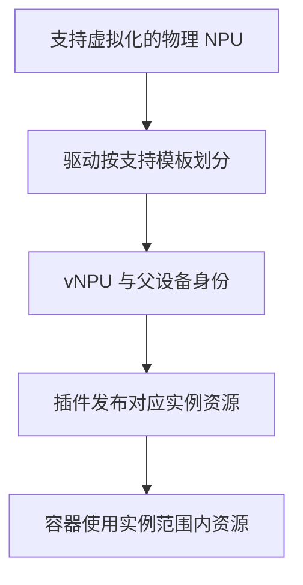
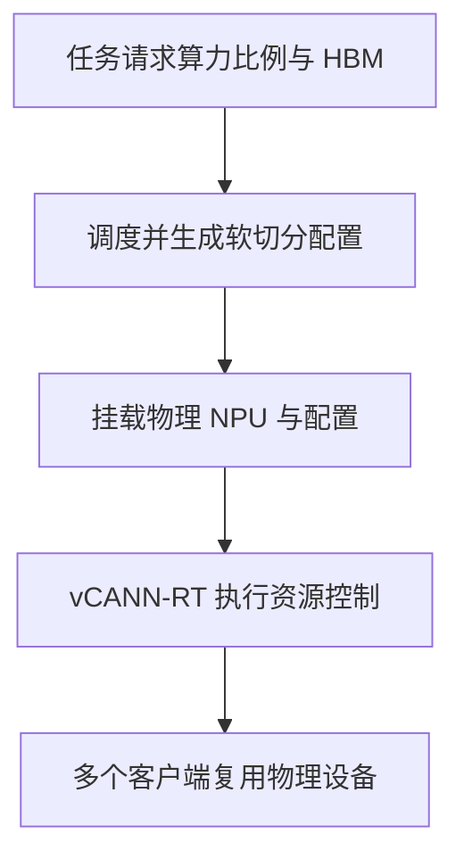

# 昇腾 NPU 硬件虚拟化与软切分

“把一张 910B 分给几个容器”可能对应不同实现：创建具有指定规格的虚拟设备，或把同一物理设备交给多个容器，再由计算运行时控制使用比例。它们的设备身份、配额单位、清理方式和通信支持并不相同。

先记住两个对象：**HDK vNPU 划分虚拟设备；vCANN-RT 软切分让多个客户端按配置使用同一设备。** 前者也依赖驱动与软件管理，后者也会控制资源，但不能只因为名称都有“虚拟化”，就认为隔离能力完全等价。

本文的产品与功能约束对应 2026 年 11 月 6 日查阅的 MindCluster 官方文档。具体部署应固定发行版本及其配套 HDK、CANN、容器运行时和调度组件；不从 A2 的能力推导全部 A3/A5 产品。

## 1. 先确认一张“卡”代表什么

板卡、物理处理器、Die、驱动设备、虚拟设备和进程逻辑设备不是同一层。某种产品的一个模块可能包含多个计算单元；容器所见设备数也不等于机箱板卡数量。

记录时至少保留整机型号、设备/Die 身份、物理 ID、虚拟 ID、父子关系、实例模板，以及进程所见 ordinal。`ASCEND_RT_VISIBLE_DEVICES=0` 只是在该进程已有可见范围内选择设备，不能据此判断 Host 0 号物理设备被分配给了它。

整机前置见 [Atlas 800I A2](../../servers/huawei-atlas/01-Atlas-800I-A2与Ascend-910B软硬件架构.md)与 [Atlas A3 产品形态](../../servers/huawei-atlas/02-Atlas-800I-A3整机架构与产品形态.md)。

## 2. HDK vNPU 划分了什么

HDK 方案根据支持的虚拟化模板，为实例分配 AICore、AICPU、设备内存等资源；部分产品还涉及 DVPP。可用资源组合由产品与模板决定，不是任意填写百分比就能切出一台设备。[原理与产品支持表见 HDK 虚拟化说明](https://github.com/Ascend/mind-cluster/blob/master/docs/zh/scheduling/04_usage/02_virtual_instance/00_virtual_instance_with_hdk/01_description.md)。

“硬件资源划分”不意味着整台服务器被拆成若干完全独立故障域。实例仍可能共享父设备、驱动、PCIe、Host、供电与散热。应分别核对内存访问隔离、计算资源分配、故障传播和跨实例通信，不能把 vNPU 简单等同于一块独立物理卡或虚拟机。

### 2.1 模板的数字不能只按名字猜

官方静态 vNPU 文档在对应 Atlas A2 产品行中列有 `vir12_3c_32g` 与 `vir06_1c_16g` 等模板，对应 vNPU 类型分别含有 `12c.3cpu.32g`、`6c.1cpu.16g`。它说明模板绑定多个资源维度，而不是只有 AICore 百分比。[模板与产品对应关系见静态 vNPU 文档](https://github.com/Ascend/mind-cluster/blob/master/docs/zh/scheduling/04_usage/02_virtual_instance/00_virtual_instance_with_hdk/04_static_vnpu_scheduling/02_mounting_vnpu_static.md)。

这些名称不能当作所有 910B 的通用菜单。实际还要核对处理器规格、允许的布局组合、保留资源、框架与模型是否支持实例容量。NPU 内部的 AICPU 资源，也不是容器 CPU request 所申请的 Host CPU 核。

## 3. 静态与动态区别在实例生命周期

| 维度 | 静态 vNPU | 动态 vNPU |
| --- | --- | --- |
| 实例创建 | 预先创建布局 | 按支持流程在任务准备时创建 |
| 调度库存 | 已存在的虚拟实例 | 与驱动、插件、调度器协作的可划分容量 |
| 容器交付 | 注入已有虚拟设备 | 创建后注入相应实例 |
| 任务结束 | 不意味着静态布局自动销毁 | 需要正确完成实例清理 |
| 主要风险 | 库存未刷新、Profile 碎片 | 创建失败、残留实例、并发状态不一致 |

静态并非“永远不能改”，动态也并非“运行中随时伸缩”。一个模型已经按原容量分配权重和 KV 后，改变设备布局通常不等于对当前进程无感扩容。

### 3.1 官方静态路径的边界

查阅版本说明：每 Pod 使用切分后的 vNPU 时只支持一个；创建或销毁静态 vNPU 后需要刷新插件，文档给出的方式是重启 Ascend Device Plugin；静态路径也存在故障重调度、交换机亲和性等限制。**这些是该静态实现的限制，不是所有昇腾资源池的永久结论。**

不要把物理整卡 Pod 的环境变量直接粘贴到静态 vNPU 清单。官方文档明确区分 Docker Runtime 的虚拟设备参数与 Kubernetes 静态调度路径；后者还要求移除某些原有 `ASCEND_VISIBLE_DEVICES` 注入字段，避免两套分配逻辑冲突。

### 3.2 官方动态路径的边界

MindCluster 动态 vNPU 调度文档要求配合其支持的 Volcano 路径，当前描述中每 Pod 最终挂载一个 vNPU，并对模板混用、静态/动态混用与模式切换设置限制。某个 Runtime 单容器方式正常，不代表 Kubernetes 调度路径也支持同样组合。[详见动态 vNPU 调度](https://github.com/Ascend/mind-cluster/blob/master/docs/zh/scheduling/04_usage/02_virtual_instance/00_virtual_instance_with_hdk/05_dynamic_vnpu_scheduling/01_dynamic_vnpu_scheduling_inference.md)。

动态容器退出时的正常销毁，与服务器突然重启后的残留处理是两种情况。恢复时要核对实际虚拟设备与分配账本，不能仅凭 Pod 消失就重新出售容量。

## 4. vCANN-RT 软切分怎样执行

官方方案把同一 NPU 挂载到多个容器，向运行时提供软切分配置，由 vCANN-RT 与 CANN 执行资源控制。AICore 的细粒度共享基于时分复用；HBM 也有相应配额。它不是先生成若干与物理卡完全等价的独立芯片。[原理见 vCANN-RT 虚拟化说明](https://github.com/Ascend/mind-cluster/blob/master/docs/zh/scheduling/04_usage/02_virtual_instance/01_virtual_instance_with_vcann_rt/00_description.md)。

这里有两种完全不同的失败：调度器批准了份额，但运行时控制没有正确加载；运行时控制已生效，但配额不足以满足模型峰值。前者是分配合同没有落到执行层，后者是模型预算或性能容量问题。

### 4.1 调度字段的数字可能是百分比

官方软切分路径的 `aicoreQuota` 表示 AICore 百分比，`hbmQuota` 表示请求的设备内存量，`policy` 表示策略。部分任务资源请求数字要与 `aicoreQuota` 一致，**不是实际 NPU 卡数**。[字段、单位和调度约束见软切分调度文档](https://github.com/Ascend/mind-cluster/blob/master/docs/zh/scheduling/04_usage/02_virtual_instance/01_virtual_instance_with_vcann_rt/01_soft_allocation_scheduling_inference.md)。

所以看到资源请求 `25`，不能立即理解为 25 张 NPU；看到“25%”，也不能据此保证 25% 的 tokens/s。前者取决于资源语义，后者还受内存访问、算子结构、队列和其他客户端影响。

### 4.2 三种策略怎样理解

| 策略 | 理解重点 | 需要验证 |
| --- | --- | --- |
| `fixed-share` | 固定配额模式 | 目标比例怎样执行、内存边界与业务尾延迟 |
| `elastic` | 弹性模式 | 空闲资源借用与竞争时的回收行为 |
| `best-effort` | 争抢模式 | 资源不足时的性能与公平性 |

策略名称不构成业务 SLO。特别是弹性借用：空闲时的峰值吞吐不能当作多人同时运行时的承诺容量。还应确认同一物理设备上的任务策略是否满足该版本的一致性约束。

## 5. 支持约束决定方案能否用于 vLLM

查阅的 vCANN-RT 特性文档限定推理任务、一个容器挂载一个 NPU，并要求按支持流程串行下发软切分任务。Atlas A3 路径还涉及单 Die 模式；软切分物理设备不能直接按同一方式直通虚拟机。Kubernetes 软切分调度另外依赖 Ascend for Volcano，不是启用一个环境变量就可由任意调度器接管。

因此，对于现有 `--tensor-parallel-size 2` 的 vLLM-Ascend 实例，不能把“两个软切分份额”直接替换“两张物理设备”。先核对单容器/Pod 能力、框架的设备枚举、HCCL、图模式、模板和目标版本支持。某些方案的单设备软切分约束，就已经与原部署形态冲突。

官方早期软切分参考实践还强调普通容器、可信授权用户及共享内存的安全前提。不要把 `privileged: true` 或开放全部设备作为默认排障方式；它可能绕开原本依赖的控制路径。可信共享与不可信租户隔离不是同一承诺。[参考实践](https://www.hiascend.com/developer/techArticles/20260310-1)。

## 6. HBM 预算如何计算

以下是抽象预算，不是某个产品的模板或配置清单。假设一个共享实例允许使用 32 GiB，应用峰值包含：

| 部分 | 假设峰值 |
| --- | --- |
| 权重与常驻对象 | 18 GiB |
| KV Cache | 8 GiB |
| 图、工作区与通信缓冲 | 4 GiB |
| 尚未计入的安全余量 | 2 GiB |

`18 + 8 + 4 + 2 = 32 GiB`，这已经没有进一步增长空间。若长请求使 KV 多出 3 GiB，即使整张物理 NPU 还有空闲 HBM，也不能假定该实例可以突破配额。

`gpu-memory-utilization` 一类框架参数描述框架自己的内存预算，不是资源池配额的替代品；框架读取到的设备总量是否已经反映软切分边界，也要核对实现。调小它可能减少框架分配，但不能证明运行时隔离已生效。

## 7. 从哪些证据判断配额与回收

| 层次 | 观察对象 | 要排除的问题 |
| --- | --- | --- |
| Host | 物理设备、虚拟实例、驱动固件、父子关系 | 型号/模板不支持，实例残留 |
| 调度 | 请求资源、PodGroup 配额、分配记录 | 把百分比当卡数，重复发布容量 |
| 容器 | 设备节点、配置挂载、权限、实际加载库 | 配置漏挂、版本不匹配、控制库未生效 |
| 进程 | 框架可见设备、内存峰值、错误和 Rank | ordinal 错配、额外 Context、通信不支持 |
| 业务 | 独占与共享对比、P99、Goodput | “密度提高”掩盖服务退化 |

先在节点用 `npu-smi info` 建立物理库存，再按该版本帮助查询虚拟实例；对照 [Ascend Device Plugin](../../../ai-systems/inference/vllm-ascend/06-Ascend-Device-Plugin资源发现与Pod设备注入.md)的分配链路。本文不提供通用创建/销毁命令：错误地修改在线布局可能影响同卡其他任务，必须使用目标产品和发行版本的操作路径。

## 8. 练习与答案

**问题一：vNPU 与 vCANN-RT 是否都是把物理核心永久均分？**

答案：不是。HDK vNPU 按支持模板形成虚拟设备，vCANN-RT 通过运行时配置实施软切分，其中算力细分基于时分复用。资源边界与实例生命周期要分别核对。

**问题二：软切分任务请求数字为 25，是否应该准备 25 张卡？**

答案：不一定。在本文对应的官方软切分调度路径中，请求数字可能与 AICore 百分比关联。必须与资源键、PodGroup 配额和插件模式一起解释。

**问题三：32 GiB 配额的应用为什么在整卡还有空闲时仍可能 OOM？**

答案：配额限制实例，而不是只在整卡用满时生效。还要核对框架预算、工作区、图、Context、KV 峰值与内存碎片，不能只统计权重。

**问题四：一个 TP=2 的 vLLM-Ascend 容器能否直接改为两个软切分份额？**

答案：不能直接推导。查阅的官方软切分路径限制一个容器挂载一个 NPU，还需确认框架、通信和模式支持；份额数量不等于可供 TP 使用的独立设备数量。

## 9. 官方参考

- [HDK 虚拟化原理与支持产品](https://github.com/Ascend/mind-cluster/blob/master/docs/zh/scheduling/04_usage/02_virtual_instance/00_virtual_instance_with_hdk/01_description.md)
- [静态 vNPU 挂载、模板与限制](https://github.com/Ascend/mind-cluster/blob/master/docs/zh/scheduling/04_usage/02_virtual_instance/00_virtual_instance_with_hdk/04_static_vnpu_scheduling/02_mounting_vnpu_static.md)
- [动态 vNPU 调度](https://github.com/Ascend/mind-cluster/blob/master/docs/zh/scheduling/04_usage/02_virtual_instance/00_virtual_instance_with_hdk/05_dynamic_vnpu_scheduling/01_dynamic_vnpu_scheduling_inference.md)
- [vCANN-RT 虚拟化特性与约束](https://github.com/Ascend/mind-cluster/blob/master/docs/zh/scheduling/04_usage/02_virtual_instance/01_virtual_instance_with_vcann_rt/00_description.md)
- [软切分调度与配额字段](https://github.com/Ascend/mind-cluster/blob/master/docs/zh/scheduling/04_usage/02_virtual_instance/01_virtual_instance_with_vcann_rt/01_soft_allocation_scheduling_inference.md)
