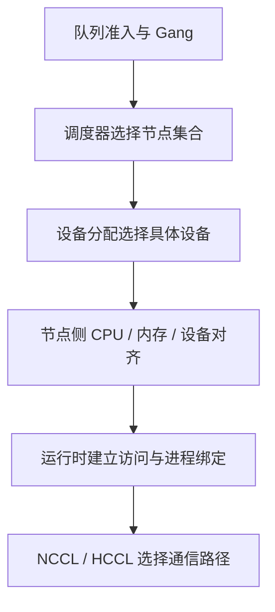

# GPU 集群拓扑感知调度

一个任务申请四张 GPU，节点也恰好剩四张，仍可能运行得很慢：剩余设备分散在不同互联岛，GPU 离通信 NIC 很远，或进程绑定与实际链路不匹配。**数量满足只说明能计数，拓扑可行才说明这些设备能组成目标工作负载。**

本篇从一张教学拓扑矩阵出发，解释设备集合、CPU/NIC 亲和、Kubernetes 分工与运行时证据。前置阅读：[服务器拓扑与 NUMA](../../pcie-numa/04-GPU服务器硬件拓扑与NUMA.md)、[NVLink 与 NVSwitch](../../nvlink-nvswitch/01-NVLink与NVSwitch原理.md)、[NCCL 通信](../../../ai-systems/training/distributed/05-NCCL%20通信原理与常见问题.md)。

## 1. 一项放置要同时满足哪些约束

| 约束 | 问题 |
| --- | --- |
| 执行兼容 | GPU 型号、精度、驱动与框架路径是否支持 |
| 单设备容量 | 每 Rank 权重、KV/激活与工作区能否放下 |
| 设备集合 | 这几张设备之间有什么互联与 P2P 能力 |
| CPU/内存 | Host 准备线程、内存访问是否匹配 NUMA |
| GPU/NIC | 跨机通信能否使用合适 NIC 与直接传输路径 |
| 数据位置 | 本地缓存、PV、共享存储是否可达 |
| 故障与隔离 | 是否共享机架、Fabric、设备与租户边界 |

拓扑不是单一距离值。较近的 PCIe 路径不等于任意环境都支持 P2P；同 NUMA 不等于同交换芯片；同 NVLink 域也不等于设备访问已授权。

## 2. 读懂一份 `nvidia-smi topo -m`

```bash
nvidia-smi topo -m
```

下面是**便于推理的教学输出**，不是某台 DGX 的实测。假设四 GPU 分成两个 NVLink 对，两个 NIC 分别靠近一个 CPU/NUMA 域：

```text
        GPU0 GPU1 GPU2 GPU3 NIC0 NIC1 CPU Affinity NUMA Affinity GPU NUMA ID
GPU0     X   NV4  SYS  SYS  PIX  SYS  0-15         0             N/A
GPU1    NV4   X   SYS  SYS  PIX  SYS  0-15         0             N/A
GPU2    SYS  SYS   X   NV4  SYS  PIX  16-31        1             N/A
GPU3    SYS  SYS  NV4   X   SYS  PIX  16-31        1             N/A
NIC0    PIX  PIX  SYS  SYS   X   SYS
NIC1    SYS  SYS  PIX  PIX  SYS   X

NIC Legend:
  NIC0: mlx5_0
  NIC1: mlx5_1
```

| 标记 | 中文含义 | 不能额外推出 |
| --- | --- | --- |
| `X` | 自身 | 不是链路带宽 |
| `NV#` | 通过由相应数量 NVLink 组成的连接路径 | 数字不是 NVSwitch 数、代际或网络跳数 |
| `PIX` | 路径至多经过一个 PCIe Bridge，常见于单 Switch 路径 | 不保证实际 P2P 已启用 |
| `PXB` | 路径经过多个 PCIe Bridge，不经过 PCIe Host Bridge | 不等于跨 CPU Socket |
| `PHB` | 路径经过 PCIe Host Bridge | 不代表 CPU Core 逐字节拷贝 |
| `NODE` | 同一 NUMA 节点内经过 PCIe Host Bridge 之间的路径 | 不是跨 NUMA 的同义词 |
| `SYS` | 跨 PCIe 及 Socket 间互联的路径 | 不保证应用实际采用这条传输 |

`CPU Affinity` 是相关 CPU 的亲和范围，不是已经为进程绑定的核；`NUMA Affinity` 描述设备关联的 NUMA；`GPU NUMA ID` 在支持相应内存 NUMA 表示的系统上才有具体意义，`N/A` 不等于设备没有 CPU 亲和关系。[标记与查询定义见 nvidia-smi 文档](https://docs.nvidia.com/deploy/nvidia-smi/index.html)。

`NIC0` 是本次拓扑输出中的网卡别名，需要通过 NIC Legend 对应 RDMA 设备，再关联端口、PCI BDF 和物理布线。它不一定是 Linux `eth0`，也不保证相邻 GPU 序号就是相邻物理槽位。

## 3. 用矩阵判断设备集合，而不是只数空闲卡

在上面的教学系统中，假设 TP=2 的模型必须优先使用 NVLink 对。若 GPU0、GPU1 空闲，候选集合符合互联目标；若只剩 GPU0、GPU2，则虽然数量也是二，路径条件已经变化。

再看碎片：假设另一个节点的 GPU2、GPU3 空闲，集群总共四张空闲，但没有一个节点拥有四张空闲。传统单 Pod 申请四张 GPU 无法跨节点拼装。换成多 Pod 作业后可以重新设计并行，但通信路径与软件条件都随之改变，不能把它当成原方案的等价替换。

这类示例说明：**空闲总数、单节点可用数、同高速域可用集合、业务可交付容量是四种指标。** 装箱应尽量保留后续任务需要的连续资源集合，而不是只提高当前已分配比例。

## 4. 拓扑、P2P 能力和性能需要分开验证

```bash
nvidia-smi topo -p2p r
nvidia-smi topo -p2p w
nvidia-smi topo -p2p n
nvidia-smi topo -p2p p
```

`r/w` 分别查询读写能力，`n/p` 查询 NVLink/PCIe P2P 能力。两设备显示有 NVLink 路径，与特定操作的 P2P 能力、当前框架是否使用它，是不同判断。

某个读写矩阵的教学片段：

```text
       GPU0 GPU1
GPU0    X   OK
GPU1   OK    X
```

`OK` 表示查询到相应能力，不等于已经测出有效带宽。完整状态缩写按本机驱动输出 Legend 解读；功能验证、消息大小相关带宽和集合通信仍需独立测试。更详细输出见 [NVLink 主文](../../nvlink-nvswitch/01-NVLink与NVSwitch原理.md)。

`nvbandwidth`、CUDA P2P 样例和 NCCL 基准分别回答不同问题：端点搬运、程序功能与通信算法表现。它们会产生设备负载，应在授权测试资源上执行，不把生产节点的只读巡检变成无提示的压力测试。

## 5. NUMA、CPU 和 NIC 怎样影响实际路径

### 5.1 同 NUMA 不等于 CPU 不参与

CPU 仍要完成任务提交、驱动调用和部分协议控制。直接 DMA/P2P 减少的是数据对 Host 内存或 CPU Core 拷贝的依赖，不是让 CPU 从系统中消失。

不同 NUMA 也不意味着每个字节都由 CPU Core 搬运。数据可能经过 PCIe Root Complex、Socket 互联或其他路径；应用也可能退回 Host staging。实际采用哪条路径要看平台能力、IOMMU/ACS、驱动、通信库与日志。

### 5.2 GPU-NIC 亲和必须关联真实网卡

跨机训练要确认 GPU 到 NIC 的路径、RDMA 设备、网络端口和交换网络一致。离得近的 NIC 如果没有加入正确网络，仍然无法用于目标通信。

GPUDirect RDMA 还依赖支持的驱动、DMA-BUF 或相应 peer-memory 路径、权限和内存注册。不能把“某模块没有加载”直接当成所有版本直通失败的充分证据，也不能仅凭 NIC 和 GPU 同 NUMA 就断言已在使用 GDR。

### 5.3 ACS/IOMMU 要先观察，不盲目关闭

ACS 的重定向可能改变某些平台的点对点路径，IOMMU 与虚拟化也会影响地址与访问条件。但生产环境不能直接照抄 `setpci` 或关闭 VT-d：这可能影响隔离、设备直通和现有业务。

先读取完整 PCIe 树与相关设备状态：

```bash
lspci -t
lspci -vv -s 0000:41:00.0
numactl --hardware
```

这里的 BDF 是格式示例，需要替换为现场设备或相关上游桥。单个 `SrcValid+`、一次慢测试或“关闭 P2P 后不挂”都只能帮助缩小路径，不能独立证明根因。[NCCL 的 GPU、ACS、虚拟机与容器排障说明](https://docs.nvidia.com/deeplearning/nccl/user-guide/docs/troubleshooting/gpu_troubleshooting.html)。

## 6. Kubernetes 中由谁负责哪一层



这是职责示意，不是所有实现的严格时间顺序。部分设备分配与节点选择会协同完成。

### 6.1 调度器选节点不等于选了最佳 GPU 对

NodeSelector、NodeAffinity 和污点可以区分节点池，但通常不能单独表达“该节点上的 GPU0 和 GPU1 必须成对分配”。传统 Device Plugin、可选 PreferredAllocation、厂商调度扩展或 DRA 驱动承担的范围不同，必须确认实际实现。

自定义标签还需要来源、更新时间与失效处理。标签写着 `nvlink-domain=rack-a` 不证明 Fabric 当前健康；故障后如果标签不刷新，调度器仍可能按过期描述放置任务。

### 6.2 Topology Manager 是节点侧对齐

kubelet Topology Manager 合并 CPU、设备、内存等 Hint Provider 提供的信息，再按策略决定是否接受相应分配。CPU/内存的对齐还依赖相应 Manager 策略与支持条件。它不是负责全机架放置的集群调度器。[官方职责与策略](https://kubernetes.io/docs/tasks/administer-cluster/topology-manager/)。

`single-numa-node` 要求可接受的单 NUMA 对齐，严格策略可能导致节点侧 admission 失败；它不会神奇地把跨两个 NUMA 的八卡作业变成单 NUMA 作业。对于 NVSwitch 八卡或跨托盘任务，盲目要求全部资源同 NUMA 还可能排除本来合理的布局。

### 6.3 Gang 只保证一组任务共同满足准入条件

Gang 可以减少一部分 Rank 占着卡等待其他 Rank 的问题，但“凑齐所有 Pod”与“所有 Pod 属于合适的 Fabric 域”不是同一条件。还要有拓扑选择、网络配置、设备准备和通信就绪。

参考 [Gang Scheduling](./06-Gang%20Scheduling%20在分布式训练中的作用.md)和 [DRA](../dra/01-Kubernetes%20DRA%20概念与核心%20API（v1.35+）.md)。

## 7. 调度策略随并行方式改变

| 工作负载 | 首先考虑 | 需要避免的简化 |
| --- | --- | --- |
| 单实例 TP | 频繁集合通信、每 Rank 显存、高速域 | 任意空闲卡都等价 |
| DP/分布式训练 | 梯度通信、慢 Rank、GPU-NIC 与扩展效率 | 只要 Gang 成功就会快 |
| PP/EP | 流水线气泡、激活/专家通信与跨层分组 | 所有并行组都用同一距离规则 |
| 单卡推理多副本 | 尾延迟、内存、邻居干扰与副本故障域 | 一律聚集到同一高速岛 |
| KV/Prefill-Decode 分离 | 实际数据传输与端到端延迟 | 只优化 GPU-GPU 理论带宽 |

在 [GB200/GB300 NVL72](../../servers/nvidia-dgx/03-GB200-GB300-NVL72机架级架构.md) 等系统中，NVLink 域可跨操作系统节点。调度对象还要表达机架/域/托盘，而不只套用“跨节点一定走 RDMA”的旧模型。对昇腾则应读取相应设备与互联拓扑，不能用 `nvidia-smi` 的矩阵符号替代 HCCS/HCCL 事实。

## 8. 运行后怎样验证放置真的生效

先建立 `Pod UID → 节点 → 物理 UUID/实例 → 容器设备 → Rank → NIC` 映射，再核对实际进程的 CPU 亲和和内存位置。容器里的 `/sys` 必须正确反映所需拓扑；为观察而扩大权限应有明确范围，不能默认所有调试都启动特权 Pod。

然后在受控复现实例启用通信日志，记录选择的设备、传输和拓扑。日志变量写入现有测试启动环境，而不是单独执行一次就认为影响已运行服务：

```bash
export NCCL_DEBUG=INFO
export NCCL_DEBUG_SUBSYS=INIT,GRAPH,NET
```

日志通常会增加输出，应限定测试窗口并清理敏感地址。再比较单卡、同岛、跨岛与跨节点的通信时间，结合模型时间线判断影响。一次修改同时改变并行度、批量和通信开关，不能把收益全部归因于拓扑。

如果通信占比高，检查消息模式与路径；如果通信已快而 GPU 仍等待，继续查 CPU 输入、存储、同步与服务排队。网络与 NCCL 基线见 [RDMA 与 NCCL 测试方法](../../../networking/rdma-roce/ai-cluster/09-RDMA与NCCL基准测试方法.md)，设备生命周期见 [资源池设备模型](../pooling/01-资源池设备模型分配与回收原理.md)。

## 9. 练习与答案

**问题一：`NV4`、`NODE`、`SYS` 分别能说明什么？**

答案：`NV4` 表示相应四条 NVLink 组成的连接路径，不表示第四代；`NODE` 是同一 NUMA 内经过 PCIe Host Bridge 之间的路径；`SYS` 涉及 Socket 间互联。它们都不是有效带宽测试结果。

**问题二：四张空闲 GPU 为什么可能不能满足单 Pod 的四卡请求？**

答案：设备可能分散在不同节点，传统 Pod 扩展资源不能跨节点拼装；即使同节点，Profile、容量与互联集合也可能不满足任务要求。

**问题三：Topology Manager 是否会自动在整个集群挑选最佳 NVLink 域？**

答案：不会。它在 kubelet/节点侧合并可用 Hint 并按策略对齐资源。全局节点集合与高速域选择需要调度和设备分配实现共同支持。

**问题四：看到 P2P 为 OK，为什么还要查 NCCL 和业务时间线？**

答案：能力可用不代表应用选用了它，也不保证特定消息与算法的有效吞吐。还需确认 Rank、NIC、实际传输、竞争与同步等待。

## 10. 参考与致谢 {/* #参考与致谢 */}

- [nvidia-smi 拓扑与 P2P 查询](https://docs.nvidia.com/deploy/nvidia-smi/index.html)
- [NCCL GPU、ACS 与多节点 NVLink 排障](https://docs.nvidia.com/deeplearning/nccl/user-guide/docs/troubleshooting/gpu_troubleshooting.html)
- [Kubernetes Topology Manager](https://kubernetes.io/docs/tasks/administer-cluster/topology-manager/)
- [Kubernetes Device Plugins](https://kubernetes.io/docs/concepts/extend-kubernetes/compute-storage-net/device-plugins/)
- [NVIDIA nvbandwidth](https://github.com/NVIDIA/nvbandwidth)
