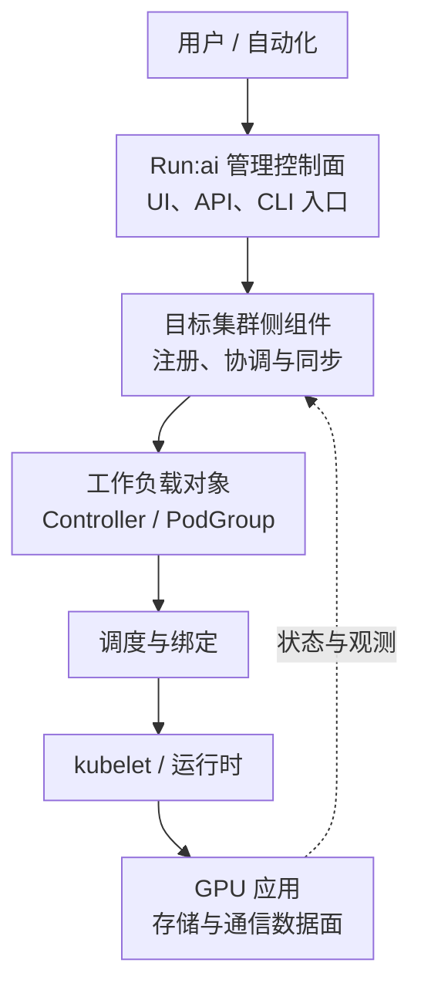

# Run:ai 控制面集群组件与部署边界

Run:ai 的管理控制面负责组织资源、提交入口和分析，集群组件负责与 Kubernetes 协同管理任务和调度。两者都可依赖 Kubernetes，但不是同一个组件，也不应与 Kubernetes API Server 混为一谈。

## 1. 两条路径

图中实线表示管理或执行关系，虚线表示状态反馈，不是网络端口或完整组件清单。管理连接中断与 GPU 进程停止不是同一个事件。

控制面可以集中管理多个集群。集群间 CPU、GPU、存储和网络仍是各自的资源集合；一个管理入口并不会让不同机房的显存变成可透明合并的单机设备。

## 2. 三种责任边界

SaaS 模式把管理控制面交给服务方，客户仍需维护自己的集群侧条件。自托管需要自行承担控制面和集群组件的升级、证书、存储与备份。DGX Cloud Run:ai 又有服务约定下的共享责任，不能把其“客户不能安装集群级组件”泛化到所有自托管集群。

对部署方案应逐项确认谁维护 Kubernetes、镜像仓库、身份提供方、TLS、持久化服务及监控。少写一条 Helm 命令不会产生这些前提；Chart 安装成功也不证明它们已可靠运行。

## 3. 安装前的闭环

先让宿主 GPU、运行时和 Kubernetes GPU 资源正常，再确认目标产品支持矩阵、管理入口、DNS/TLS、身份、镜像访问及所需存储。联网、代理与隔离环境的制品准备方式不同，离线部署必须同时保存镜像、Chart 和配置版本。

新版本的 Run:ai 制品分发来源会变化，不能复制旧文档中某个仓库地址并长期使用。安装应从固定版本官方流程生成配置，妥善保存凭据引用，不在文章、Shell 历史或 Git 中写明文密钥。

## 4. 组件健康不等于任务健康

管理组件 Running 只证明进程存在；还需验证注册、同步、身份和资源信息新鲜度。任务 Pod Running 则可能尚在下载模型、等待 Rank 或初始化 CUDA。每一层都应有自己的成功证据。

当控制面不可达时，先读本地 Kubernetes 对象、调度器事件和应用状态，再判断是否需要恢复连接。不能假设所有已运行任务立即终止，也不能保证提交、策略更新、观测等控制功能仍完整可用。

进一步阅读[控制面高可用、状态持久化与断连恢复](./08-控制面高可用状态持久化与断连恢复.md)。增加 API 副本不消除数据库或共享存储单点；恢复旧控制面状态后，还要与仍在运行的集群对象重新核对。

## 5. 掌握检查

控制面显示集群断连，但本地训练仍有进展，矛盾吗？不矛盾，管理同步与数据执行是不同路径。若同一时刻 GPU 分配数量出现差异，应先比较采样时间和对象口径，不急于删除并重新注册整个集群。

## 6. 参考资料

- [Run:ai 系统组件](https://run-ai-docs.nvidia.com/self-hosted/getting-started/overview)
- [安装方式](https://run-ai-docs.nvidia.com/self-hosted/getting-started/installation)
- [集群安装与注册](https://run-ai-docs.nvidia.com/self-hosted/getting-started/installation/install-using-helm/helm-install)
