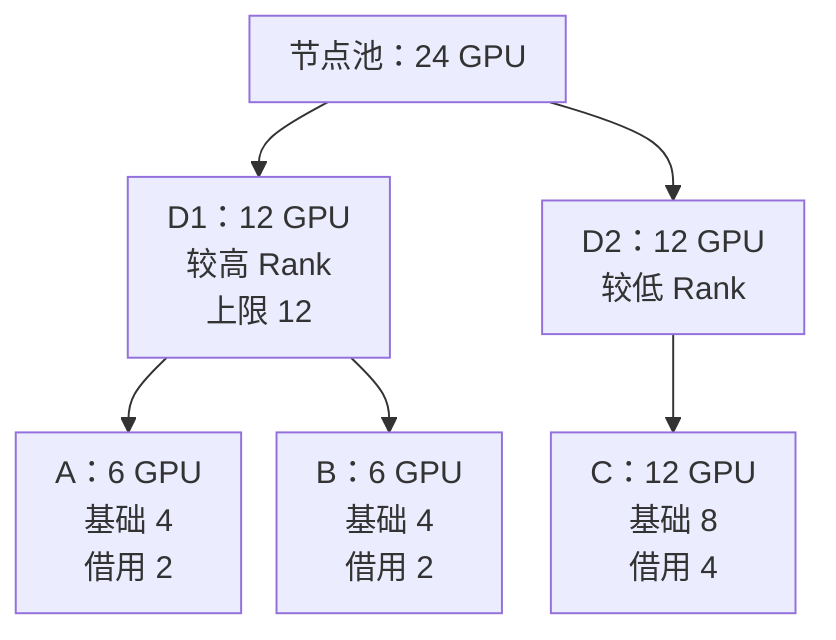

# Quota Fairshare 借用回收与抢占

配额并不总是不可超越的硬上限。Run:ai 的调度模型允许在策略和可抢占条件下使用其他队列暂未需要的资源；当资源应归还时，再通过回收恢复资格。理解可回收性，才能解释为什么昨天运行的任务今天会重新排队。

## 1. 先分清资格、上限与实配

Deserved Quota 是组织应享有的资源资格；Over Quota 是允许借用的部分；Fairshare 是供需和公平规则下本轮计算的份额。已绑定的资源是实际分配，GPU SM 利用率则是运行活动，不能混为一个数。

本篇依据 2026 年 10 月核对的 NVIDIA self-hosted 调度说明。数字例子是明确假设下的教学账本，不是闭源调度器输出；字段、启用条件与支持范围应绑定实际版本。

| 概念 | 回答什么 | 不保证什么 |
| --- | --- | --- |
| Quota | 在对应池和层级应获得多少资源 | 不保证故障、超售和拓扑限制下都可立即放置 |
| Fairshare | 当前应分到多少，包括可借用部分 | 不是永久承诺，也不是不可突破的硬上限 |
| Max GPU Device Allocation / Limit | Quota 加 Over Quota 的总上界 | 上限变大不会凭空创造资源 |
| Preemptible | 该工作负载是否允许被回收 | 不代表已有 Checkpoint 或零成本迁移 |
| Workload priority | 同项目队列中先服务谁 | 不形成跨项目的统一整数排序 |

不可抢占工作负载只能在项目和部门两层的对应配额条件内调度。可抢占也不等于一定能借用，还要满足 Over Quota 开关、Rank、上限、需求及放置条件。

## 2. 同 Rank 的比例只是最简单一层

假设单池 16 GPU，A/B 属于同一不额外限制容量的部门，同 Rank、Quota 均为 4，额外需求充分，权重为 1:3；采用即时 Fairshare，GPU 可分配粒度不构成限制，CPU/内存和拓扑均满足。

```text
基础份额合计 = 4 + 4 = 8
可借用余量 = 16 - 8 = 8
A = 4 + 8 × 1/4 = 6
B = 4 + 8 × 3/4 = 10
```

这不是“所有队列都按权重瓜分总卡数”：先满足有需求的配额，再讨论剩余资源。若 B 的总需求只有 4，A 可以使用无人需要的余量，不必强行维持 6/10；需求和上限截断后还需要重新考虑未使用部分。

## 3. 部门、项目与 Rank 必须逐层计算

队列按 Department/Node Pool、Project/Node Pool 建立，不是一张全局项目表。部门的总预算约束子项目，项目 Rank 在同部门同池的兄弟项目间比较，部门 Rank 在同池部门间比较。不要把低 Rank 部门里的高 Rank 项目直接放到所有项目最前面。

教学条件：池容量 24 GPU，各请求均可拆分放置；所有借用都允许抢占，忽略保护时间及其他资源约束，使用即时 Fairshare。

| 对象 | Quota | Rank | 总上限 | 总需求 |
| --- | --- | --- | --- | --- |
| 部门 D1 | 8 | 较高 | 12 | 16 |
| 部门 D2 | 8 | 较低 | 24 | 12 |
| D1 的项目 A | 4 | 较高 | 6 | 8 |
| D1 的项目 B | 4 | 较低 | 12 | 8 |
| D2 的项目 C | 8 | 唯一项目 | 24 | 12 |

先分部门：D1/D2 的配额需求各满足 8，余量 8。较高 Rank 的 D1 可再取得 4，但达到总上限 12；其余 4 归 D2，形成 D1=12、D2=12。此时即使 D1 需求 16，也不能越过其上限。

再分 D1：A/B 的配额各 4，部门内剩余 4。较高 Rank 的 A 先取得 2 到其上限 6，其余 2 给 B，得到 A=6、B=6；C=12。总量为 6+6+12=24。不同 Rank 的对象没有直接套用一份全局权重分母。



图对应本节假设：先分部门，再分部门内部项目；每条父子关系都要守住父层预算。图中份额不是拓扑放置结果，也不是各任务的 SM 利用率。

反例：把 D1 上限降到 10，其他假设不变，部门层余量只能给 D1 2，D2 得到余下 6 中自己实际需要的 4，另有 2 无匹配需求。A 可到 6，B 只能到 4；B 的项目上限虽然是 12，仍不能穿透父部门限制。空闲资源不意味着组织限制失效。

另一个边界是配额超售：若子项目 Quota 合计超过父部门，不能据此让不可抢占任务突破父部门 Quota；若整个池的 Quota 超过物理容量，也不可能同时兑现。对象创建或参数校验成功，不等于存在对应物理资源。

## 4. Rank、回收和任务优先级不是同一轴

官方调度过程区分资源整理、跨队列回收和同队列优先级抢占。不能只看任务 priority 大小解释全部结果。

例如 A 有资格取回资源，B 借用资源上的任务虽比 A 的任务 priority 高，只要符合可抢占和保护条件，仍可能成为跨项目回收对象。反过来，A 内新任务 priority 更高，也不能突破 A 的父部门上限。

还有一种容易忽略的整组效应：某个可抢占 6 GPU 作业，4 GPU 落在配额范围、2 GPU 属于借用，不意味着平台只取走其中 2 GPU、保留另外 4 GPU 继续训练。若作业整体按超配额工作负载处理并被回收，释放量可能为 6，导致暂时低于配额。官方调度说明明确提醒了这种部分在配额内、部分在配额外的情形。

平台回收和应用恢复是两份协议。需要计算已完成但未持久化的工作、重载数据和重新 rendezvous 的成本，不能因为资源重新分配正确就认定业务无损。

## 5. 资格达到，整组形状仍可能失败

假设目标 PodGroup 必须在两台节点各放 4 GPU，资格是 8，池中空闲也是 8，但两台节点分别只空闲 2 和 6。总量相等仍无法组成 4+4。若 GPU 型号、亲和性或 CPU 内存再有限制，可行集合会进一步缩小。

公平份额是连续账本，真实工作负载通常是离散形状。不能承诺按公式得到 6 GPU 的队列就一定运行一个 8 GPU 作业；也不能认定它永远不可能运行，因为无人竞争或不可拆分的作业选择可能使实际分配暂时超过计算份额。此时应解释所采用的需求、竞争和整组条件，不编造通用取整公式。

当前文档中的 Gang 和多级子组规则见[PodGroup 生命周期](./04-训练推理工作负载与PodGroup生命周期.md)。重新放置也可能需要终止并重建进程，不是默认在线迁移 GPU 上下文。

## 6. 最小运行保护把资格变成时间问题

Node Pool 的 minimum guaranteed runtime 会在保护期内使可抢占工作负载暂时按不可抢占处理。它不是应用级 Checkpoint 成功标志，也不等于永远不可抢占。

教学时间线：B 的任务 10:00 启动，保护 10 分钟；10:02 A 取得更高资源资格。若所需资源必须从 B 回收，且没有其他可行放置，A 仍可能至少等待到 10:10，之后还需停止、释放与启动时间。不能许诺“最高优先级 1 分钟内启动”。

保护时长需要与业务 SLA、重算损失和备用容量一起设计。减少保护可以改善排队响应，却可能频繁中断尚未产出有效结果的训练；增大保护则可能使交互工作负载失去实时性。

## 7. 即时与时间型 Fairshare

即时模式关注本轮供需；时间型模式还把历史资源消费引入超配额公平性。不能再笼统地说 Run:ai Fairshare 完全不看历史，也不能把它等同于 Slurm Fair Tree 的具体公式。

教学比较：两个同 Rank、同权重队列当前需求相同，历史账本中 A 用了 8 GPU×3 小时=24 GPU·h，B 用了 8 GPU×1 小时=8 GPU·h。单看当前需求无法解释历史是否失衡；启用时间型模式后，过往消费可以影响接下来可借用部分。但不能从 24:8 直接推出下一轮份额 1:3，实际还取决于窗口、衰减、历史权重、配额和其他竞争者。

节点池文档给出 Historical usage weight 和 Historical usage window 等配置：历史权重为 0 时忽略历史影响；更大值增强历史影响。这里不复制某个 UI 默认值作为所有安装的保证。GPU·h 账本也不等于 GPU SM 忙碌率积分，更不等于模型有效 Token 产出。

持久化还要找对实例：self-hosted v3.0 的高级集群配置明确区分通用指标 Prometheus 与历史用量专用 Prometheus，后者默认没有持久存储。不能仅因面板仍有历史曲线，就保证调度账本可恢复。具体配置入口及恢复推演见[历史账本与控制面恢复](./08-控制面高可用状态持久化与断连恢复.md)。

## 8. 一份可复核的调度解释

解释 Pending 或被抢占，至少保存池和时间、部门/项目层级、各层 Quota/Limit/Rank/权重、当前需求和分配、Fairshare 模式、任务可抢占性、保护剩余时间、整组形状及真实事件。缺少其中一层，可能把正常策略误判成故障。

按“资格 → 层级上限 → 回收条件 → 完整放置 → 容器启动 → 应用恢复”逐层排除。GPU 利用率低只提供运行现象，既不能证明没有资源分配，也不能自动授权抢走任务。

## 9. 掌握检查

**高 Rank 项目是否总比其他项目先运行？** 先确定父部门和节点池，Rank 不是全局编号；已有资格还要满足保护与放置。

**部门上限为 10，子项目上限合计为 18，能否用 18？** 不能以子项相加穿透父限制。

**同权重为什么不同份额？** 检查 Rank、需求截断、父层限制、历史模式和不可拆分形状，不能只看一个权重字段。

**保护 10 分钟，是否保证 10 分钟后对方立即拿到卡？** 不保证，还要满足回收条件、释放、放置和初始化。

## 10. 参考资料

- [队列层级、配额、Rank 与调度原则](https://run-ai-docs.nvidia.com/self-hosted/platform-management/runai-scheduler/scheduling/concepts-and-principles)
- [分配顺序、回收及 Fairshare 模式](https://run-ai-docs.nvidia.com/self-hosted/platform-management/runai-scheduler/scheduling/how-the-scheduler-works)
- [节点池保护时间与历史用量配置](https://run-ai-docs.nvidia.com/self-hosted/platform-management/aiinitiatives/resources/node-pools)
