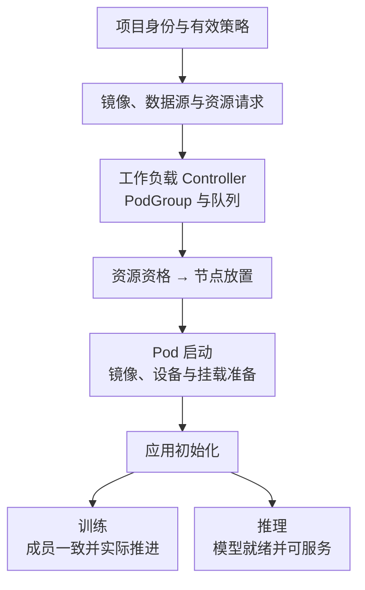

# 训练推理工作负载与 PodGroup 生命周期

训练、交互工作区和推理都可以消耗 GPU，但它们对完成、可抢占性和服务就绪的定义不同。不能用一个 Pod Running 状态统一证明它们健康。

## 1. 一次提交的阶段

这是分层检查图，不规定每个控制器的内部实现顺序。Pod 启动位于两条业务成功路径之前，因此 Running 不能代替训练进度或推理就绪证据。

应用初始化可能包括模型下载、权重读取、CUDA 初始化、通信建立和编译。某个阶段成功，只证明它自己的条件；错误应对应到当前阶段，而不是把所有等待都归类为“GPU 不够”。

提交前还要区分[主体授权](./09-AccessRules角色作用域与权限治理.md)与[有效工作负载策略](./10-工作负载策略继承模板与资产治理.md)。模板只是配置来源，原生与注册类型的策略解析机制也不同；请求在这一层被拒绝，不能直接按调度 Pending 排查，更不能凭控制面规则存在就断言所有外部提交入口受控。

## 2. PodGroup 的作用边界

PodGroup 让调度器按一个工作负载处理多个 Pod，并可施加整组条件。不同版本还可能有子组和多级组结构，必须以目标工作负载集成支持为准。

2026 年 10 月核对的 self-hosted 调度文档进一步描述了多级子组：例如分离式推理包含 Router、Prefill、Decode，不同功能可有多个副本，每个副本还可能是多 Pod 的 Leader/Worker 集合。这不是要求所有组件永远共享一个不可拆分 Gang，而是按工作负载集成表达各层的最小可运行集合。

教学推演：一个 Decode 副本需要两个 Worker Pod 才完整，另一个完整副本已经服务。新增副本只有一个 Pod 有资源时，不能把“已分配一半”算作增加一个可服务副本；但也不能仅凭新增组未就绪，就推断所有既有组必须停止。应分别核对顶层 PodGroup、子组的 Gang/最小副本约束及应用依赖，不能从通用名称猜测 CRD 字段。

调度器在选择节点前需要检查 Project/Pool 和 Department/Pool 两层队列资格，随后才尝试整组绑定。对于采用 Gang 的对应组，无法满足时按组等待并在后续周期重试，不靠手工给部分 Pod 换调度器绕过。组合配额、保护时间与形状的完整算例见[公平调度](./03-Quota-Fairshare借用回收与抢占.md)。

资源一起满足不等于进程同时 Ready：镜像缓存、节点 I/O 和设备初始化速度仍不同。训练还需要正确 Rank 与 rendezvous；推理的分离组件还需要路由、连接和请求路径完整。整组调度解决资源准入与放置问题，不替代应用协议。

## 3. 训练的恢复语义

教学条件：8 Worker 训练中的一个 Pod 因硬件故障退出。框架可能要求整组重启，也可能支持弹性恢复，取决于实际训练方式。平台重新创建 Pod 不自动恢复优化器、随机数、数据位置或所有分片。

Checkpoint 应绑定模型、优化器、调度器、训练 Step、数据迭代状态及框架元数据。恢复时若 World Size 改变，需要明确支持状态重分片，不能只修改 Worker 数量并继续读取旧文件。

## 4. 推理的就绪与缩容

推理 Pod 已启动但模型尚未加载时，不应进入正常流量。就绪门槛应反映可处理目标请求的状态；健康检查应避免因为短暂排队就触发重启，使模型不断冷启动。

缩容或抢占时，应先摘除流量、处理在途请求和连接，再释放 GPU。增加副本并不保证立刻增加有效容量，因为还需要加载时间、存储吞吐和网关路由。扩容速度与稳态吞吐属于两个指标。

## 5. 制品与权限

调度成功后拉镜像失败，先查节点拉取身份、仓库权限和平台架构；数据挂载失败则查 StorageClass、访问模式、UID/GID 和路径。不要为了完成一份示例，把全部宿主目录和特权权限暴露给应用。

参考[NGC 身份与镜像](../../../../cloud-native/containers/images/02-NGC镜像身份权限与制品生命周期.md)，但模型与数据的访问控制仍需要独立验证。

## 6. 掌握检查

所有 Pod 都 Running，为什么训练仍卡住？继续查 Rank、成员集合、数据读取和通信。推理 GPU 利用率很低却延迟很高，为什么不能立即缩容？先判断冷启动、排队、CPU/存储和请求分布，低利用率不是容量冗余的充分证据。

## 7. 参考资料

- [工作负载与 PodGroup](https://run-ai-docs.nvidia.com/self-hosted/platform-management/runai-scheduler/scheduling/concepts-and-principles)
- [工作负载管理](https://run-ai-docs.nvidia.com/self-hosted/getting-started/overview)
- [PyTorch Distributed Checkpoint](https://docs.pytorch.org/docs/stable/distributed.checkpoint.html)
