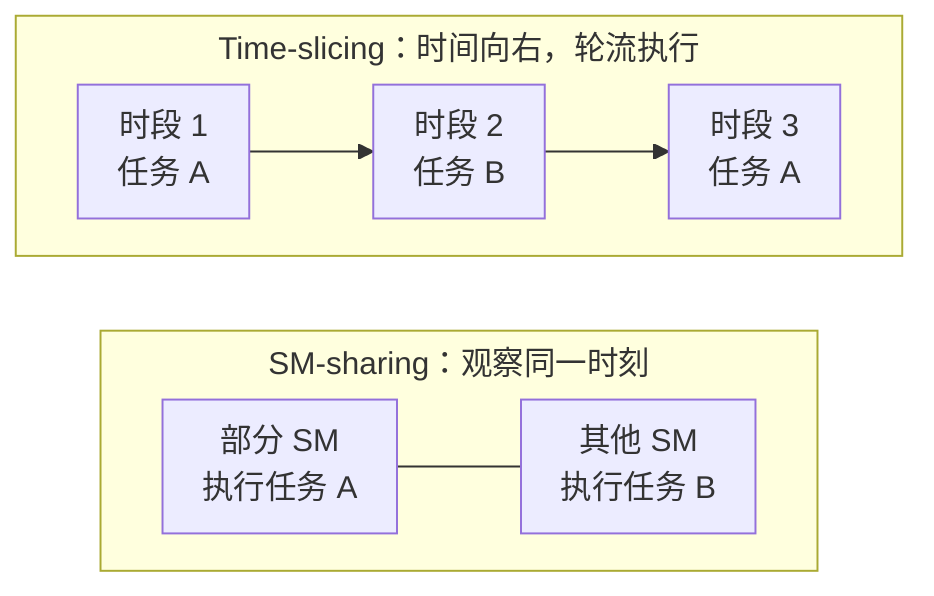

# GPU 分数资源、显存限制与隔离边界

申请 `0.5 GPU` 究竟意味着什么，必须由具体资源机制定义。它可能表示显存份额、时间份额或某种记账单位，不能凭小数形式就推导出“一半算力、一半延迟、一半故障影响”。本篇专门说明 Run:ai GPU fractions，不把它与其他共享实现混用。

## 1. 先区分显存空间与计算时间

本篇以 2026 年 10 月核对的 self-hosted **v3.0** 文档为当前机制基线。该版使用标准 NVIDIA CUDA 实现分数显存，替代旧版专有共享引擎；计算模式区分默认 time-slicing 与显式 SM-sharing，不能将旧版独立 time-slicing 页面与新版字段拼接。版本迁移见[GPU Fractions 迁移说明](https://docs.nvidia.com/run-ai/self-hosted/documentation/installation-and-configuration/upgrade/migrate-gpu-fractions)。

把它们拆成两个问题更容易理解：显存限制解决“能占多少空间”，计算模式解决“如何共享执行资源”。同样 0.5 在不同容量 GPU 上不是相同字节数。某任务占用显存少，却可能长期提交计算；另一个任务占用显存多，却主要等待输入。显存份额不能直接预测谁更快。

产品版本、工作负载类型、库注入和集群配置都会影响实际支持范围。下面的容量例子是解释模型，不是对任意 CUDA 程序安全隔离的承诺，也不反向推测闭源显存控制实现。

## 2. 调度器和节点各承担什么

调度器寻找满足份额或显存请求的 GPU，CUDA 执行相应显存限制。产品还会通过 reservation Pod 向其他调度器表达整卡已被纳入分数分配，避免把同一整卡重复交付。没有显存 Limit 的请求，其 Limit 等于 Request；动态增长则属于另外的动态 fractions 机制。资源是否可用，不能仅通过租户 Pod 中有没有一个整数字段判断，参见 [v3.0 GPU Memory Fractions](https://docs.nvidia.com/run-ai/self-hosted/documentation/platform-management/runai-scheduler/resource-optimization/gpu-fractions/memory-fractions)。

这形成三个需要对齐的账本：组织配额、物理卡上的份额放置、应用实际内存。配额足够但卡上没有合适空间，仍会 Pending；应用显存超限，也不表示项目配额一定超限。

排查时应同时记录工作负载请求、目标物理卡身份、节点分配信息和进程内分配结果。只统计 Pod 数，无法区分八个任务共享一张卡与八个任务各占一张卡。

## 3. 手算容量：空闲总量不等于可放置量

假设两张 GPU 各有 80 GiB 教学容量，平台已给每张预留 8 GiB，供任务使用的预算为 72 GiB。A、B、C 各请求 24 GiB 且都放到第一张卡，第一张剩余 0，第二张剩余 72，此时一个 48 GiB 请求能放到第二张。

如果改成每张都已有 24 GiB 和 16 GiB 的任务，两张卡分别只剩 32 GiB，总空闲仍有 64 GiB，但单卡 48 GiB 请求无法容纳。不能通过把两个不连续 GPU 的显存数字相加来满足一份单设备请求。

这个例子忽略了实现开销与动态变化；真实可分配容量应来自平台公布值。对于多 GPU fractions，还要满足多个设备的同形份额与节点约束，不是找到若干零散字节就算满足。

## 4. 显存够用为什么延迟仍会恶化

设两个任务各申请 24 GiB，单独执行一次计算分别需要 40 ms、60 ms。把它们放到同一张卡，不能断言各自耗时变成 80 ms、120 ms，也不能断言整体刚好 100 ms。内核并发、调度、带宽、缓存和输入到达时间都可能改变结果。

隔离评估至少有四个维度：内存占用是否受控；计算份额如何竞争；尾延迟是否受其他租户影响；故障是否传播。文档声明提供某种内存限制，不自动等于硬件分区级的全部隔离。

高利用率也不一定代表共享收益。若吞吐增加 10%，P99 却超过业务 SLO，共享可能只适合离线任务而不适合该在线服务。评价单位应是满足约束的有效工作量，而不是卡上塞进了多少进程。

## 5. Fractions、时间切片与 MIG 的差别

| 问题 | Fractions | 时间共享 | MIG |
| --- | --- | --- | --- |
| 主要划分对象 | 显存预算 | 执行时间机会或份额 | 硬件实例及其资源形状 |
| 显存份额能否推出等比例算力 | 不能 | 仍取决于具体机制与负载 | 也不能把规格比例当成应用性能比例 |
| 需要关注的碎片 | 单卡剩余容量和多卡形状 | 时间竞争与调度开销 | 可创建实例的硬件几何 |

MIG 的原理回到[主文章](../../sharing/09-MIG%20原理与%20Kubernetes%20配置.md)。它与 CUDA 显存限制、计算共享不是同一层机制；是否允许在某节点或实例上组合，应查目标版本支持矩阵，不能将旧版 fractions 的限制无条件当成新版兼容结论，也不能自行拼接两套模式并假定兼容。

### 5.1 v3.0 的两种计算模式

| 维度 | Time-slicing | SM-sharing |
| --- | --- | --- |
| 执行方式 | 工作负载轮流使用 GPU 计算引擎，默认模式 | 工作负载在不同 SM 上并行执行，需显式选择 |
| 空闲资源 | 其他任务可利用未用时间 | 其他任务可利用空闲 SM，并非静态预切固定 SM |
| 文档描述的错误域 | 工作负载各自的错误域 | 共享 context，致命 context 错误可影响同卡共享任务 |
| 计算归因 | 仍需核对实际采集口径 | 不提供逐容器计算归因；显存仍可按容器报告 |

模式虽然按工作负载声明，但对每张 GPU 互斥：第一个任务确定模式，后续任务必须同模式，设备空下来后才重置。参见 [GPU Compute Modes](https://docs.nvidia.com/run-ai/self-hosted/documentation/platform-management/runai-scheduler/resource-optimization/gpu-fractions/compute-modes)。这不表示 time-slicing 可以隔离所有物理硬件故障，也不表示 SM-sharing 必然满足任意在线服务 SLO。

两幅是同一 GPU 的两种备选模式，不是同时叠加的两层切分。时段长度与 SM 数量均为示意，不表示等额算力承诺；SM-sharing 的空闲 SM 可被其他任务利用，不是固定预留分区。

教学反例：两张卡各有 32 GiB 空闲，但都运行 time-slicing 任务。一个请求 16 GiB 的 SM-sharing 任务并不能仅凭显存充足就加入。空闲量还要按模式分组，不能把它归咎为配额错误。部门统一默认模式有助于减少这种碎片，但默认值是否可改、强制规则是否覆盖当前入口，仍需[策略治理](./10-工作负载策略继承模板与资产治理.md)证明。

## 6. 多租户观测不能重复计数

如果一个物理 GPU 的设备级利用率为 80%，采集系统把它附上 A、B 两个 Pod 标签后，不能计算成 A 使用 80% 加 B 使用 80%。这可能只是同一个设备级事实被重复关联。

应区分设备级总指标、进程级可归因指标和业务级吞吐。显存归属较容易观察，也不能代替计算归属；短时采样还可能遗漏瞬时分配峰值。完整口径见[GPU 容量与多租户归因](../../../../sre/observability/gpu/06-GPU容量利用率与多租户归因.md)。

在 v3.0 SM-sharing 下，不能用设备总利用率乘显存申请比例，补造产品未提供的逐容器计算指标。若 A、B 各申请四分之一显存，两者计算活跃程度仍可能完全不同；成本分摊可以另定业务规则，但必须标明它是分摊模型，不是测量事实。

## 7. 掌握检查

解释为什么 0.5 GPU 不保证半张卡的吞吐；算出两卡各剩 32 GiB 时为什么不能接单卡 48 GiB 请求；说明 reservation、组织配额与应用显存是三种不同证据。最后为一个在线服务列出共享验收指标，必须同时包含吞吐、尾延迟、干扰和失败范围。

补充解释：为什么有空闲显存仍可能等待另一种计算模式？为什么共享 context 的致命错误与显存配额没有因果等价关系？为什么逐容器显存可见不代表逐容器算力也可测？

## 8. 节点条件与旧版迁移不能只看平台版本

v3.0 分数显存要求 CUDA 13.4+、驱动 r615+、GPU Operator 26.7.1+，以及挂载于 `/sys/fs/cgroup` 的 Linux cgroup v2；GPU Operator 的 NRI 插件需关闭。Operator 版本不能代替逐节点驱动检查。这些是该分数能力的前提，不是所有非分数工作负载的统一安装前提。参见 [Memory Fractions 前提](https://docs.nvidia.com/run-ai/self-hosted/documentation/platform-management/runai-scheduler/resource-optimization/gpu-fractions/memory-fractions)。

迁移还需检查提交方式。原生工作负载由平台转换请求，而注册类型 YAML 中的旧 `RUNAI_GPU_MEMORY_LIMIT` 在 v3.0 不再生效，需迁为匹配请求单位和目标容器的 limit annotation。漏迁可能正常启动却丢失动态增长上限，因此 Running 不能证明限额正确。升级说明还区分原生工作负载的重新提交与旧对象直接恢复；不要将其当作透明热切换。参见[迁移与验证](https://docs.nvidia.com/run-ai/self-hosted/documentation/installation-and-configuration/upgrade/migrate-gpu-fractions)。

对 compute mode，应以目标版本的 Compute Modes 与提交参考核对字段、容器名和最终 Pod；单独设置模式而没有同容器分数显存请求，不能据此证明已启用。原生和注册类型可以通过对应策略治理，外部直接提交的工作负载不具备相同的策略覆盖保证。参数被保存在 YAML 中、调度器已识别、节点组件已施加限制和应用已验证，是四种不同证据。
